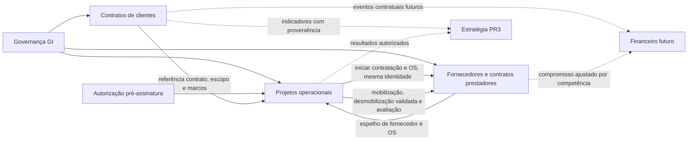

# Auditoria 03A — Gestão de Contratos

**Data:** 06/11/2026. **Natureza:** auditoria estática e plano de reaproveitamento; nenhuma implementação.
**Fonte acessível:** repositório privado `jandersontameirao-svg/ARQUEO-CONTRATOS`, branch `main`, commit [`c799a92100998c92a2b480c8ab8ddeb1d33ec77c`](https://github.com/jandersontameirao-svg/ARQUEO-CONTRATOS/commit/c799a92100998c92a2b480c8ab8ddeb1d33ec77c).
**Parecer:** reaproveitamento funcional substancial recomendado, condicionado à adaptação de autorização, integridade, migrações e semântica financeira. Não homologar o legado nem autorizar desenvolvimento automaticamente.

## 1. Base, acesso e limites da evidência

A branch documental `audit/03a-contratos` parte exclusivamente da fundação PR #1, `dev/comando-01-fundacao`, SHA `b60ab6adf058b4cc5cce2dcadce2bb7efc6c6da3`. PR #3 de Estratégia (SHA `467a9f7d56fddf286600983912bab3e333c0a770`) é referência arquitetural, não alteração desta auditoria nem dependência integrada por merge. A main do destino permanece sem mudanças; PRs ainda dependem de aprovação do CEO.

Verificados metadados, ref e árvore recursiva não truncada: **673 arquivos (blobs)**; 356 sob client/src/server/shared/drizzle, 74 arquivos test/spec (70 em server, quatro em client), 222 artefatos em .manus/db e quatro backups em .legacy-backup. Foram lidos integralmente **67 arquivos textuais selecionados**: todos os seis schemas, cinco migrações SQL, router principal, módulos de router, camada REST de integração, contexto/auth, funções de banco e serviços críticos, App/guards/PDF, configuração e amostras de testes. A árvore foi inventariada por completo; **isso não equivale a revisão linha a linha dos 673 arquivos**, nem prova de execução de todas as telas.

Não foram lidos os resultados de consultas .manus/db, dumps, PDFs contratuais reais, imagens de documentos, chaves/certificados ou dados privados; caminhos sensíveis foram apenas identificados na árvore. Nenhum código legado, script npm/pnpm, migração, job, e-mail, IA ou endpoint de produção foi executado. Não houve acesso ao banco real. Schema declarado, migração versionada, interface presente e fluxo homologado são evidências distintas.

Não foi disponibilizado um Plano Mestre V03 verificável nesta frente; aderência integral a ele não está certificada. As regras expressas neste comando e decisões D01–D13 orientam o plano.

## 2. Arquitetura observada e aderência ao destino

| Camada | Evidência na origem | Reaproveitamento / adaptação |
|---|---|---|
| Frontend | React 19/TypeScript, Vite, Wouter, Radix, Recharts/Chart.js, TanStack Query/tRPC, Tailwind | Reusar telas/wizards/formulários/gráficos; adaptar contexto e navegação superior GI, sem cards demonstrativos substitutos |
| Backend | Express 4, tRPC 11, Zod, Drizzle/mysql2 | tRPC pode continuar sob identidade/guard da GI; eliminar autenticação paralela e autorização ad hoc |
| Banco | 49 nomes de tabela em seis schemas; cinco migrações SQL | Projetar migrações sequenciais GI, checksum/up/down; reconciliação estrutural obrigatória antes de qualquer importação |
| Identidade | OAuth/SDK Manus + login local scrypt, roles user/manager/admin, companyId único no usuário | Substituir por sessão GI, DIRETORES/GERENTES/OPERADORES + concessões/negações por pessoa/empresa/unidade/módulo/ação |
| Arquivos/PDF | R2/S3, fallback Forge/Manus, jsPDF/html2canvas/PDFKit/Puppeteer, ZIPs | Reusar templates; transporte independente, objetos privados e autorização em cada download/exportação |
| Integração | REST somente leitura /api/integration/v1 com bearer global | DTOs úteis; reescrever autenticação/escopo por consumidor e empresa, sem ativar conexão agora |
| IA/automações | análise contrato/aditivo/pré-assinatura, motor financeiro, riscos, ATENA chat, notificações/e-mails, cron | Preservar contratos de interface e UX; integrações desligadas, execução humana determinística disponível |

Fontes: [package.json](https://github.com/jandersontameirao-svg/ARQUEO-CONTRATOS/blob/c799a92100998c92a2b480c8ab8ddeb1d33ec77c/package.json), [server/_core/index.ts](https://github.com/jandersontameirao-svg/ARQUEO-CONTRATOS/blob/c799a92100998c92a2b480c8ab8ddeb1d33ec77c/server/_core/index.ts), [server/_core/sdk.ts](https://github.com/jandersontameirao-svg/ARQUEO-CONTRATOS/blob/c799a92100998c92a2b480c8ab8ddeb1d33ec77c/server/_core/sdk.ts), [server/storage.ts](https://github.com/jandersontameirao-svg/ARQUEO-CONTRATOS/blob/c799a92100998c92a2b480c8ab8ddeb1d33ec77c/server/storage.ts), [client/src/App.tsx](https://github.com/jandersontameirao-svg/ARQUEO-CONTRATOS/blob/c799a92100998c92a2b480c8ab8ddeb1d33ec77c/client/src/App.tsx). Não se presume licença efetivamente suficiente apenas porque package.json declara MIT; confirmar autorização de reaproveitamento e dependências antes do port.

Holding única, vínculo temporal empresa–unidade único, habilitação operacional e IDs corporativos vêm da GI. A origem não contém business_units nem histórico equivalente e usa IDs inteiros locais; **não copiar companies/users/roles como novos mestres**. Cada referência legada deve ter mapa `(source_system, source_entity, legacy_id) → corporate_id`, sem fusão automática por nome, CNPJ ou número de contrato.

UTU e Vinho 24 Horas continuam somente em Estratégia. Negação/entitlement no backend prevalece mesmo com permissão pessoal ou acesso corporativo. Histórico de resultados deve conservar unidade vigente e competência; o modelo da PR #3 não autoriza copiar seus totais para um segundo livro financeiro.

## 3. Inventário funcional e lacunas

| Família | Funcionalidades encontradas | Evidência principal / lacuna |
|---|---|---|
| Holding/empresas/clientes | dashboard corporativo/empresa, empresas com cadastro CNPJ/endereço/logo/cor, clientes globais e vínculo N:N com empresas, pesquisa global, relatórios | Companies, CompanyDetails, Clients, ClientDetails, GroupDashboard; autorização e dashboard por cliente compartilhado precisam correção |
| Contratos de clientes | criar/editar/consultar/excluir, pausa/retomada, PDF, gestores e aprovadores, código legado, número global por ano de assinatura, signedDate/isSigned | ContractDetails/Review/Management; routers contracts e contractNumbering; assinaturas concorrentes precisam atomicidade de negócio |
| Aditivos | wizard financeiro/escopo/prazo, PDF, alterações e vigência, rascunho/análise/aplicação, sequência ADNN | AditivoWizardDrawer, amendments, contractAmendments; não somar delta duas vezes nem apagar versões anteriores |
| Obrigações/inteligência | extrair cláusulas/obrigações/campos, comparar versões, perguntas, riscos/negociação/health score | contractIntelligence; extração depende de IA, não foi localizada tabela canônica autônoma de obrigações com cumprimento/vencimento/aprovação |
| Pré-assinatura | análise/relatório/feedback/similares e riscos antes da assinatura | PreSignatureAnalysis e schema-pre-signature; **não comprova abertura autorizada de projeto operacional pré-contrato** |
| Marcos | criar/editar/excluir, valor previsto/pago, prazo, dueDate, status, anexação a aditivo, origem manual/IA, quitação sem caixa, alertas | MilestonesPanel/Section/ReportDrawer; separar obrigação/marco/medição de liquidação financeira |
| Medições/boletins | itens, período, total/acumulado, escopo de marco, criar a partir de marcos, submissão, revisão, alterações, rejeição, aprovação interna/pública/manual, histórico, impressão/PDF | MeasurementReportWizard/Drawer/Print, MeasurementItemsList; coexistem três modelos de boletins e estados divergentes |
| Aprovações | aprovadores por contrato, responsáveis internos, links/tokens com expiração, aprovação/rejeição via e-mail, evidências manuais e histórico | approval/approvalPublic/measurementReports; consolidar state machine, identidade e single-use atômico |
| Documentos | contrato/aditivo, classificação/categorias, upload em lote, listagem, ZIP por categoria, notas fiscais e comprovantes | DocumentsManager, documents, invoiceFiles; upload e download carecem de escopo consistente; classificação não deve depender de IA obrigatória |
| Assinatura/certificados | assinar/verificar PDF, validação ICP, timestamp, configuração/demo/testes | bulletin/signatures/icpBrasilCertificates; existência do código não prova validade jurídica ou cadeia ICP em produção |
| Riscos | contract_risks e risks, ações/mitigação, pipeline idempotente por aplicação, feedback/recomendações e alertas | RisksTab, contractRisks, riskIngestion; múltiplas tabelas exigem reconciliação, não descarte automático |
| Valores/eventos financeiros | total de contrato/aditivos, marcos, medições aprovadas, paid/settled_no_cash, cobrança/inadimplência, previsões/fluxo/receita e anexos fiscais | reports/serializers/financialMotor; preservar regras úteis, sem implementar Financeiro agora |
| Governança operacional | roles/permissões, usuários, notificações, alertas, controle de mudanças com submissão/aprovação/rejeição/implementação | UserRolesManager, ChangeControl, routers; trocar autoridade por guard GI e manter histórico |
| Serviços externos | OAuth/Forge, R2/S3, LLM/ATENA, OCR/CNPJ, e-mail/notificações, mapa/calendário | adapters e serviços; desligados nesta rodada e nos futuros testes; ICS pode ser local |
| Qualidade | 74 arquivos de teste, scripts de freeze/baseline e workflow | Teste presente não é teste aprovado, E2E no nome não prova navegador; seção 8 |

A navegação realmente declarada está no apêndice C. Existem backups/componentes antigos e rotas redirecionadas: não migrar artefatos mortos como se fossem nova funcionalidade, mas comparar variantes antes de descontinuar qualquer capacidade.

## 4. Banco: estrutura, relacionamentos e migrações

**44 tabelas declaradas no schema principal; 49 nomes únicos na união dos seis schemas.** Cinco arquivos SQL criam 42 nomes distintos. Não foram localizados CREATE TABLE versionados, nesse conjunto SQL, para `contract_outcomes`, `contract_knowledge_index`, `pre_signature_reports`, `boletim_items`, `risk_register`, `atena_conversations` e `atena_messages`. Isso é divergência de código/migrações, não prova de ausência/presença no banco real.

Relacionamentos dominantes: empresa→contratos; cliente global↔empresas via company_clients; contrato→aditivos/marcos/documentos/riscos/aprovadores/responsáveis; marco/aditivo→boletins/itens; boletim→histórico/aprovações/tokens/notas fiscais; usuário→papéis/alertas. Nem todo vínculo possui FK: o schema principal contém 18 chamadas .references; muitos IDs são apenas int. Não inferir integridade de produção.

**Conflitos que impedem migração cega:**

- measurement_reports é redeclarada em schema.ts, schema-measurement-report.ts e schema-boletim.ts. Este último usa UUID varchar para id e colunas snake_case; outro usa int autoincrement e defaults camelCase, com estados diferentes. [drizzle/schema-boletim.ts:34](https://github.com/jandersontameirao-svg/ARQUEO-CONTRATOS/blob/c799a92100998c92a2b480c8ab8ddeb1d33ec77c/drizzle/schema-boletim.ts#L34), [drizzle/schema-measurement-report.ts:29](https://github.com/jandersontameirao-svg/ARQUEO-CONTRATOS/blob/c799a92100998c92a2b480c8ab8ddeb1d33ec77c/drizzle/schema-measurement-report.ts#L29), [drizzle/schema.ts:934](https://github.com/jandersontameirao-svg/ARQUEO-CONTRATOS/blob/c799a92100998c92a2b480c8ab8ddeb1d33ec77c/drizzle/schema.ts#L934).
- measurement_report_items/approval_actions e approval_tokens também têm definições repetidas. contract_outcomes/contract_knowledge_index/pre_signature_reports divergem entre schema-analysis e schema-pre-signature. Preservar origem e reconciliar DTOs/linhagem, sem apagar registros presumidos duplicados.
- Três famílias coexistem: measurement_bulletins/measurement_items; measurement_reports/measurement_report_items; measurement_reports/boletim_items. Selecionar canônico só após caracterização e decisão de paridade.
- Moeda/câmbio não aparecem no schema principal examinado. Valores DECIMAL são frequentemente convertidos por Number/parseFloat em cálculos; adicionar moeda/competência e aritmética decimal no destino, sem assumir BRL de todos os contratos históricos.
- Migrações 0000–0004 não têm pares down visíveis. db:push gera/aplica migrações; index.ts permite iniciar após schema inválido com warning. Não levar esse comportamento fail-open para o destino.

O inventário nominal completo está no apêndice A. Não copiar snapshots Drizzle ou executar migrations para tentar descobrir dados reais.

## 5. Riscos demonstrados estaticamente e correções exigidas no plano

**Evidência de código; exploração e acesso produtivo não executados.** P0/P1 são prioridades para port seguro, não afirmação de incidente na origem.

| ID / prioridade | Achado e evidência | Tratamento obrigatório antes do port funcional |
|---|---|---|
| C01 — P0 | auth.demoLogin é publicProcedure, pode criar usuário admin e usa fallback de segredo; JWT tem formato diferente da sessão SDK. [server/routers.ts:149](https://github.com/jandersontameirao-svg/ARQUEO-CONTRATOS/blob/c799a92100998c92a2b480c8ab8ddeb1d33ec77c/server/routers.ts#L149) | NÃO MIGRAR demoLogin, defaults de segredo ou contas demo permissivas. Usar só autenticação GI. Não presumir exploração bem-sucedida: compatibilidade do token não foi testada |
| C02 — P0 | bootstrapAdmin não verifica que seja realmente o primeiro admin; com segredo válido promove usuário existente. [server/routers.ts:228](https://github.com/jandersontameirao-svg/ARQUEO-CONTRATOS/blob/c799a92100998c92a2b480c8ab8ddeb1d33ec77c/server/routers.ts#L228) | Provisionamento administrativo isolado e auditado, sem endpoint público transportado |
| C03 — P0 | protectedProcedure verifica apenas usuário; contracts.getByCompany lista todas as empresas, listByClient e globalSearch não recebem principal/escopo; vários documentos, aprovadores e responsáveis não validam ownership. [server/_core/trpc.ts:12](https://github.com/jandersontameirao-svg/ARQUEO-CONTRATOS/blob/c799a92100998c92a2b480c8ab8ddeb1d33ec77c/server/_core/trpc.ts#L12), [server/routers.ts:751](https://github.com/jandersontameirao-svg/ARQUEO-CONTRATOS/blob/c799a92100998c92a2b480c8ab8ddeb1d33ec77c/server/routers.ts#L751), [server/routers.ts:2771](https://github.com/jandersontameirao-svg/ARQUEO-CONTRATOS/blob/c799a92100998c92a2b480c8ab8ddeb1d33ec77c/server/routers.ts#L2771), [server/db.ts:868](https://github.com/jandersontameirao-svg/ARQUEO-CONTRATOS/blob/c799a92100998c92a2b480c8ab8ddeb1d33ec77c/server/db.ts#L868) | Guard GI em leitura/escrita/export/anexo/job, incluindo relações-filhas, SQL por company_id e teste IDOR; não confiar em filtragem de tela |
| C04 — P0 | /api/upload-payment-evidence montado com multer+handler sem autenticação/escopo visíveis. [server/_core/index.ts:57](https://github.com/jandersontameirao-svg/ARQUEO-CONTRATOS/blob/c799a92100998c92a2b480c8ab8ddeb1d33ec77c/server/_core/index.ts#L57), [server/_core/uploadPaymentEvidence.ts](https://github.com/jandersontameirao-svg/ARQUEO-CONTRATOS/blob/c799a92100998c92a2b480c8ab8ddeb1d33ec77c/server/_core/uploadPaymentEvidence.ts) | Anexos privados, autorização do report/empresa, limites reais, MIME/magic bytes e chaves normalizadas |
| C05 — P1 | SDK valida sessão e busca usuário mas não revalida isActive no authenticateRequest; login local faz essa checagem, sessões podem sobreviver à desativação. [server/_core/sdk.ts:259](https://github.com/jandersontameirao-svg/ARQUEO-CONTRATOS/blob/c799a92100998c92a2b480c8ab8ddeb1d33ec77c/server/_core/sdk.ts#L259) | Sessão GI com revogação e autorização dinâmica; DTOs sem passwordHash/openId desnecessário |
| C06 — P1 | Token bearer REST único dá acesso às empresas informadas por ID; não contém company/module/action. CORS aceita origem quando lista vazia. [server/integrations/authMiddleware.ts](https://github.com/jandersontameirao-svg/ARQUEO-CONTRATOS/blob/c799a92100998c92a2b480c8ab8ddeb1d33ec77c/server/integrations/authMiddleware.ts) | Não ativar ponte; novo principal de serviço restrito e auditado, fail-closed, rotação sem defaults |
| C07 — P1 | Aprovação pública lê token e atualiza token/boletim em operações separadas; não há transação/CAS no fluxo observado. [server/routers/approvalPublic.ts:84](https://github.com/jandersontameirao-svg/ARQUEO-CONTRATOS/blob/c799a92100998c92a2b480c8ab8ddeb1d33ec77c/server/routers/approvalPublic.ts#L84) | Single-use com hash de token, validade, destinatário e transição atômica; reenvio revoga anterior; sem divulgar dados além do documento autorizado |
| C08 — P1 | markAsPaid lê e incrementa valorPago, atualiza marco e status em operações separadas; não recebe ctx para escopo nem lock/idempotency key. [server/routers/measurementReports.ts:1039](https://github.com/jandersontameirao-svg/ARQUEO-CONTRATOS/blob/c799a92100998c92a2b480c8ab8ddeb1d33ec77c/server/routers/measurementReports.ts#L1039) | Pagamento/recebimento é autoridade futura Financeiro. Não transportar como baixa real; evento contratual idempotente e reconciliação futura; testar corrida/retry/falha parcial |
| C09 — P1 | approveManualAndPay combina evidência de aprovação com incremento de pagamento, apesar de existir registerManualApproval separado. [server/routers/measurementReports.ts:1448](https://github.com/jandersontameirao-svg/ARQUEO-CONTRATOS/blob/c799a92100998c92a2b480c8ab8ddeb1d33ec77c/server/routers/measurementReports.ts#L1448) | Separar aceitação de medição, direito a faturar, documento fiscal e liquidação. CEO homologa semântica/fluxo; não permitir dupla contagem |
| C10 — P1 | Helper calculateMilestoneUpdates usa Map.set por milestone, sempre somando sobre o mesmo previousPaid; dois itens do mesmo marco sobrescrevem o acumulado. [server/lib/measurementApprovalService.ts:28](https://github.com/jandersontameirao-svg/ARQUEO-CONTRATOS/blob/c799a92100998c92a2b480c8ab8ddeb1d33ec77c/server/lib/measurementApprovalService.ts#L28) | Corrigir agregação decimal e teste com vários itens/marco antes de reutilizar helper. Não foi comprovado que o helper esteja na rota ativa |
| C11 — P1 | Dashboard empresa busca todos os contratos dos seus clientes sem filtro companyId; cliente compartilhado pode contaminar total. [server/db.ts:791](https://github.com/jandersontameirao-svg/ARQUEO-CONTRATOS/blob/c799a92100998c92a2b480c8ab8ddeb1d33ec77c/server/db.ts#L791) | Filtrar empresa no contrato, deduplicar entidades/linhagem; testes com cliente em duas empresas e holding sem soma dupla |
| C12 — P1 | Serializador usa todo valorPrevisto em saldo de marcos não paid (inclui cancelados/settled_no_cash e não desconta parcial). Resumo paid usa fallback para valorPrevisto se valorPago é ausente/falsy; esse fallback não prova recebimento (a string decimal zero, quando presente, é truthy). [server/integrations/serializers.ts:79](https://github.com/jandersontameirao-svg/ARQUEO-CONTRATOS/blob/c799a92100998c92a2b480c8ab8ddeb1d33ec77c/server/integrations/serializers.ts#L79), [server/integrations/serializers.ts:159](https://github.com/jandersontameirao-svg/ARQUEO-CONTRATOS/blob/c799a92100998c92a2b480c8ab8ddeb1d33ec77c/server/integrations/serializers.ts#L159) | Caracterizar estados, residual decimal e quitação sem caixa; corrigir antes de publicar indicadores para Estratégia |
| C13 — P1 | Número de contrato: nextSequence tem transação própria, mas leitura de isSigned e update do contrato não compartilham lock/transação no serviço. [server/contractNumbering.ts:38](https://github.com/jandersontameirao-svg/ARQUEO-CONTRATOS/blob/c799a92100998c92a2b480c8ab8ddeb1d33ec77c/server/contractNumbering.ts#L38), [server/sequences.ts:30](https://github.com/jandersontameirao-svg/ARQUEO-CONTRATOS/blob/c799a92100998c92a2b480c8ab8ddeb1d33ec77c/server/sequences.ts#L30) | Assinatura + sequência + auditoria atômicas, unique e compare-and-set; testar primeira sequência e duas assinaturas concorrentes |
| C14 — P1 | ZIP de documentos faz fetch de fileUrl persistida; outras rotas aceitam URLs/fileKeys do cliente. [server/routers/documents.ts:146](https://github.com/jandersontameirao-svg/ARQUEO-CONTRATOS/blob/c799a92100998c92a2b480c8ab8ddeb1d33ec77c/server/routers/documents.ts#L146), [server/routers.ts:2777](https://github.com/jandersontameirao-svg/ARQUEO-CONTRATOS/blob/c799a92100998c92a2b480c8ab8ddeb1d33ec77c/server/routers.ts#L2777) | Não usar URL arbitrária como autoridade; object ID autorizado, allowlist/storage independente, impedir SSRF/path traversal e limites por lote |
| C15 — P1 | Árvore contém caminhos .manus/db e arquivos nomeados private.key/test-key.pem; não foram lidos e validade/uso é desconhecida | NÃO MIGRAR dados/chaves/sessões. Inventário controlado e avaliação de rotação por responsáveis, sem reproduzir material |
| C16 — P1 | Modelos duplicados/migrações incompletas, enum/status divergentes e chamadas Number/parseFloat | Mapper explícito com proveniência; migrations GI verificáveis e reversíveis; tipos/decimais e testes de estados. Nenhum patch na origem |

## 6. Matriz de reaproveitamento

Classificação orienta trabalho FUTURO. REAPROVEITAR não significa copiar sem revisão de segurança; NÃO MIGRAR não autoriza apagar funcionalidade do original.

| Componente/capacidade | Decisão | Destino proposto / condição |
|---|---|---|
| ContractDetails/Review/Management e cards, drawers/wizards | REAPROVEITAR | Port substancial React/TS, mesmos campos/fluxos; testes de paridade e guard GI |
| Empresas/usuários/papéis locais | ADAPTAR | Referenciar mestres GI; manter campos adicionais aprovados, mapear IDs/proveniência; não criar cadastro concorrente |
| Clientes globais e company_clients | ADAPTAR | Contrapartes corporativas com papéis cliente/prestador independentes e vínculos autorizados; não duplicar pessoa jurídica |
| Numeração e sequências de contrato/aditivo | ADAPTAR | Preservar número histórico/imutabilidade; atomicidade/CAS e regra global ou por empresa homologada |
| AditivoWizardDrawer e análise de impacto | REAPROVEITAR / ADAPTAR | UI/regras determinísticas preservadas; IA opcional desligada, impactos versionados |
| Marcos, itens, períodos e medição | ADAPTAR | Modelo canônico após reconciliação dos três schemas; manter variantes e campos sem perda |
| Aprovação interna/manual e evidências | ADAPTAR | Máquina de estados única, alçadas/segregação, anexos privados; sem efetivar caixa |
| Aprovação pública/tokens e autenticação legada | RECONSTRUIR | Segurança sob fundação GI; preservar experiência de aprovação, não middleware inseguro |
| Templates PDF/boletins/relatórios, charts/ICS | REAPROVEITAR | Capturas/exportações sintéticas e paridade de layout/campos; backend autoriza scope e export |
| Storage R2/S3 e download ZIP | ADAPTAR | Interface independente e offline para testes; eliminar fallback obrigatório Manus |
| Motor financeiro de marcos/deduplicação | ADAPTAR | Somente obrigações/previsões contratuais; sem livro ou baixa. Separar extração IA do cálculo determinístico |
| markAsPaid / approveManualAndPay como liquidação | NÃO MIGRAR neste comando | Preservar capacidade no backlog de integração Financeiro; substituir por evento/política aprovada, sem perda de histórico |
| Riscos/recomendações/controle de mudanças | ADAPTAR | Reconciliar tabelas e aprovações, provenance e auditoria; integração Estratégia por referências |
| Contratos prestadores/OS/cadastro fornecedores | NÃO MIGRAR para Contratos de clientes | Autoridade Fornecedores 05A, espelhada em Projetos; referências, não clones |
| Abertura autorizada de projeto pré-assinatura | ADAPTAR interface entre Contratos e Projetos; classificação do mecanismo operacional pendente de 04A | Não comprovado nesta fonte de Contratos. Isso não demonstra ausência no aplicativo Projetos, cujo ZIP está bloqueado; preservar autorização/limites e vínculo posterior, sem exigir isSigned ou reconstruir fluxo maduro desconhecido |
| OAuth/SDK obrigatório, runtime Manus, ATENA chat, LLMs/e-mails externos ativos | NÃO MIGRAR como dependência ativa | Interfaces futuras desligadas; nenhuma conexão nesta rodada |
| Testes de domínio e fixtures | ADAPTAR | Dados sintéticos, DB isolado, mocks de I/O; substituir contextos fake por HTTP/E2E para autorização real |
| Backups, consultas .manus, dumps, chaves/certificados e sessões | NÃO MIGRAR | Não publicar/copiá-los; arquivamento controlado fora do Git conforme política aprovada |

## 7. Funcionamento integrado e contratos de interface futuros

Regras já aprovadas pelo CEO (não requerem nova confirmação): pré-projeto autorizado antes de assinatura formal; Arq Fornecedores como módulo integrado, espelho funcional em Projetos; Ana gerencia contratações/OS operacionais conforme permissões; reserva provisória sem custo; mobilização efetiva e condições da OS determinam compromisso/custo; desmobilização retroativa validada para na data efetiva; avaliação em Projetos atualiza histórico canônico do fornecedor.

| Evento/fluxo | Autoridade canônica | Consumidores / invariantes |
|---|---|---|
| Empresa/pessoa/escopo/permissão | Fundação GI | Três módulos usam IDs comuns e uma unidade ativa por competência; UTU/Vinho operacionais negados |
| Contrato de cliente/aditivo/marco | Contratos | Projetos referencia receita/escopo/marcos; Estratégia recebe indicador rastreável; não criar contrato duplicado em Fornecedores |
| Autorização de abertura de projeto pré-assinatura | Projetos com política aprovada | contract_id pode ser nulo e há autorização explícita, empresa, motivo, limites, prazo, aprovador, evidência; assinatura posterior não cria projeto novo |
| Fornecedor/profissional PJ/MEI e contrato de prestador/OS | Fornecedores | Projetos inicia processo por mesma API/domínio e mostra espelho, sem novo cadastro ou contrato paralelo |
| Reserva provisória | Projetos / Fornecedores conforme workflow | Evento operacional sem valor comprometido/realizado; não vira custo por mera reserva |
| Mobilização/condições OS | Operação Projetos; vínculo canônico OS Fornecedores | Emite compromisso de competência elegível, nunca recontar por espelho |
| Desmobilização retroativa validada | Operação autorizada | Data efetiva distinta de data do registro; emitir ajuste/compensação idempotente, sem apagar evento original |
| Avaliação operacional de prestador | Projetos registra; Fornecedores conserva histórico | Avaliação ligada a OS/projeto/período/avaliador e fornecedor canônico, com auditoria |
| Medição aprovada/condição faturável | Contratos (cliente) ou Fornecedores (prestador) | Financeiro futuro consome eventos; aprovação não prova liquidação |
| Escrituração/pagamento/recebimento | Financeiro FUTURO | Não implementado nesta rodada. Contratos não baixa caixa nem altera custo operacional duplicado |

Envelope proposto, ainda **não implementado**: event_id, event_type, schema_version, source_system, entity_id/revision, company_id, unit_at_effective_date, effective_at, recorded_at, currency, quantity/rate/amount quando cabíveis, evidence_id, authorized_actor, correlation_id e idempotency_key. Consumidor guarda chave e revisão, rejeita duplicata/reordenação indevida, mantém motivo de correção. Moeda/dado ausente gera limitação explícita, não total inventado.

Relatórios independentes: [04A — Projetos, fonte ZIP bloqueada](https://github.com/jandersontameirao-svg/Gest-o-Integrada-/blob/audit/04a-projetos/docs/AUDITORIA_04A_PROJETOS.md) e [05A — Fornecedores](https://github.com/jandersontameirao-svg/Gest-o-Integrada-/blob/audit/05a-fornecedores/docs/AUDITORIA_05A_FORNECEDORES.md). São branches documentais separadas; esses arquivos não precisam estar presentes nesta branch.

O conteúdo real do aplicativo Projetos deve vir exclusivamente do ZIP indicado em 04A. Esta auditoria não usa grupo-arqueo-portfolio como substituto e não afirma que a interface atual dos três sistemas já esteja conectada.

## 8. Qualidade observada e o que não foi homologado

Foram apenas consultados checks existentes do SHA da origem. [Run 35126668548](https://github.com/jandersontameirao-svg/ARQUEO-CONTRATOS/actions/runs/35126668548) está **failure**. Job baseline falhou em Setup pnpm: workflow declara versão 10, packageManager declara 10.4.1. Instalação/check TypeScript/testes ficaram **skipped**; Gate de Deploy falhou; validação de CR foi skipped em push. Portanto o run não demonstra defeito em todas as funções, mas tampouco comprova compilação/testes aprovados. Não foi reexecutado.

Há `npm/pnpm check` separado do build (Vite+esbuild não equivale a tsc). vitest.config inclui server/**/*.test.ts/spec.ts e não os quatro testes de client/src/__tests__. Arquivos com nome e2e podem testar createCaller/contratos estáticos: não são prova Playwright. preSignatureAnalysis.e2e.test.ts contém it.skip. integration.api.test.ts mocka queries. docs/TYPESCRIPT_ERRORS_REMAINING.md é relato histórico (~40 erros), não medição atual; não foi tratado como resultado fresco. Workflow usa DATABASE_URL de secret, sem DB sintético provisionado no YAML lido — é preciso provar isolamento antes de reutilizá-lo.

Testes da fundação/PR #3 são regressões do destino; **não homologam ARQUEO-CONTRATOS**. Não foi executado npm audit nem alegado zero vulnerabilidades da origem nesta auditoria documental.

## 9. Etapas futuras, testes e critérios de aceite

| Etapa proposta | Trabalho futuro | Aceite/testes obrigatórios |
|---|---|---|
| 03B.0 — caracterização isolada | Fixar SHA, autorização de código/licença; selecionar schemas/fluxos canônicos sem remover variantes; separar I/O/IA | Inventário de campos/estados/telas mapeado, fixtures sintéticas, saída de rede bloqueada e zero segredos; baseline funcional documentada |
| 03B.1 — segurança/identidade | Guard GI + entitlements, empresa por registro e relações-filhas, DTOs, anexos privados e auditoria | DIRETORES/GERENTES/OPERADORES; negação e ID adulterado em todas as rotas; leitura/export/download/jobs e sessão revogada; UTU/Vinho negados |
| 03B.2 — contratos/aditivos | Reusar UI madura, persistência, números, versões, impactos e referências corporativas | Salvar/recarregar/editar/history; assinatura concorrente, sequência inicial, delta aplicado uma vez, preservação de número/proveniência; MySQL isolado |
| 03B.3 — interface pré-projeto e marcos | Contrato de interface para autorização pré-assinatura, sem implementar aplicativo Projetos ou duplicar seu cadastro; marcos/obrigações e vínculo futuro. Workflow operacional depende de fonte/auditoria 04A e autorização 04B | Projeto autorizado abre sem assinatura; não autorizado falha; assinatura vincula mesmo ID; revogação/prazo/limite auditados e efeitos financeiros não inventados |
| 03B.4 — medições/aprovações | Reconciliar três schemas e variantes; itens, estados, alçadas/evidências | Dois itens mesmo marco, medição parcial, glosa, revisão/rejeição, retry/concorrência/token expirado ou reutilizado, rollback transacional e invariantes de saldo |
| 03B.5 — PDF/documentos/relatórios | Templates originais e export autorizado, storage independente | Playwright download/recarga, igualdade de campos/totais, isolamento por escopo, MIME real/tamanho/ZIP seguro; OCR/IA sem rede |
| 03B.6 — interfaces internas | Eventos versionados/idempotentes para Projetos/Fornecedores/Financeiro futuro/Estratégia | Mesmo evento repetido/reordenado não duplica contrato/compromisso/resultado; transferência preserva unidade; ausência de FX não consolida incorretamente |

Cada etapa exige TypeScript, build, unitários, HTTP+MySQL descartável, migrations/checksum/up/down, segurança e E2E Playwright, auditoria de dependências sem desabilitar checks, e matriz origem→destino→estado→teste→divergência. Nenhuma etapa acima foi executada.

## 10. Decisões em aberto para o CEO

1. Alçadas: quem pode autorizar pré-projeto, limites/expiração/revogação e efeitos de encerramento; a permissão de pré-abertura já está aprovada.
2. Numeração: manter sequência global AAAA-NNNNNN e regras de aditivo para novos contratos ou novo padrão; histórico nunca renumerado automaticamente.
3. Máquina de estados canônica de boletim/medição e quais evidências satisfazem aprovação/faturabilidade; sem inferir pagamento da aprovação.
4. Política de glosa, parcial, quitação sem caixa, cancelamento e estorno; autoridade futura de liquidação permanece Financeiro.
5. Alçadas de Ana/demais operadores: ações/configuração por pessoa dentro dos três perfis, sem criar perfil fixo baseado no nome da pessoa.
6. Retenção/assinatura jurídica, quem custodia certificados, se aprovação externa por link será mantida e requisitos de identidade/expiração.
7. Modelo de contraparte corporativa com papéis cliente/prestador e visibilidade entre empresas; não confundir autorização de contrato com cadastro compartilhável.
8. Estratégia de preservação de modelos/variantes legadas e priorização de port; qualquer retirada de funcionalidade requer aprovação explícita.
9. Eventual migração controlada de dados em etapa própria (não autorizada por esta auditoria), com fonte/backup, minimização, reconciliação e ambiente isolado.

## 11. Comando futuro preparado — NÃO EXECUTADO

> **CODEX — COMANDO 03B | IMPLEMENTAÇÃO DE CONTRATOS DE CLIENTES.** Após nova autorização expressa do CEO, criar branch de implementação baseada na fundação aprovada e tratar dependência da PR #3 sem merge automático. Usar ARQUEO-CONTRATOS SHA c799a92100998c92a2b480c8ab8ddeb1d33ec77c e esta auditoria como fontes; reaproveitar substancialmente interfaces/regras, corrigir C01–C16 no destino e caracterizar variantes antes de descontinuá-las. Entregar fatias verticais de contratos/aditivos, interface para autorização de pré-projeto, marcos/medições/aprovações, arquivos/PDF e eventos internos. Não reconstruir o aplicativo Projetos por ausência do ZIP: implementação operacional depende de 04A e comando 04B autorizado. Reusar IDs mestres e guard GI; preservar única unidade ativa e história; UTU/Vinho somente Estratégia; Fornecedores canônico para prestadores/OS espelhados em Projetos. Não criar livro Financeiro, não ativar IA/Manus/ATENA ou serviços externos, não migrar dados reais/credenciais nem modificar originais. Rodar todos os testes isolados e abrir PR em rascunho com matriz de paridade e evidências; aguardar CEO antes de merge/deploy.

Esse texto é planejamento; não delega nem inicia 03B, 04B ou 05B. As três auditorias permanecem independentes e somente documentais.

## Apêndice A — inventário integral de nomes de tabelas declarados

Nome de tabela não prova existência no banco de produção. A união deduplica apenas nomes no inventário, não registros.

| Tabela | Declarações de código |
|---|---|
| `contract_outcomes` | [drizzle/schema-analysis.ts:26](https://github.com/jandersontameirao-svg/ARQUEO-CONTRATOS/blob/c799a92100998c92a2b480c8ab8ddeb1d33ec77c/drizzle/schema-analysis.ts#L26); [drizzle/schema-pre-signature.ts:26](https://github.com/jandersontameirao-svg/ARQUEO-CONTRATOS/blob/c799a92100998c92a2b480c8ab8ddeb1d33ec77c/drizzle/schema-pre-signature.ts#L26) |
| `contract_knowledge_index` | [drizzle/schema-analysis.ts:52](https://github.com/jandersontameirao-svg/ARQUEO-CONTRATOS/blob/c799a92100998c92a2b480c8ab8ddeb1d33ec77c/drizzle/schema-analysis.ts#L52); [drizzle/schema-pre-signature.ts:194](https://github.com/jandersontameirao-svg/ARQUEO-CONTRATOS/blob/c799a92100998c92a2b480c8ab8ddeb1d33ec77c/drizzle/schema-pre-signature.ts#L194) |
| `pre_signature_reports` | [drizzle/schema-analysis.ts:84](https://github.com/jandersontameirao-svg/ARQUEO-CONTRATOS/blob/c799a92100998c92a2b480c8ab8ddeb1d33ec77c/drizzle/schema-analysis.ts#L84); [drizzle/schema-pre-signature.ts:80](https://github.com/jandersontameirao-svg/ARQUEO-CONTRATOS/blob/c799a92100998c92a2b480c8ab8ddeb1d33ec77c/drizzle/schema-pre-signature.ts#L80) |
| `approval_tokens` | [drizzle/schema-approval-tokens.ts:7](https://github.com/jandersontameirao-svg/ARQUEO-CONTRATOS/blob/c799a92100998c92a2b480c8ab8ddeb1d33ec77c/drizzle/schema-approval-tokens.ts#L7); [drizzle/schema.ts:1171](https://github.com/jandersontameirao-svg/ARQUEO-CONTRATOS/blob/c799a92100998c92a2b480c8ab8ddeb1d33ec77c/drizzle/schema.ts#L1171) |
| `measurement_reports` | [drizzle/schema-boletim.ts:35](https://github.com/jandersontameirao-svg/ARQUEO-CONTRATOS/blob/c799a92100998c92a2b480c8ab8ddeb1d33ec77c/drizzle/schema-boletim.ts#L35); [drizzle/schema-measurement-report.ts:26](https://github.com/jandersontameirao-svg/ARQUEO-CONTRATOS/blob/c799a92100998c92a2b480c8ab8ddeb1d33ec77c/drizzle/schema-measurement-report.ts#L26); [drizzle/schema.ts:934](https://github.com/jandersontameirao-svg/ARQUEO-CONTRATOS/blob/c799a92100998c92a2b480c8ab8ddeb1d33ec77c/drizzle/schema.ts#L934) |
| `boletim_items` | [drizzle/schema-boletim.ts:62](https://github.com/jandersontameirao-svg/ARQUEO-CONTRATOS/blob/c799a92100998c92a2b480c8ab8ddeb1d33ec77c/drizzle/schema-boletim.ts#L62) |
| `measurement_report_items` | [drizzle/schema-measurement-report.ts:61](https://github.com/jandersontameirao-svg/ARQUEO-CONTRATOS/blob/c799a92100998c92a2b480c8ab8ddeb1d33ec77c/drizzle/schema-measurement-report.ts#L61); [drizzle/schema.ts:1013](https://github.com/jandersontameirao-svg/ARQUEO-CONTRATOS/blob/c799a92100998c92a2b480c8ab8ddeb1d33ec77c/drizzle/schema.ts#L1013) |
| `approval_actions` | [drizzle/schema-measurement-report.ts:82](https://github.com/jandersontameirao-svg/ARQUEO-CONTRATOS/blob/c799a92100998c92a2b480c8ab8ddeb1d33ec77c/drizzle/schema-measurement-report.ts#L82); [drizzle/schema.ts:1047](https://github.com/jandersontameirao-svg/ARQUEO-CONTRATOS/blob/c799a92100998c92a2b480c8ab8ddeb1d33ec77c/drizzle/schema.ts#L1047) |
| `risk_register` | [drizzle/schema-pre-signature.ts:51](https://github.com/jandersontameirao-svg/ARQUEO-CONTRATOS/blob/c799a92100998c92a2b480c8ab8ddeb1d33ec77c/drizzle/schema-pre-signature.ts#L51) |
| `users` | [drizzle/schema.ts:8](https://github.com/jandersontameirao-svg/ARQUEO-CONTRATOS/blob/c799a92100998c92a2b480c8ab8ddeb1d33ec77c/drizzle/schema.ts#L8) |
| `companies` | [drizzle/schema.ts:50](https://github.com/jandersontameirao-svg/ARQUEO-CONTRATOS/blob/c799a92100998c92a2b480c8ab8ddeb1d33ec77c/drizzle/schema.ts#L50) |
| `clients` | [drizzle/schema.ts:92](https://github.com/jandersontameirao-svg/ARQUEO-CONTRATOS/blob/c799a92100998c92a2b480c8ab8ddeb1d33ec77c/drizzle/schema.ts#L92) |
| `company_clients` | [drizzle/schema.ts:126](https://github.com/jandersontameirao-svg/ARQUEO-CONTRATOS/blob/c799a92100998c92a2b480c8ab8ddeb1d33ec77c/drizzle/schema.ts#L126) |
| `contracts` | [drizzle/schema.ts:142](https://github.com/jandersontameirao-svg/ARQUEO-CONTRATOS/blob/c799a92100998c92a2b480c8ab8ddeb1d33ec77c/drizzle/schema.ts#L142) |
| `financial_milestones` | [drizzle/schema.ts:180](https://github.com/jandersontameirao-svg/ARQUEO-CONTRATOS/blob/c799a92100998c92a2b480c8ab8ddeb1d33ec77c/drizzle/schema.ts#L180) |
| `audit_logs` | [drizzle/schema.ts:208](https://github.com/jandersontameirao-svg/ARQUEO-CONTRATOS/blob/c799a92100998c92a2b480c8ab8ddeb1d33ec77c/drizzle/schema.ts#L208) |
| `contract_amendments` | [drizzle/schema.ts:224](https://github.com/jandersontameirao-svg/ARQUEO-CONTRATOS/blob/c799a92100998c92a2b480c8ab8ddeb1d33ec77c/drizzle/schema.ts#L224) |
| `roles` | [drizzle/schema.ts:258](https://github.com/jandersontameirao-svg/ARQUEO-CONTRATOS/blob/c799a92100998c92a2b480c8ab8ddeb1d33ec77c/drizzle/schema.ts#L258) |
| `permissions` | [drizzle/schema.ts:272](https://github.com/jandersontameirao-svg/ARQUEO-CONTRATOS/blob/c799a92100998c92a2b480c8ab8ddeb1d33ec77c/drizzle/schema.ts#L272) |
| `role_permissions` | [drizzle/schema.ts:286](https://github.com/jandersontameirao-svg/ARQUEO-CONTRATOS/blob/c799a92100998c92a2b480c8ab8ddeb1d33ec77c/drizzle/schema.ts#L286) |
| `user_roles` | [drizzle/schema.ts:298](https://github.com/jandersontameirao-svg/ARQUEO-CONTRATOS/blob/c799a92100998c92a2b480c8ab8ddeb1d33ec77c/drizzle/schema.ts#L298) |
| `notifications` | [drizzle/schema.ts:311](https://github.com/jandersontameirao-svg/ARQUEO-CONTRATOS/blob/c799a92100998c92a2b480c8ab8ddeb1d33ec77c/drizzle/schema.ts#L311) |
| `contract_documents` | [drizzle/schema.ts:331](https://github.com/jandersontameirao-svg/ARQUEO-CONTRATOS/blob/c799a92100998c92a2b480c8ab8ddeb1d33ec77c/drizzle/schema.ts#L331) |
| `contract_risks` | [drizzle/schema.ts:354](https://github.com/jandersontameirao-svg/ARQUEO-CONTRATOS/blob/c799a92100998c92a2b480c8ab8ddeb1d33ec77c/drizzle/schema.ts#L354) |
| `risks` | [drizzle/schema.ts:382](https://github.com/jandersontameirao-svg/ARQUEO-CONTRATOS/blob/c799a92100998c92a2b480c8ab8ddeb1d33ec77c/drizzle/schema.ts#L382) |
| `risk_actions` | [drizzle/schema.ts:406](https://github.com/jandersontameirao-svg/ARQUEO-CONTRATOS/blob/c799a92100998c92a2b480c8ab8ddeb1d33ec77c/drizzle/schema.ts#L406) |
| `ai_runs` | [drizzle/schema.ts:428](https://github.com/jandersontameirao-svg/ARQUEO-CONTRATOS/blob/c799a92100998c92a2b480c8ab8ddeb1d33ec77c/drizzle/schema.ts#L428) |
| `contract_learning` | [drizzle/schema.ts:448](https://github.com/jandersontameirao-svg/ARQUEO-CONTRATOS/blob/c799a92100998c92a2b480c8ab8ddeb1d33ec77c/drizzle/schema.ts#L448) |
| `risk_feedback` | [drizzle/schema.ts:483](https://github.com/jandersontameirao-svg/ARQUEO-CONTRATOS/blob/c799a92100998c92a2b480c8ab8ddeb1d33ec77c/drizzle/schema.ts#L483) |
| `measurement_bulletins` | [drizzle/schema.ts:512](https://github.com/jandersontameirao-svg/ARQUEO-CONTRATOS/blob/c799a92100998c92a2b480c8ab8ddeb1d33ec77c/drizzle/schema.ts#L512) |
| `measurement_items` | [drizzle/schema.ts:551](https://github.com/jandersontameirao-svg/ARQUEO-CONTRATOS/blob/c799a92100998c92a2b480c8ab8ddeb1d33ec77c/drizzle/schema.ts#L551) |
| `bulletin_approvals_history` | [drizzle/schema.ts:585](https://github.com/jandersontameirao-svg/ARQUEO-CONTRATOS/blob/c799a92100998c92a2b480c8ab8ddeb1d33ec77c/drizzle/schema.ts#L585) |
| `alerts` | [drizzle/schema.ts:614](https://github.com/jandersontameirao-svg/ARQUEO-CONTRATOS/blob/c799a92100998c92a2b480c8ab8ddeb1d33ec77c/drizzle/schema.ts#L614) |
| `alerts_history` | [drizzle/schema.ts:659](https://github.com/jandersontameirao-svg/ARQUEO-CONTRATOS/blob/c799a92100998c92a2b480c8ab8ddeb1d33ec77c/drizzle/schema.ts#L659) |
| `bulletin_approvers` | [drizzle/schema.ts:688](https://github.com/jandersontameirao-svg/ARQUEO-CONTRATOS/blob/c799a92100998c92a2b480c8ab8ddeb1d33ec77c/drizzle/schema.ts#L688) |
| `bulletin_approval_history` | [drizzle/schema.ts:706](https://github.com/jandersontameirao-svg/ARQUEO-CONTRATOS/blob/c799a92100998c92a2b480c8ab8ddeb1d33ec77c/drizzle/schema.ts#L706) |
| `bulletin_approval_links` | [drizzle/schema.ts:725](https://github.com/jandersontameirao-svg/ARQUEO-CONTRATOS/blob/c799a92100998c92a2b480c8ab8ddeb1d33ec77c/drizzle/schema.ts#L725) |
| `contract_recommendations` | [drizzle/schema.ts:744](https://github.com/jandersontameirao-svg/ARQUEO-CONTRATOS/blob/c799a92100998c92a2b480c8ab8ddeb1d33ec77c/drizzle/schema.ts#L744) |
| `contract_approvers` | [drizzle/schema.ts:779](https://github.com/jandersontameirao-svg/ARQUEO-CONTRATOS/blob/c799a92100998c92a2b480c8ab8ddeb1d33ec77c/drizzle/schema.ts#L779) |
| `contract_responsible` | [drizzle/schema.ts:798](https://github.com/jandersontameirao-svg/ARQUEO-CONTRATOS/blob/c799a92100998c92a2b480c8ab8ddeb1d33ec77c/drizzle/schema.ts#L798) |
| `bulletin_approval_tokens` | [drizzle/schema.ts:817](https://github.com/jandersontameirao-svg/ARQUEO-CONTRATOS/blob/c799a92100998c92a2b480c8ab8ddeb1d33ec77c/drizzle/schema.ts#L817) |
| `bulletin_client_approvals` | [drizzle/schema.ts:834](https://github.com/jandersontameirao-svg/ARQUEO-CONTRATOS/blob/c799a92100998c92a2b480c8ab8ddeb1d33ec77c/drizzle/schema.ts#L834) |
| `ai_analysis_history` | [drizzle/schema.ts:864](https://github.com/jandersontameirao-svg/ARQUEO-CONTRATOS/blob/c799a92100998c92a2b480c8ab8ddeb1d33ec77c/drizzle/schema.ts#L864) |
| `milestone_alerts` | [drizzle/schema.ts:895](https://github.com/jandersontameirao-svg/ARQUEO-CONTRATOS/blob/c799a92100998c92a2b480c8ab8ddeb1d33ec77c/drizzle/schema.ts#L895) |
| `sequences` | [drizzle/schema.ts:1094](https://github.com/jandersontameirao-svg/ARQUEO-CONTRATOS/blob/c799a92100998c92a2b480c8ab8ddeb1d33ec77c/drizzle/schema.ts#L1094) |
| `change_requests` | [drizzle/schema.ts:1109](https://github.com/jandersontameirao-svg/ARQUEO-CONTRATOS/blob/c799a92100998c92a2b480c8ab8ddeb1d33ec77c/drizzle/schema.ts#L1109) |
| `invoice_files` | [drizzle/schema.ts:1215](https://github.com/jandersontameirao-svg/ARQUEO-CONTRATOS/blob/c799a92100998c92a2b480c8ab8ddeb1d33ec77c/drizzle/schema.ts#L1215) |
| `atena_conversations` | [drizzle/schema.ts:1241](https://github.com/jandersontameirao-svg/ARQUEO-CONTRATOS/blob/c799a92100998c92a2b480c8ab8ddeb1d33ec77c/drizzle/schema.ts#L1241) |
| `atena_messages` | [drizzle/schema.ts:1255](https://github.com/jandersontameirao-svg/ARQUEO-CONTRATOS/blob/c799a92100998c92a2b480c8ab8ddeb1d33ec77c/drizzle/schema.ts#L1255) |

Migrações SQL lidas: [drizzle/0000_flawless_morbius.sql](https://github.com/jandersontameirao-svg/ARQUEO-CONTRATOS/blob/c799a92100998c92a2b480c8ab8ddeb1d33ec77c/drizzle/0000_flawless_morbius.sql), [drizzle/0001_odd_naoko.sql](https://github.com/jandersontameirao-svg/ARQUEO-CONTRATOS/blob/c799a92100998c92a2b480c8ab8ddeb1d33ec77c/drizzle/0001_odd_naoko.sql), [drizzle/0002_clammy_forge.sql](https://github.com/jandersontameirao-svg/ARQUEO-CONTRATOS/blob/c799a92100998c92a2b480c8ab8ddeb1d33ec77c/drizzle/0002_clammy_forge.sql), [drizzle/0003_clumsy_kat_farrell.sql](https://github.com/jandersontameirao-svg/ARQUEO-CONTRATOS/blob/c799a92100998c92a2b480c8ab8ddeb1d33ec77c/drizzle/0003_clumsy_kat_farrell.sql), [drizzle/0004_spicy_skaar.sql](https://github.com/jandersontameirao-svg/ARQUEO-CONTRATOS/blob/c799a92100998c92a2b480c8ab8ddeb1d33ec77c/drizzle/0004_spicy_skaar.sql). Não foram encontrados pares down na árvore.

## Apêndice B — inventário de APIs declaradas

Extração estática dos nomes de procedures: 146 em appRouter monolítico, 103 em routers montados importados e duas system = **251 declaradas em routers montados**. O arquivo server/routers/contractApprovers.ts contém mais cinco procedures, mas appRouter usa implementação inline; não contabilizar ambas como capacidades adicionais. Nomes de guarda descrevem apenas a declaração: protected não implica autorização por empresa. O inventário não é prova de runtime ou de compatibilidade de todas as entradas.

| Namespace / fonte | Procedures (guarda de origem) |
|---|---|
| admin · [server/routers.ts:76](https://github.com/jandersontameirao-svg/ARQUEO-CONTRATOS/blob/c799a92100998c92a2b480c8ab8ddeb1d33ec77c/server/routers.ts#L76) | `contractAiDiagnostics` (protected) |
| auth · [server/routers.ts:141](https://github.com/jandersontameirao-svg/ARQUEO-CONTRATOS/blob/c799a92100998c92a2b480c8ab8ddeb1d33ec77c/server/routers.ts#L141) | `me` (public), `logout` (public), `demoLogin` (public), `login` (public), `bootstrapAdmin` (public), `createLocalUser` (admin), `setPassword` (protected) |
| companies · [server/routers.ts:296](https://github.com/jandersontameirao-svg/ARQUEO-CONTRATOS/blob/c799a92100998c92a2b480c8ab8ddeb1d33ec77c/server/routers.ts#L296) | `list` (protected), `getById` (protected), `create` (admin), `update` (admin), `delete` (admin), `getDependencies` (protected), `deleteWithDependencies` (admin) |
| clients · [server/routers.ts:496](https://github.com/jandersontameirao-svg/ARQUEO-CONTRATOS/blob/c799a92100998c92a2b480c8ab8ddeb1d33ec77c/server/routers.ts#L496) | `list` (protected), `listByCompany` (protected), `getById` (protected), `create` (manager), `linkToCompany` (manager), `unlinkFromCompany` (manager), `update` (manager), `delete` (admin), `consultarCNPJ` (public) |
| contracts · [server/routers.ts:751](https://github.com/jandersontameirao-svg/ARQUEO-CONTRATOS/blob/c799a92100998c92a2b480c8ab8ddeb1d33ec77c/server/routers.ts#L751) | `getByCompany` (protected), `listByClient` (protected), `getById` (protected), `getRisks` (protected), `create` (protected), `update` (protected), `signContract` (protected), `delete` (protected), `togglePause` (protected), `uploadPdf` (protected), `linkPdf` (protected), `uploadAndAnalyze` (protected), `analyzePdf` (protected), `createMilestonesFromAnalysis` (protected), `createRisk` (protected), `generateRiskMeasures` (protected) |
| contractRisks · [server/routers.ts:1459](https://github.com/jandersontameirao-svg/ARQUEO-CONTRATOS/blob/c799a92100998c92a2b480c8ab8ddeb1d33ec77c/server/routers.ts#L1459) | `listByContract` (protected), `create` (protected), `update` (protected), `delete` (protected) |
| milestones · [server/routers.ts:1540](https://github.com/jandersontameirao-svg/ARQUEO-CONTRATOS/blob/c799a92100998c92a2b480c8ab8ddeb1d33ec77c/server/routers.ts#L1540) | `getById` (protected), `listByContract` (protected), `create` (protected), `update` (protected), `updateStatus` (protected), `delete` (manager), `settleWithoutCash` (protected), `migrateBulletins` (admin) |
| amendments · [server/routers.ts:1864](https://github.com/jandersontameirao-svg/ARQUEO-CONTRATOS/blob/c799a92100998c92a2b480c8ab8ddeb1d33ec77c/server/routers.ts#L1864) | `listByContract` (protected), `create` (protected), `update` (protected), `delete` (protected), `analyzeAmendmentPdf` (protected), `analyzeAndDraft` (protected), `applyDraft` (protected) |
| reports · [server/routers.ts:2265](https://github.com/jandersontameirao-svg/ARQUEO-CONTRATOS/blob/c799a92100998c92a2b480c8ab8ddeb1d33ec77c/server/routers.ts#L2265) | `global` (admin), `groupDashboard` (admin), `byCompany` (protected), `companyContracts` (protected), `byClient` (protected), `upcomingMilestones` (protected), `overdueMilestones` (protected), `revenueFlow` (admin), `companyRevenueFlow` (admin) |
| storage · [server/routers.ts:2379](https://github.com/jandersontameirao-svg/ARQUEO-CONTRATOS/blob/c799a92100998c92a2b480c8ab8ddeb1d33ec77c/server/routers.ts#L2379) | `uploadImage` (protected) |
| ocr · [server/routers.ts:2430](https://github.com/jandersontameirao-svg/ARQUEO-CONTRATOS/blob/c799a92100998c92a2b480c8ab8ddeb1d33ec77c/server/routers.ts#L2430) | `extractFromCNPJCard` (protected) |
| roles · [server/routers.ts:2452](https://github.com/jandersontameirao-svg/ARQUEO-CONTRATOS/blob/c799a92100998c92a2b480c8ab8ddeb1d33ec77c/server/routers.ts#L2452) | `list` (admin), `getById` (admin), `getPermissions` (admin) |
| permissions · [server/routers.ts:2470](https://github.com/jandersontameirao-svg/ARQUEO-CONTRATOS/blob/c799a92100998c92a2b480c8ab8ddeb1d33ec77c/server/routers.ts#L2470) | `list` (admin) |
| userRoles · [server/routers.ts:2476](https://github.com/jandersontameirao-svg/ARQUEO-CONTRATOS/blob/c799a92100998c92a2b480c8ab8ddeb1d33ec77c/server/routers.ts#L2476) | `getByUserId` (admin), `assign` (admin), `remove` (admin) |
| homeStats · [server/routers.ts:2519](https://github.com/jandersontameirao-svg/ARQUEO-CONTRATOS/blob/c799a92100998c92a2b480c8ab8ddeb1d33ec77c/server/routers.ts#L2519) | `get` (protected) |
| users · [server/routers.ts:2545](https://github.com/jandersontameirao-svg/ARQUEO-CONTRATOS/blob/c799a92100998c92a2b480c8ab8ddeb1d33ec77c/server/routers.ts#L2545) | `list` (admin), `getById` (admin), `create` (admin), `update` (admin), `delete` (admin) |
| companyDashboard · [server/routers.ts:2634](https://github.com/jandersontameirao-svg/ARQUEO-CONTRATOS/blob/c799a92100998c92a2b480c8ab8ddeb1d33ec77c/server/routers.ts#L2634) | `get` (protected) |
| globalSearch · [server/routers.ts:2642](https://github.com/jandersontameirao-svg/ARQUEO-CONTRATOS/blob/c799a92100998c92a2b480c8ab8ddeb1d33ec77c/server/routers.ts#L2642) | `search` (protected) |
| notifications · [server/routers.ts:2650](https://github.com/jandersontameirao-svg/ARQUEO-CONTRATOS/blob/c799a92100998c92a2b480c8ab8ddeb1d33ec77c/server/routers.ts#L2650) | `list` (protected), `unreadCount` (protected), `markAsRead` (protected), `markAllAsRead` (protected), `delete` (protected) |
| alerts · [server/routers.ts:2681](https://github.com/jandersontameirao-svg/ARQUEO-CONTRATOS/blob/c799a92100998c92a2b480c8ab8ddeb1d33ec77c/server/routers.ts#L2681) | `checkExpiring` (admin), `getExpiring` (protected), `getDashboardWidget` (protected), `list` (protected), `markAsRead` (protected), `checkAndCreate` (admin) |
| trends · [server/routers.ts:2759](https://github.com/jandersontameirao-svg/ARQUEO-CONTRATOS/blob/c799a92100998c92a2b480c8ab8ddeb1d33ec77c/server/routers.ts#L2759) | `revenueByMonth` (protected) |
| contractDocuments · [server/routers.ts:2771](https://github.com/jandersontameirao-svg/ARQUEO-CONTRATOS/blob/c799a92100998c92a2b480c8ab8ddeb1d33ec77c/server/routers.ts#L2771) | `list` (protected), `add` (protected), `delete` (protected) |
| overdue · [server/routers.ts:2802](https://github.com/jandersontameirao-svg/ARQUEO-CONTRATOS/blob/c799a92100998c92a2b480c8ab8ddeb1d33ec77c/server/routers.ts#L2802) | `list` (protected) |
| measurementBulletins · [server/routers.ts:2816](https://github.com/jandersontameirao-svg/ARQUEO-CONTRATOS/blob/c799a92100998c92a2b480c8ab8ddeb1d33ec77c/server/routers.ts#L2816) | `listByMilestone` (protected), `listByContract` (protected), `countByMilestone` (protected), `getById` (protected), `create` (protected), `update` (protected), `generateWithAI` (protected), `approve` (protected), `reject` (protected), `getApprovalHistory` (protected), `getRejectionReasons` (protected), `getRejectionStats` (protected), `delete` (protected) |
| measurementItems · [server/routers.ts:3179](https://github.com/jandersontameirao-svg/ARQUEO-CONTRATOS/blob/c799a92100998c92a2b480c8ab8ddeb1d33ec77c/server/routers.ts#L3179) | `listByBulletin` (protected), `create` (protected), `createBatch` (protected), `update` (protected), `delete` (protected), `approve` (protected), `reject` (protected), `submit` (protected), `markAsPaid` (protected), `getApprovalHistory` (protected) |
| measurementDashboard · [server/routers.ts:3414](https://github.com/jandersontameirao-svg/ARQUEO-CONTRATOS/blob/c799a92100998c92a2b480c8ab8ddeb1d33ec77c/server/routers.ts#L3414) | `getContractProgress` (protected), `getMetrics` (protected), `getMilestoneProgress` (protected) |
| approvers · [server/routers.ts:3446](https://github.com/jandersontameirao-svg/ARQUEO-CONTRATOS/blob/c799a92100998c92a2b480c8ab8ddeb1d33ec77c/server/routers.ts#L3446) | `create` (protected), `getByContract` (protected), `delete` (protected) |
| signatures · [server/routers.ts:3493](https://github.com/jandersontameirao-svg/ARQUEO-CONTRATOS/blob/c799a92100998c92a2b480c8ab8ddeb1d33ec77c/server/routers.ts#L3493) | `generateSignedPDF` (protected), `verifySignature` (public) |
| icpBrasilCertificates · [server/routers.ts:3541](https://github.com/jandersontameirao-svg/ARQUEO-CONTRATOS/blob/c799a92100998c92a2b480c8ab8ddeb1d33ec77c/server/routers.ts#L3541) | `validateCertificate` (protected), `uploadCertificate` (protected), `generateTimestamp` (protected), `verifyTimestamp` (public) |
| contractApprovers · [server/routers.ts:3623](https://github.com/jandersontameirao-svg/ARQUEO-CONTRATOS/blob/c799a92100998c92a2b480c8ab8ddeb1d33ec77c/server/routers.ts#L3623) | `list` (protected), `getById` (protected), `create` (protected), `update` (protected), `delete` (protected) |
| contractResponsible · [server/routers.ts:3672](https://github.com/jandersontameirao-svg/ARQUEO-CONTRATOS/blob/c799a92100998c92a2b480c8ab8ddeb1d33ec77c/server/routers.ts#L3672) | `list` (protected), `getById` (protected), `create` (protected), `update` (protected), `delete` (protected) |
| aiAnalysis · [server/routers/ai-analysis.ts:13](https://github.com/jandersontameirao-svg/ARQUEO-CONTRATOS/blob/c799a92100998c92a2b480c8ab8ddeb1d33ec77c/server/routers/ai-analysis.ts#L13) | `analyzeContract` (protected), `getHistoricalPatterns` (protected), `saveFeedback` (protected), `listFeedbacks` (protected), `populateKnowledgeBase` (protected), `getLearningStats` (protected), `getPredictionAccuracy` (protected), `compareClientRisks` (protected), `getContractRecommendations` (protected), `updateRecommendationFeedback` (protected) |
| approval · [server/routers/approval.ts:19](https://github.com/jandersontameirao-svg/ARQUEO-CONTRATOS/blob/c799a92100998c92a2b480c8ab8ddeb1d33ec77c/server/routers/approval.ts#L19) | `listByBulletin` (protected), `submitForApproval` (protected), `approveBulletin` (protected), `rejectBulletin` (protected), `createApprovalLink` (protected), `validateToken` (public), `approveViaLink` (public), `rejectViaLink` (public), `getApprovalHistory` (protected), `generateEmailTemplate` (protected) |
| approvalPublic · [server/routers/approvalPublic.ts:18](https://github.com/jandersontameirao-svg/ARQUEO-CONTRATOS/blob/c799a92100998c92a2b480c8ab8ddeb1d33ec77c/server/routers/approvalPublic.ts#L18) | `getByToken` (public), `approve` (public), `reject` (public) |
| atena · [server/routers/atena.ts:28](https://github.com/jandersontameirao-svg/ARQUEO-CONTRATOS/blob/c799a92100998c92a2b480c8ab8ddeb1d33ec77c/server/routers/atena.ts#L28) | `listConversations` (protected), `getMessages` (protected), `deleteConversation` (protected), `sendMessage` (protected) |
| bulletin · [server/routers/bulletin.ts:19](https://github.com/jandersontameirao-svg/ARQUEO-CONTRATOS/blob/c799a92100998c92a2b480c8ab8ddeb1d33ec77c/server/routers/bulletin.ts#L19) | `getById` (protected), `generatePDF` (protected), `validateCertificate` (protected), `signPDF` (protected), `verifySignature` (protected), `generateTestCertificate` (protected), `downloadTestCertificate` (protected) |
| calendar · [server/routers/calendar.ts:13](https://github.com/jandersontameirao-svg/ARQUEO-CONTRATOS/blob/c799a92100998c92a2b480c8ab8ddeb1d33ec77c/server/routers/calendar.ts#L13) | `exportMilestone` (protected), `exportContractMilestones` (protected) |
| changeControl · [server/routers/changeControl.ts:40](https://github.com/jandersontameirao-svg/ARQUEO-CONTRATOS/blob/c799a92100998c92a2b480c8ab8ddeb1d33ec77c/server/routers/changeControl.ts#L40) | `list` (protected), `getById` (protected), `create` (protected), `update` (protected), `submit` (protected), `approve` (protected), `reject` (protected), `validateToken` (public), `markImplemented` (protected) |
| contractIntelligence · [server/routers/contractIntelligence.ts:30](https://github.com/jandersontameirao-svg/ARQUEO-CONTRATOS/blob/c799a92100998c92a2b480c8ab8ddeb1d33ec77c/server/routers/contractIntelligence.ts#L30) | `extractClauses` (protected), `extractObligations` (protected), `askQuestion` (protected), `compareVersions` (protected), `negotiationPlaybook` (protected), `healthScore` (protected), `extractFields` (protected), `classifyAndRoute` (protected) |
| delinquency · [server/routers/delinquency.ts:21](https://github.com/jandersontameirao-svg/ARQUEO-CONTRATOS/blob/c799a92100998c92a2b480c8ab8ddeb1d33ec77c/server/routers/delinquency.ts#L21) | `getDelinquentContracts` (protected), `getOverdueMillestones` (protected), `getDelinquencySummary` (protected) |
| documents · [server/routers/documents.ts:19](https://github.com/jandersontameirao-svg/ARQUEO-CONTRATOS/blob/c799a92100998c92a2b480c8ab8ddeb1d33ec77c/server/routers/documents.ts#L19) | `upload` (protected), `listByContract` (protected), `downloadCategoryZip` (protected), `delete` (protected) |
| financialMotor · [server/routers/financialMotor.ts:17](https://github.com/jandersontameirao-svg/ARQUEO-CONTRATOS/blob/c799a92100998c92a2b480c8ab8ddeb1d33ec77c/server/routers/financialMotor.ts#L17) | `step1Configure` (protected), `step2GenerateProposal` (protected), `step3ApplyMilestones` (protected), `getMilestones` (protected), `validateIntegrity` (protected), `repair` (protected), `diagnostics` (protected), `findSimilarMilestones` (protected) |
| measurementReports · [server/routers/measurementReports.ts:43](https://github.com/jandersontameirao-svg/ARQUEO-CONTRATOS/blob/c799a92100998c92a2b480c8ab8ddeb1d33ec77c/server/routers/measurementReports.ts#L43) | `getForMilestone` (protected), `create` (protected), `list` (protected), `get` (protected), `addItem` (protected), `removeItem` (protected), `update` (protected), `submit` (protected), `approve` (protected), `reject` (protected), `requestChanges` (protected), `delete` (protected), `getApprovalHistory` (protected), `getByMilestone` (protected), `updateMilestoneItem` (protected), `updatePeriod` (protected), `markAsPaid` (protected), `generatePDF` (protected), `approveViaEmailLink` (public), `rejectViaEmailLink` (public), `createFromMilestones` (protected), `listByContract` (protected), `approveManualAndPay` (protected), `exportManual` (protected), `registerManualApproval` (protected), `uploadInvoice` (protected), `listInvoices` (protected), `deleteInvoice` (protected) |
| preSignatureAnalysis · [server/routers/preSignatureAnalysis.ts:327](https://github.com/jandersontameirao-svg/ARQUEO-CONTRATOS/blob/c799a92100998c92a2b480c8ab8ddeb1d33ec77c/server/routers/preSignatureAnalysis.ts#L327) | `analyze` (protected), `getSimilarContracts` (protected), `saveReport` (protected), `exportReport` (protected), `saveFeedback` (protected), `listReports` (protected), `getReport` (protected) |
| system · [server/_core/systemRouter.ts:5](https://github.com/jandersontameirao-svg/ARQUEO-CONTRATOS/blob/c799a92100998c92a2b480c8ab8ddeb1d33ec77c/server/_core/systemRouter.ts#L5) | `health` (public), `notifyOwner` (admin) |
| contractApprovers arquivo não montado · [server/routers/contractApprovers.ts:6](https://github.com/jandersontameirao-svg/ARQUEO-CONTRATOS/blob/c799a92100998c92a2b480c8ab8ddeb1d33ec77c/server/routers/contractApprovers.ts#L6) | list, getById, create, update, delete; não duplicar implementação inline |

REST/Express montado em [server/_core/index.ts](https://github.com/jandersontameirao-svg/ARQUEO-CONTRATOS/blob/c799a92100998c92a2b480c8ab8ddeb1d33ec77c/server/_core/index.ts):

| Método / caminho | Acesso observado / uso |
|---|---|
| GET /api/oauth/callback | Callback OAuth Manus; substituir identidade |
| POST /api/upload-payment-evidence | Sem auth/escopo visível no mount; C04 |
| /api/trpc | Adapter tRPC: procedures acima, queries/mutations conforme fonte |
| GET /api/integration/v1/health | Público, saúde |
| GET /api/integration/v1/ready | Público, SELECT 1, não consultado nesta auditoria |
| GET /api/integration/v1/companies/:id/summary | Bearer global, resumo |
| GET /api/integration/v1/companies/:id/financial?windowDays=30 | Bearer global, carteira/saldos/janela |
| GET /api/integration/v1/companies/:id/clients | Bearer global, clientes |
| GET /api/integration/v1/companies/:id/risks | Bearer global, riscos |
| GET /api/integration/v1/contracts/:id/detail | Bearer global, contrato/marcos/riscos |

Origem de cada rota REST: [server/integrations/router.ts](https://github.com/jandersontameirao-svg/ARQUEO-CONTRATOS/blob/c799a92100998c92a2b480c8ab8ddeb1d33ec77c/server/integrations/router.ts), autenticação [server/integrations/authMiddleware.ts](https://github.com/jandersontameirao-svg/ARQUEO-CONTRATOS/blob/c799a92100998c92a2b480c8ab8ddeb1d33ec77c/server/integrations/authMiddleware.ts). Não foram chamadas.

## Apêndice C — rotas/telas declaradas no cliente

Extraídas de App.tsx; componentes presentes/rotas declaradas não certificam persistência ou homologação:

- `/demo` → `Demo`.
- `/login` → `Login`.
- `/onboarding` → `Onboarding`.
- `/overdue` → `OverdueMilestones`.
- `/` → `Home`.
- `/dashboard` → `GroupDashboard`.
- `/reports/company/:id` → `CompanyReports`.
- `/reports` → `Reports`.
- `/companies` → `Companies`.
- `/companies/:id/dashboard` → `CompanyDashboard`.
- `/companies/:id/details` → `CompanyDetails`.
- `/companies/:id` → `CompanyDetails`.
- `/clients` → `Clients`.
- `/clients/:id` → `ClientDetails`.
- `/contracts/review/:clientId` → `ContractReview`.
- `/contracts/:id/risks` → `ContractRisks`.
- `/contracts/:id` → `ContractDetails`.
- `/reports/:id/view` → `BulletinView`.
- `/measurement-dashboard` → `MeasurementDashboard`.
- `/bulletins-dashboard` → `BulletinsDashboard`.
- `/alerts` → `AlertsPage`.
- `/change-control` → `ChangeControl`.
- `/ai-contract-analysis` → `AIContractAnalysis`.
- `/ai-risk-dashboard` → `AIRiskDashboard`.
- `/pre-signature-analysis` → `PreSignatureAnalysis`.
- `/pre-signature-analysis/new` → `NewPreSignatureAnalysis`.
- `/bulletins/:id/view` → `BulletinViewRedirect`.
- `/bulletins/:id` → `BulletinRedirect`.
- `/contracts/:id/bulletins` → `ContractBulletinsRedirect`.
- `/approval/:token` → `PublicApproval`.
- `/contracts/:contractId/approvers` → `ApproverManagement`.
- `/certificates` → `CertificateConfiguration`.
- `/certificates/demo` → `CertificateDemo`.
- `/dashboard/measurements` → `MeasurementDashboard`.
- `/reports/measurement/:reportId/print` → `MeasurementReportPrint`.
- `/reports/measurement/list` → `MeasurementReportsList`.
- `/admin/users` → `UserManagement`.
- `/admin/roles` → `RolesPage`.
- `/users` → `Users`.
- `/users/:id` → `UserDetails`.
- `/404` → `NotFound`.

Fonte [client/src/App.tsx:129](https://github.com/jandersontameirao-svg/ARQUEO-CONTRATOS/blob/c799a92100998c92a2b480c8ab8ddeb1d33ec77c/client/src/App.tsx#L129). Outros componentes maduros inventariados na árvore incluem wizard de aditivo, motor de marcos, documentos, editores/fluxos/históricos de boletim, itens de medição, assinatura, pagamentos/evidências, risco, busca e relatórios. Componentes não roteados diretamente podem ser aninhados ou legado; devem ser caracterizados antes de exclusão.

## Apêndice D — cobertura textual rastreável

Arquivos lidos (67), além da árvore completa e metadados/checks de CI:

- [.github/workflows/baseline-protection.yml](https://github.com/jandersontameirao-svg/ARQUEO-CONTRATOS/blob/c799a92100998c92a2b480c8ab8ddeb1d33ec77c/.github/workflows/baseline-protection.yml)
- [client/src/App.tsx](https://github.com/jandersontameirao-svg/ARQUEO-CONTRATOS/blob/c799a92100998c92a2b480c8ab8ddeb1d33ec77c/client/src/App.tsx)
- [client/src/__tests__/complete-flow-navigation.e2e.test.ts](https://github.com/jandersontameirao-svg/ARQUEO-CONTRATOS/blob/c799a92100998c92a2b480c8ab8ddeb1d33ec77c/client/src/__tests__/complete-flow-navigation.e2e.test.ts)
- [client/src/lib/pdfUtils.ts](https://github.com/jandersontameirao-svg/ARQUEO-CONTRATOS/blob/c799a92100998c92a2b480c8ab8ddeb1d33ec77c/client/src/lib/pdfUtils.ts)
- [client/src/lib/routeGuards.ts](https://github.com/jandersontameirao-svg/ARQUEO-CONTRATOS/blob/c799a92100998c92a2b480c8ab8ddeb1d33ec77c/client/src/lib/routeGuards.ts)
- [docs/TYPESCRIPT_ERRORS_REMAINING.md](https://github.com/jandersontameirao-svg/ARQUEO-CONTRATOS/blob/c799a92100998c92a2b480c8ab8ddeb1d33ec77c/docs/TYPESCRIPT_ERRORS_REMAINING.md)
- [drizzle/0000_flawless_morbius.sql](https://github.com/jandersontameirao-svg/ARQUEO-CONTRATOS/blob/c799a92100998c92a2b480c8ab8ddeb1d33ec77c/drizzle/0000_flawless_morbius.sql)
- [drizzle/0001_odd_naoko.sql](https://github.com/jandersontameirao-svg/ARQUEO-CONTRATOS/blob/c799a92100998c92a2b480c8ab8ddeb1d33ec77c/drizzle/0001_odd_naoko.sql)
- [drizzle/0002_clammy_forge.sql](https://github.com/jandersontameirao-svg/ARQUEO-CONTRATOS/blob/c799a92100998c92a2b480c8ab8ddeb1d33ec77c/drizzle/0002_clammy_forge.sql)
- [drizzle/0003_clumsy_kat_farrell.sql](https://github.com/jandersontameirao-svg/ARQUEO-CONTRATOS/blob/c799a92100998c92a2b480c8ab8ddeb1d33ec77c/drizzle/0003_clumsy_kat_farrell.sql)
- [drizzle/0004_spicy_skaar.sql](https://github.com/jandersontameirao-svg/ARQUEO-CONTRATOS/blob/c799a92100998c92a2b480c8ab8ddeb1d33ec77c/drizzle/0004_spicy_skaar.sql)
- [drizzle/schema-analysis.ts](https://github.com/jandersontameirao-svg/ARQUEO-CONTRATOS/blob/c799a92100998c92a2b480c8ab8ddeb1d33ec77c/drizzle/schema-analysis.ts)
- [drizzle/schema-approval-tokens.ts](https://github.com/jandersontameirao-svg/ARQUEO-CONTRATOS/blob/c799a92100998c92a2b480c8ab8ddeb1d33ec77c/drizzle/schema-approval-tokens.ts)
- [drizzle/schema-boletim.ts](https://github.com/jandersontameirao-svg/ARQUEO-CONTRATOS/blob/c799a92100998c92a2b480c8ab8ddeb1d33ec77c/drizzle/schema-boletim.ts)
- [drizzle/schema-measurement-report.ts](https://github.com/jandersontameirao-svg/ARQUEO-CONTRATOS/blob/c799a92100998c92a2b480c8ab8ddeb1d33ec77c/drizzle/schema-measurement-report.ts)
- [drizzle/schema-pre-signature.ts](https://github.com/jandersontameirao-svg/ARQUEO-CONTRATOS/blob/c799a92100998c92a2b480c8ab8ddeb1d33ec77c/drizzle/schema-pre-signature.ts)
- [drizzle/schema.ts](https://github.com/jandersontameirao-svg/ARQUEO-CONTRATOS/blob/c799a92100998c92a2b480c8ab8ddeb1d33ec77c/drizzle/schema.ts)
- [package.json](https://github.com/jandersontameirao-svg/ARQUEO-CONTRATOS/blob/c799a92100998c92a2b480c8ab8ddeb1d33ec77c/package.json)
- [server/_core/context.ts](https://github.com/jandersontameirao-svg/ARQUEO-CONTRATOS/blob/c799a92100998c92a2b480c8ab8ddeb1d33ec77c/server/_core/context.ts)
- [server/_core/env.ts](https://github.com/jandersontameirao-svg/ARQUEO-CONTRATOS/blob/c799a92100998c92a2b480c8ab8ddeb1d33ec77c/server/_core/env.ts)
- [server/_core/index.ts](https://github.com/jandersontameirao-svg/ARQUEO-CONTRATOS/blob/c799a92100998c92a2b480c8ab8ddeb1d33ec77c/server/_core/index.ts)
- [server/_core/oauth.ts](https://github.com/jandersontameirao-svg/ARQUEO-CONTRATOS/blob/c799a92100998c92a2b480c8ab8ddeb1d33ec77c/server/_core/oauth.ts)
- [server/_core/password.ts](https://github.com/jandersontameirao-svg/ARQUEO-CONTRATOS/blob/c799a92100998c92a2b480c8ab8ddeb1d33ec77c/server/_core/password.ts)
- [server/_core/sdk.ts](https://github.com/jandersontameirao-svg/ARQUEO-CONTRATOS/blob/c799a92100998c92a2b480c8ab8ddeb1d33ec77c/server/_core/sdk.ts)
- [server/_core/systemRouter.ts](https://github.com/jandersontameirao-svg/ARQUEO-CONTRATOS/blob/c799a92100998c92a2b480c8ab8ddeb1d33ec77c/server/_core/systemRouter.ts)
- [server/_core/trpc.ts](https://github.com/jandersontameirao-svg/ARQUEO-CONTRATOS/blob/c799a92100998c92a2b480c8ab8ddeb1d33ec77c/server/_core/trpc.ts)
- [server/_core/uploadPaymentEvidence.ts](https://github.com/jandersontameirao-svg/ARQUEO-CONTRATOS/blob/c799a92100998c92a2b480c8ab8ddeb1d33ec77c/server/_core/uploadPaymentEvidence.ts)
- [server/baseline-regression.test.ts](https://github.com/jandersontameirao-svg/ARQUEO-CONTRATOS/blob/c799a92100998c92a2b480c8ab8ddeb1d33ec77c/server/baseline-regression.test.ts)
- [server/companyReports.ts](https://github.com/jandersontameirao-svg/ARQUEO-CONTRATOS/blob/c799a92100998c92a2b480c8ab8ddeb1d33ec77c/server/companyReports.ts)
- [server/contractNumbering.test.ts](https://github.com/jandersontameirao-svg/ARQUEO-CONTRATOS/blob/c799a92100998c92a2b480c8ab8ddeb1d33ec77c/server/contractNumbering.test.ts)
- [server/contractNumbering.ts](https://github.com/jandersontameirao-svg/ARQUEO-CONTRATOS/blob/c799a92100998c92a2b480c8ab8ddeb1d33ec77c/server/contractNumbering.ts)
- [server/cronJobs.ts](https://github.com/jandersontameirao-svg/ARQUEO-CONTRATOS/blob/c799a92100998c92a2b480c8ab8ddeb1d33ec77c/server/cronJobs.ts)
- [server/db.ts](https://github.com/jandersontameirao-svg/ARQUEO-CONTRATOS/blob/c799a92100998c92a2b480c8ab8ddeb1d33ec77c/server/db.ts)
- [server/financialMotor/auditLogger.ts](https://github.com/jandersontameirao-svg/ARQUEO-CONTRATOS/blob/c799a92100998c92a2b480c8ab8ddeb1d33ec77c/server/financialMotor/auditLogger.ts)
- [server/financialMotor/deduplicator.ts](https://github.com/jandersontameirao-svg/ARQUEO-CONTRATOS/blob/c799a92100998c92a2b480c8ab8ddeb1d33ec77c/server/financialMotor/deduplicator.ts)
- [server/financialMotor/milestoneService.ts](https://github.com/jandersontameirao-svg/ARQUEO-CONTRATOS/blob/c799a92100998c92a2b480c8ab8ddeb1d33ec77c/server/financialMotor/milestoneService.ts)
- [server/integration.api.test.ts](https://github.com/jandersontameirao-svg/ARQUEO-CONTRATOS/blob/c799a92100998c92a2b480c8ab8ddeb1d33ec77c/server/integration.api.test.ts)
- [server/integrations/authMiddleware.ts](https://github.com/jandersontameirao-svg/ARQUEO-CONTRATOS/blob/c799a92100998c92a2b480c8ab8ddeb1d33ec77c/server/integrations/authMiddleware.ts)
- [server/integrations/queries.ts](https://github.com/jandersontameirao-svg/ARQUEO-CONTRATOS/blob/c799a92100998c92a2b480c8ab8ddeb1d33ec77c/server/integrations/queries.ts)
- [server/integrations/router.ts](https://github.com/jandersontameirao-svg/ARQUEO-CONTRATOS/blob/c799a92100998c92a2b480c8ab8ddeb1d33ec77c/server/integrations/router.ts)
- [server/integrations/serializers.ts](https://github.com/jandersontameirao-svg/ARQUEO-CONTRATOS/blob/c799a92100998c92a2b480c8ab8ddeb1d33ec77c/server/integrations/serializers.ts)
- [server/lib/measurementApprovalService.ts](https://github.com/jandersontameirao-svg/ARQUEO-CONTRATOS/blob/c799a92100998c92a2b480c8ab8ddeb1d33ec77c/server/lib/measurementApprovalService.ts)
- [server/measurementApprovalService.test.ts](https://github.com/jandersontameirao-svg/ARQUEO-CONTRATOS/blob/c799a92100998c92a2b480c8ab8ddeb1d33ec77c/server/measurementApprovalService.test.ts)
- [server/preSignatureAnalysis.e2e.test.ts](https://github.com/jandersontameirao-svg/ARQUEO-CONTRATOS/blob/c799a92100998c92a2b480c8ab8ddeb1d33ec77c/server/preSignatureAnalysis.e2e.test.ts)
- [server/reports.ts](https://github.com/jandersontameirao-svg/ARQUEO-CONTRATOS/blob/c799a92100998c92a2b480c8ab8ddeb1d33ec77c/server/reports.ts)
- [server/routers.ts](https://github.com/jandersontameirao-svg/ARQUEO-CONTRATOS/blob/c799a92100998c92a2b480c8ab8ddeb1d33ec77c/server/routers.ts)
- [server/routers/ai-analysis.ts](https://github.com/jandersontameirao-svg/ARQUEO-CONTRATOS/blob/c799a92100998c92a2b480c8ab8ddeb1d33ec77c/server/routers/ai-analysis.ts)
- [server/routers/approval.ts](https://github.com/jandersontameirao-svg/ARQUEO-CONTRATOS/blob/c799a92100998c92a2b480c8ab8ddeb1d33ec77c/server/routers/approval.ts)
- [server/routers/approvalPublic.ts](https://github.com/jandersontameirao-svg/ARQUEO-CONTRATOS/blob/c799a92100998c92a2b480c8ab8ddeb1d33ec77c/server/routers/approvalPublic.ts)
- [server/routers/atena.ts](https://github.com/jandersontameirao-svg/ARQUEO-CONTRATOS/blob/c799a92100998c92a2b480c8ab8ddeb1d33ec77c/server/routers/atena.ts)
- [server/routers/bulletin.ts](https://github.com/jandersontameirao-svg/ARQUEO-CONTRATOS/blob/c799a92100998c92a2b480c8ab8ddeb1d33ec77c/server/routers/bulletin.ts)
- [server/routers/calendar.ts](https://github.com/jandersontameirao-svg/ARQUEO-CONTRATOS/blob/c799a92100998c92a2b480c8ab8ddeb1d33ec77c/server/routers/calendar.ts)
- [server/routers/changeControl.ts](https://github.com/jandersontameirao-svg/ARQUEO-CONTRATOS/blob/c799a92100998c92a2b480c8ab8ddeb1d33ec77c/server/routers/changeControl.ts)
- [server/routers/contractApprovers.ts](https://github.com/jandersontameirao-svg/ARQUEO-CONTRATOS/blob/c799a92100998c92a2b480c8ab8ddeb1d33ec77c/server/routers/contractApprovers.ts)
- [server/routers/contractIntelligence.ts](https://github.com/jandersontameirao-svg/ARQUEO-CONTRATOS/blob/c799a92100998c92a2b480c8ab8ddeb1d33ec77c/server/routers/contractIntelligence.ts)
- [server/routers/delinquency.ts](https://github.com/jandersontameirao-svg/ARQUEO-CONTRATOS/blob/c799a92100998c92a2b480c8ab8ddeb1d33ec77c/server/routers/delinquency.ts)
- [server/routers/documents.ts](https://github.com/jandersontameirao-svg/ARQUEO-CONTRATOS/blob/c799a92100998c92a2b480c8ab8ddeb1d33ec77c/server/routers/documents.ts)
- [server/routers/financialMotor.ts](https://github.com/jandersontameirao-svg/ARQUEO-CONTRATOS/blob/c799a92100998c92a2b480c8ab8ddeb1d33ec77c/server/routers/financialMotor.ts)
- [server/routers/measurementReports-updateMilestoneItem.ts](https://github.com/jandersontameirao-svg/ARQUEO-CONTRATOS/blob/c799a92100998c92a2b480c8ab8ddeb1d33ec77c/server/routers/measurementReports-updateMilestoneItem.ts)
- [server/routers/measurementReports.ts](https://github.com/jandersontameirao-svg/ARQUEO-CONTRATOS/blob/c799a92100998c92a2b480c8ab8ddeb1d33ec77c/server/routers/measurementReports.ts)
- [server/routers/preSignatureAnalysis.ts](https://github.com/jandersontameirao-svg/ARQUEO-CONTRATOS/blob/c799a92100998c92a2b480c8ab8ddeb1d33ec77c/server/routers/preSignatureAnalysis.ts)
- [server/sequences.ts](https://github.com/jandersontameirao-svg/ARQUEO-CONTRATOS/blob/c799a92100998c92a2b480c8ab8ddeb1d33ec77c/server/sequences.ts)
- [server/services/approvalTokenService.ts](https://github.com/jandersontameirao-svg/ARQUEO-CONTRATOS/blob/c799a92100998c92a2b480c8ab8ddeb1d33ec77c/server/services/approvalTokenService.ts)
- [server/services/bulletin-approval.ts](https://github.com/jandersontameirao-svg/ARQUEO-CONTRATOS/blob/c799a92100998c92a2b480c8ab8ddeb1d33ec77c/server/services/bulletin-approval.ts)
- [server/storage.ts](https://github.com/jandersontameirao-svg/ARQUEO-CONTRATOS/blob/c799a92100998c92a2b480c8ab8ddeb1d33ec77c/server/storage.ts)
- [server/userManagement.ts](https://github.com/jandersontameirao-svg/ARQUEO-CONTRATOS/blob/c799a92100998c92a2b480c8ab8ddeb1d33ec77c/server/userManagement.ts)
- [vitest.config.ts](https://github.com/jandersontameirao-svg/ARQUEO-CONTRATOS/blob/c799a92100998c92a2b480c8ab8ddeb1d33ec77c/vitest.config.ts)

