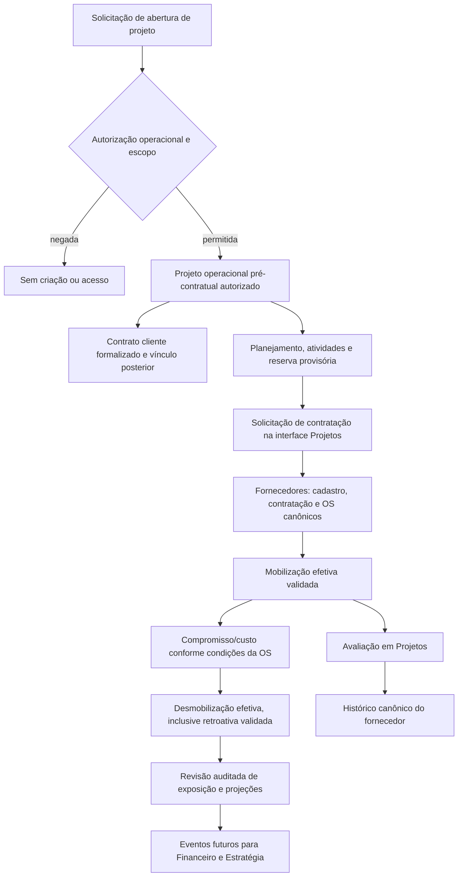

# Auditoria 04A — Gestão de Projetos

Data: 06/11/2026. Destino: `jandersontameirao-svg/Gest-o-Integrada-`.
Branch documental solicitada: `audit/04a-projetos`.

**Parecer: BLOQUEIO DE FONTE. A auditoria do aplicativo de Gestão de Projetos não pôde ser realizada.** Este documento entrega a verificação de disponibilidade, os requisitos ainda não comprovados, as fronteiras de integração e um plano condicionado à obtenção do código correto. Não certifica funcionalidades, segurança, banco, APIs ou maturidade do legado.

## 1. Fontes e evidências reais

| Fonte | Disponibilidade nesta execução | Limite da evidência |
|---|---|---|
| `ATENA_OS_Codigo_Fora_do_GitHub_Gestao_Projetos.zip` | **Não encontrado** nos anexos materializados ou arquivos disponíveis | Sem bytes, manifesto, hash, versão, árvore ou código verificáveis |
| `jandersontameirao-svg/grupo-arqueo-portfolio` | **Excluído como fonte**, conforme determinação expressa do CEO | Não foi usado para inferir o aplicativo de Projetos |
| ZIP SGE e ZIP estratégico aninhado | Presentes no workspace | São fontes de Estratégia; não substituem o ZIP operacional de Projetos |
| Plano Mestre V03 | Não disponibilizado entre os arquivos localizados | Aderência integral não verificável; requisitos deste comando e D01–D13 são as referências de governança disponíveis |
| Fundação PR #1 | Referência de destino, commit `b60ab6adf058b4cc5cce2dcadce2bb7efc6c6da3` | Não é código legado de Projetos |
| Estratégia PR #3 | Leitura de contexto, head `467a9f7d56fddf286600983912bab3e333c0a770`, rascunho sem merge no momento da consulta | Não alterada; projetos estratégicos não equivalem a projetos operacionais |

Verificação independente executada: busca de nomes com `rg --files -uuu` em `/workspace` e `/tmp`, incluindo `/tmp/codex-remote-attachments`, procurando ZIPs, ATENA e Gestão/Gestao de Projetos. Foram localizados somente `1-SGE_Grupo_Arqueo_CodigoFonte_Completo.zip` e `PlanejamentoEstrategico_SourceCode_ModuloAnterior.zip`. `/workspace/library-files` estava vazio. A busca inclui arquivos ocultos/ignorados nesses diretórios, mas não demonstra inexistência do ZIP em contas, conversas, computadores ou serviços não disponibilizados nesta execução. Não houve pesquisa de dados privados em serviços externos nem tentativa de inferir IDs de anexos.

Não foram executados aplicativos, instaladores, scripts, testes do legado, webhooks ou integrações. Nenhum dump, segredo, sessão ou dado real foi lido/importado para suprir o código ausente. Não há hash do ZIP de Projetos a registrar; não foi inventado.

Evidências de destino consultadas, vinculadas a versões explícitas:

- [Fundação: schema 001](https://github.com/jandersontameirao-svg/Gest-o-Integrada-/blob/b60ab6adf058b4cc5cce2dcadce2bb7efc6c6da3/db/migrations/001_foundation.up.sql): empresas, usuários, papéis, permissões, vínculos, sessões e auditoria.
- [PR #3: governança 002](https://github.com/jandersontameirao-svg/Gest-o-Integrada-/blob/467a9f7d56fddf286600983912bab3e333c0a770/db/migrations/002_governance.up.sql#L17): vínculo temporal empresa–unidade; perfis, concessões e habilitações por módulo. Esses incrementos não estão presumidos como integrados à base da PR #1.
- [PR #3: autorização central](https://github.com/jandersontameirao-svg/Gest-o-Integrada-/blob/467a9f7d56fddf286600983912bab3e333c0a770/server/access.ts#L7): habilitação, grants e contexto temporal.
- [PR #3: fronteira de projetos estratégicos](https://github.com/jandersontameirao-svg/Gest-o-Integrada-/blob/467a9f7d56fddf286600983912bab3e333c0a770/server/strategy.ts#L44): vínculos internos estratégicos; referência operacional ainda recusada nesse incremento.
- [Relatório de Estratégia](https://github.com/jandersontameirao-svg/Gest-o-Integrada-/blob/467a9f7d56fddf286600983912bab3e333c0a770/docs/IMPLEMENTACAO_COMANDO_02B.md) e [transição anterior](https://github.com/jandersontameirao-svg/Gest-o-Integrada-/blob/467a9f7d56fddf286600983912bab3e333c0a770/docs/TRANSICAO_GESTAO_CONTRATOS.md): limites e pendências, não homologação do legado de Projetos.

As auditorias 03A (Contratos) e 05A (Fornecedores) são dependências documentais independentes. Seus achados específicos devem ser conferidos nos respectivos relatórios/PRs; esta frente não apresenta inspeção direta desses aplicativos.

A branch documental deve partir da fundação de forma independente das outras auditorias. A referência à PR #3 é apenas contextual e não autoriza merge, cherry-pick ou alteração dela. Antes de implementar, decidir como adotar os incrementos de governança ainda em revisão.

## 2. Inventário funcional exigido — não comprovado no legado

Todos os itens abaixo são **requisitos do CEO a auditar**, e não funcionalidades que se afirma terem sido encontradas no ZIP.

| Capacidade | O que deverá ser localizado e preservado na fonte | Estado de prova |
|---|---|---|
| Projetos/portfólio operacionais | Cadastro, escopos, fases, identificadores, filtros, histórico e responsáveis | Não verificável |
| Abertura pré-contratual autorizada | Solicitação, autorização, justificativa, risco/exposição e vínculo posterior ao contrato cliente | Não verificável; regra obrigatória aprovada |
| Cronogramas e Gantt | EAP/atividades, dependências, calendários, duração, datas reais, baseline e replanejamento | Não verificável |
| Kanban e Scrum | Colunas, transições, WIP se existente, backlog, sprints, tarefas, estimativas e relatórios | Não verificável |
| Equipes e profissionais | Papéis no projeto, disponibilidade, competência, alocação e proveniência do cadastro | Não verificável |
| Custos por atividade | Composição, unidade, moeda, período, origem do compromisso e evidência de realizado | Não verificável |
| Orçamento aprovado | Versões, alçadas, baseline, aditivos, remanejamentos e histórico | Não verificável |
| Aprovado × comprometido × realizado | Definições separadas e reconciliação; sem somar os três como despesas independentes | Não verificável |
| Reservas provisórias | Estados, expiração e conversão em mobilização, sem gerar custo/compromisso por mera reserva | Não verificável; regra obrigatória aprovada |
| Mobilizações | Data efetiva, aprovação, fornecedor/profissional, atividade e condições vigentes da OS | Não verificável |
| Desmobilização retroativa | Data efetiva e data de registro distintas, validação operacional, revisão e correção auditada | Não verificável; regra obrigatória aprovada |
| Entregáveis | Versões, anexos, submissão, aceite, devolução e vínculo com marco/medição do contrato cliente | Não verificável |
| Contratações/OS | Iniciação em Projetos, execução canônica em Fornecedores, sem redigitação cadastral | Não verificável; arquitetura obrigatória |
| Avaliações | Autor, critérios, evidências, projeto/OS e histórico canônico do fornecedor | Não verificável |
| Interface com Contratos | Projeto autorizado antes de assinatura; contrato cliente, aditivos, marcos, medições e documentos vinculados | Não verificável |
| Relatórios/exportações | Filtros, cálculos, PDF/planilhas, escopo e proteção de documentos | Não verificável |
| Integrações/automação | Clientes HTTP/SDKs, filas, cron, IA, autenticação e chamadas de produção | Não verificável; não ativar serviços |

### Catálogo técnico do legado: indisponível

| Artefato solicitado | Resultado real nesta execução |
|---|---|
| Frameworks, versões, dependências e lockfile | Não inspecionados; stack do legado não determinada |
| Diretórios, componentes, telas e rotas frontend | Sem inventário verificável |
| Tabelas, colunas, chaves, índices, triggers e migrações | Sem schema verificável; nenhuma tabela real de Projetos é afirmada |
| APIs, métodos, entradas/saídas, eventos e jobs | Sem catálogo verificável; nenhuma rota real de Projetos é afirmada |
| Autenticação, autorização e isolamento | Não testados; não se conclui segurança ou vulnerabilidade concreta do legado |
| Testes existentes e cobertura | Não disponíveis; nenhuma contagem ou aprovação de testes do legado |
| Dados, volume e qualidade | Não avaliados; nenhum acesso a produção autorizado ou realizado |

Entidades ou mensagens propostas nas seções seguintes são conceitos futuros. Não são DDL, endpoints ou eventos descobertos no código original.

## 3. Matriz de reaproveitamento e bloqueios

Legenda para a decisão final, após obtenção da fonte: **REAPROVEITAR** mantém comportamento/código caracterizado; **ADAPTAR** preserva a capacidade e troca infraestrutura/escopo; **RECONSTRUIR** exige deficiência demonstrada e justificativa de paridade; **NÃO MIGRAR** exclui artefato comprovadamente inadequado ou proibido, preservando a funcionalidade por alternativa autorizada quando necessária.

Sem o ZIP, não é tecnicamente válido escolher entre as quatro classes para componentes do legado. A indisponibilidade temporária não os transforma em “NÃO MIGRAR” e não autoriza reconstruir telas maduras.

| Componente/família | Classificação | Justificativa, dependência e aceite |
|---|---|---|
| Telas maduras Gantt/Kanban/Scrum, formulários, UX e relatórios do ZIP | **PENDENTE — NÃO VERIFICÁVEL** | Localizar e caracterizar antes de escolher classe; comparar navegação, filtros, campos, cálculos e exportações |
| Regras de cronograma, orçamento, equipe, mobilização, custos e entregáveis do ZIP | **PENDENTE — NÃO VERIFICÁVEL** | Evidenciar regras e fórmulas; testes sintéticos de paridade e correções justificadas |
| Banco/migrações, APIs, integrações e jobs do ZIP | **PENDENTE — NÃO VERIFICÁVEL** | Inventário completo por arquivo/linha, rastreabilidade, autorização e rollback antes da decisão |
| Fundação comum disponível: empresas/usuários/sessões/auditoria | **REAPROVEITAR** como base de destino | Não criar masters paralelos; adaptar consumidores do legado somente após conhecer seus contratos |
| Governança/perfis/entitlements da PR #3 | **ADAPTAR** na integração futura, condicionada à aprovação da base | Sem incorporar PR em revisão automaticamente; validar ações e escopos operacionais de Projetos |
| Autenticação e autorização do legado | **PENDENTE — NÃO VERIFICÁVEL** | Alvo obrigatório: autenticação GI e guard backend; não há prova do mecanismo atual |
| Correções de persistência/fórmulas ou controles inseguros do legado | **RECONSTRUIR somente se deficiência for demonstrada**; decisão pendente | Não existe achado concreto de código a corrigir nesta frente bloqueada |
| Tokens, sessões, segredos, dumps privados e dados reais | **NÃO MIGRAR ao GitHub**, regra de proteção | Não foram encontrados/inspecionados; classificação normativa, não inventário de artefatos existentes |
| Dependência operacional obrigatória de Manus/ATENA OS/IA externa, se houver | **NÃO MIGRAR a dependência obrigatória**; existência não comprovada | Preservar funcionalidade por adaptador independente após auditoria; nenhuma chamada agora |
| Componentes de `grupo-arqueo-portfolio` como substituto da fonte | **NÃO MIGRAR nesta auditoria** | Fonte explicitamente excluída pelo CEO; não avaliada como aplicativo de Gestão de Projetos |

## 4. Matriz de autoridade e integração proposta

| Informação/ação | Autoridade canônica | Papel de Projetos | Proteção contra duplicidade |
|---|---|---|---|
| Empresa, unidade, usuários e permissões | Fundação/governança comum | Consumir IDs e vigências autorizadas | Não recadastrar empresas ou duplicar identidades; profissional não é automaticamente usuário autenticado |
| Contrato de cliente, aditivos, obrigações, marcos e medições | Gestão de Contratos | Relacionar execução/entregáveis; iniciar projeto autorizado pré-assinatura | Contrato cliente não é contrato de prestador; projeto não inventa contrato para satisfazer FK |
| Projeto operacional, atividades, cronograma, equipe e entregáveis | Gestão de Projetos | Gerenciar execução e aprovações operacionais | ID operacional próprio; distinguir de iniciativas/projetos estratégicos da PR #3 |
| Cadastro/qualificação de fornecedor, empresa prestadora e profissional PJ/MEI | Arq Fornecedores | Espelhamento funcional do mesmo cadastro conforme permissão | Uma autoridade; nenhuma cópia editável concorrente em Projetos |
| Contratação de prestador e OS | Arq Fornecedores | Iniciar e acompanhar pela interface de Projetos; Ana gerencia operações autorizadas | Comando enviado ao domínio canônico, retornando mesmo ID/revisão; não criar contrato paralelo |
| Reserva, mobilização/desmobilização e validação operacional | Projetos coordena o fato operacional; Fornecedores mantém vínculo e condições canônicas da OS | Registrar datas efetivas, atividade e evidências; solicitar alteração canônica | Evento correlacionado/idempotente; fronteira transacional deve ser homologada, sem duas fontes independentes |
| Avaliação de fornecedor | Histórico canônico de Fornecedores | Originar avaliação contextualizada por projeto/OS | Mesmo evaluation ID, autor e revisões; edição/cancelamento não cria avaliação duplicada |
| Objetivos/metas/KPIs/OKRs e projetos estratégicos | Estratégia | Referenciar e fornecer fatos operacionais autorizados futuramente | Não duplicar o cadastro estratégico; vínculo explícito por ID/tipo |
| Escrituração, pagamentos e recebimentos futuros | Financeiro | Projeção gerencial de orçamento/exposição, com fonte identificada | Somente especificar interfaces/eventos; não implementar Financeiro nesta rodada |

Ana é responsável de negócio indicada pelo CEO. Não se propõe senha, conta com privilégio global, autorização por nome/email fixo ou substituição da matriz de perfis. DIRETORES, GERENTES e OPERADORES continuam sujeitos a concessões por pessoa/empresa/módulo/ação. Uma ação iniciada em Projetos e efetivada em Fornecedores deve verificar permissões nos recursos envolvidos; acesso à tela espelhada não concede autoridade adicional.

Holding única e uma unidade ativa por empresa/período são invariantes. Histórico de atividade/mobilização/custo deve preservar a unidade pertinente à competência definida; transferências não reatribuem retrospectivamente resultados. A convenção mensal do último dia usada pela consolidação estratégica da PR #3 não deve ser aplicada automaticamente a custos diários de OS sem homologação. UTU e Vinho 24 Horas continuam apenas na Estratégia: negar operações também por API, exportação, anexos e jobs mesmo com IDs conhecidos.

## 5. Fluxos e eventos futuros — proposta, não implementação

Reservar não publica evento de custo/compromisso. Mobilizar pode produzir compromisso conforme regras aprovadas da OS, mas não significa pagamento, nota fiscal ou “realizado” automaticamente. A passagem de comprometido para realizado exige definição de evidência/aceite e autoridade futura de Financeiro; projeções devem manter esses estados separados, sem somá-los cumulativamente como despesas distintas.

Desmobilização retroativa proposta: solicitação → validação operacional → confirmação canônica com data efetiva e data de registro → cessação de projeções/custos posteriores à data efetiva segundo condições da OS → eventos de ajuste correlacionados. Não apagar histórico, não alterar silenciosamente pagamentos já efetivados, não assumir estorno fiscal automático. Correções de períodos fechados e alçadas exigem decisão do CEO/áreas responsáveis.

Eventos conceituais a especificar: projeto pré-contratual autorizado, contrato cliente vinculado, mobilização confirmada, desmobilização validada, alteração de condição de OS, entregável aceito e avaliação registrada/revisada. Envelope mínimo proposto: `eventId`, `eventType`, `schemaVersion`, empresa e escopo, ID/tipo/revisão de origem, projeto/OS/contrato pertinentes, `effectiveAt`, `recordedAt`, ator/aprovador, `correlationId`, `causationId`, idempotency key, moeda/unidade/competência quando aplicável. Reentrega e fora de ordem não podem duplicar custo ou avaliação. Outbox/reconciliação são propostas a validar, não infraestrutura existente comprovada.

## 6. Riscos e dependências

| Prioridade | Risco/limitação | Evidência atual e tratamento necessário |
|---|---|---|
| Bloqueante | Fonte correta ausente | Auditoria de código/schema/API e escolha de reaproveitamento bloqueadas; receber ZIP autorizado sem dumps/segredos |
| Alta | Confundir portfólio ou SGE com aplicativo operacional | CEO exclui portfolio; PR #3 identifica projetos estratégicos como domínio distinto |
| Alta | Recriar UX madura sem inspecionar origem | Não autorizar reconstrução por falta temporária de fonte; inventário e paridade primeiro |
| Alta | Autorização por seleção de empresa apenas na UI | Risco a testar, não vulnerabilidade descoberta; backend deve negar leitura, escrita, export, anexos e jobs por escopo |
| Alta | Cadastro ou contrato prestador duplicado em Projetos | Fornecedores deve ser autoridade; espelhamento funcional consulta/comanda mesma origem |
| Alta | Reserva, comprometido e realizado contados mais de uma vez | Sem fórmula do legado verificada; caracterizar e homologar fatos geradores por OS |
| Alta | Retroatividade sem validação ou com exclusão de evidências | Registrar antes/depois, aprovador, vigência, motivo, impacto e idempotência; nenhum apagamento de histórico |
| Alta | Unidade atual aplicada a resultados antigos | Competência e unidade histórica por fato; testes de transferência e ajuste |
| Alta | Projeto impedido até contrato assinado | Exigência de contrato não nulo não deve bloquear autorização pré-contratual legítima; vincular depois sem duplicar projeto |
| Alta | Segredos/produção acionados por instalação ou testes antigos | Triagem estática da fonte antes de executar; fixtures sintéticas e bloqueio de egress em testes |
| Média | Dependência de incrementos ainda não integrados | Fundação PR #1 e governança PR #3 precisam de estratégia de base aprovada; não fazer merge como atalho |
| Média | Plano Mestre V03 indisponível | Registrar aderência somente aos requisitos fornecidos; cotejo documental posterior obrigatório |

Não se atribuem CVEs, endpoints vulneráveis, tabelas inseguras ou falhas de autenticação ao legado ausente. Os riscos acima são de integração/governança ou hipóteses a investigar.

## 7. Etapas futuras, testes e critérios de aceite

Nenhuma das etapas de implementação está autorizada por esta auditoria.

| Etapa condicionada | Entrega futura | Critério de aceite verificável |
|---|---|---|
| 0 — Recepção da fonte correta | ZIP autorizado, tamanho/hash, proveniência, árvore e manifesto sem dados privados | Identificação inequívoca do aplicativo; nenhum uso substitutivo de portfolio/SGE; inspeção de dependências/segredos sem executá-los |
| 1 — Concluir auditoria 04A | Catálogos completos de telas, métodos, tabelas, APIs, integrações, jobs, fórmulas e testes por arquivo/linha | Toda classificação de reuso tem evidência; lacunas/fluxos simulados distinguidos de persistência real; V03 conferido se fornecido |
| 2 — Caracterização isolada e base aprovada | Testes sintéticos de paridade; contrato de governança compatível | Salvar/recarregar/editar/exportar por escopo; negar UTU/Vinho; nenhum serviço de produção; não usar testes da fundação como homologação do legado |
| 3 — Port vertical pré-contratual | Fluxo autorizado de abertura e vínculo posterior com contrato cliente | Sem contrato formal, só usuário autorizado cria projeto; assinatura posterior preserva ID, histórico e orçamento aprovado; ações negadas auditadas |
| 4 — Planejamento e execução | Gantt/Kanban/Scrum, equipes, custos e entregáveis caracterizados na origem | Paridade de campos, cálculos, filtros e transições; concorrência, baseline/revisão, calendário e dependências testados; sem sucesso de gravação simulado |
| 5 — Espelhamento de Fornecedores | Contratação/OS, mobilização, desmobilização, avaliação e orçamento comparativo | Mesmos IDs canônicos; reserva não custa; mobilização usa condições vigentes; retroatividade validada cessa custos na data efetiva; avaliação aparece uma única vez no fornecedor |
| 6 — Regressão e revisão | TypeScript/build, testes unitários, MySQL isolado, migrações/rollback e E2E | Testes sintéticos positivos/negativos por perfil/empresa/módulo/ação; duplicação, reentrega, eventos fora de ordem e dados de outra empresa negados; revisão CEO antes de merge/deploy |

Casos críticos a incluir: dois usuários editando o mesmo cronograma; mudança de OS após orçamento aprovado; mobilização atravessando troca de unidade; solicitação retroativa anterior ao início da mobilização; desmobilização repetida; período encerrado; precisão monetária/moedas distintas; ausência de câmbio explícita; acesso à OS/anexo de outro projeto/empresa; export sem concessão; chamada direta ao backend contornando tela espelhada; profissional compartilhado sem permissão; total orçado/comprometido/realizado conciliado sem dupla contagem.

## 8. Decisões pendentes do CEO

Regras já aprovadas neste comando — reserva sem custo, mobilização efetiva + OS, desmobilização retroativa validada, Fornecedores canônico/espelhado e abertura pré-contratual autorizada — não precisam ser reaprovadas para constar no plano. O detalhamento abaixo permanece aberto:

1. Fornecer acesso ao ZIP correto e, se houver, Plano Mestre V03; confirmar versão de referência e autorização para adaptação futura. Não requer acesso a banco de produção.
2. Definir alçadas/limites de exposição e documentos de autorização para abertura pré-contratual, mudança de baseline e eventual encerramento sem assinatura.
3. Definir a concessão operacional de Ana e substitutos: empresas/projetos, ações de contratação/OS, mobilização, desmobilização e avaliação; estabelecer separação entre solicitante e aprovador quando necessária.
4. Homologar data inclusiva/exclusiva de término, fuso, diárias/frações, mínimos/avisos da OS e tratamento de retroatividade em períodos encerrados. Confirmar qual evidência move compromisso para realizado, sem implementar Financeiro agora.
5. Homologar compartilhamento corporativo de prestadores/profissionais/documentos e política de retenção/privacidade por empresa; cadastro único não implica acesso irrestrito.
6. Aprovar sequência e base técnica de implementação perante PR #1/#3 ainda em revisão; não autorizar merge automaticamente.
7. Aprovar a matriz de reaproveitamento após o desbloqueio e aceitar somente divergências de funcionalidade explicitamente justificadas; decidir quaisquer exclusões futuras.

## 9. Comando futuro preparado — NÃO EXECUTADO

> **CODEX — COMANDO 04B | PORTABILIDADE DE GESTÃO DE PROJETOS — condicionado a nova autorização do CEO.** Usar a fonte autorizada `ATENA_OS_Codigo_Fora_do_GitHub_Gestao_Projetos.zip`, com hash/versão e auditoria 04A concluída. Se a fonte continuar ausente, parar a implementação e registrar o bloqueio, sem usar `grupo-arqueo-portfolio` ou reconstruir o aplicativo a partir do SGE. Confirmar a base aprovada de governança antes de abrir branch própria. Portar prioritariamente código/UX maduros e fluxos com persistência, preservando autorização de projeto pré-contratual, cronogramas/Gantt/Kanban/Scrum, equipe, orçamento e custos por atividade. Integrar a interface de contratação/OS ao domínio canônico Fornecedores, com permissões configuradas para Ana, sem cadastros/contratos duplicados. Reserva não gera custo; mobilização efetiva e OS determinam compromisso/custo; desmobilização retroativa validada cessa na data efetiva; avaliação originada em Projetos atualiza histórico único do fornecedor. Manter projetos estratégicos separados dos operacionais. Usar testes sintéticos de paridade, escopo, persistência, idempotência e histórico; testar build/TypeScript, MySQL isolado, migrações/rollback e E2E. Especificar apenas eventos/interfaces de Financeiro; sem implementar Financeiro, ativar APIs externas, IA/Manus/ATENA, migrar dados reais, alterar aplicativos originais, merge ou deploy. PR em rascunho com evidências e limitações; aguardar revisão.

## 10. Parecer e sequência recomendada

**A auditoria funcional/técnica do legado de Projetos permanece BLOQUEADA por ausência de fonte.** É possível revisar este plano documental e interfaces propostas; não é possível aprovar paridade, segurança ou reaproveitamento do aplicativo ausente.

Sequência proposta: concluir auditorias de Contratos/Fornecedores disponíveis e harmonizar autoridades/identificadores; receber o ZIP correto e completar 04A; submeter decisões de fronteira/alçadas ao CEO; somente então autorizar branches de desenvolvimento por módulo. Projetos não precisa aguardar assinatura formal de contrato para abertura autorizada, mas depende de contrato de integração e da governança comum. Espelhamento completo de contratação depende das APIs canônicas de Fornecedores. Nenhuma implementação foi iniciada nesta frente.

As verificações realizadas foram busca de fonte e revisão estática da base disponível/documentação. Testes e CI da fundação ou da Estratégia não homologam o aplicativo de Projetos. Este arquivo não altera a PR #3, os aplicativos originais, a estrutura de runtime nem dados reais. A entrega é exclusivamente documental e deve permanecer em PR independente para revisão do CEO.
