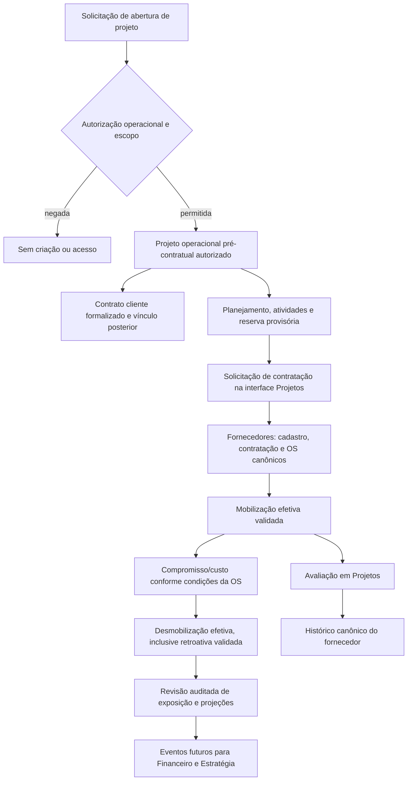

# Auditoria 04A — Gestão de Projetos (revisão após recebimento da fonte)

**Data:** 06/11/2026. **Natureza:** auditoria estática, inventário e plano de reaproveitamento. Nenhuma implementação ou migração real.

**Parecer:** **FONTE AGORA ACESSÍVEL; REAPROVEITAMENTO SUBSTANCIAL RECOMENDADO COM CORREÇÕES OBRIGATÓRIAS.** O ZIP enviado após a primeira auditoria contém o aplicativo Arqueo Gestão de Projetos, com UI, backend e schema coerentes com o domínio solicitado. O bloqueio anterior de acesso foi suprido por este pacote. Isso não certifica identidade byte a byte com o ZIP antes referido como `ATENA_OS_Codigo_Fora_do_GitHub_Gestao_Projetos.zip`, nem backup completo ou prontidão de produção.

## 1. Fonte, proveniência e limites

| Item | Evidência verificável |
|---|---|
| Anexo recebido | `1-ZKhCWMhBUInGJrQZ.zip` (nome apresentado: `ZKhCWMhBUInGJrQZ.zip`) |
| SHA-256 do ZIP | `14a3d081ec9efe179bb8cc17ae74dc2a74dd7d325b457e97ace7f1001ce9ede1` |
| Tamanho e árvore | 564.854 bytes; 277 entradas ZIP: 254 arquivos e 23 diretórios; 2.859.043 bytes descompactados declarados no índice |
| Código selecionado para inspeção | 193 arquivos de código/configuração/DDL, extraídos por allowlist local; 32 arquivos privados de consultas `.manus/db` não foram extraídos/lidos |
| Identificação funcional | package.json: name `arqueo-gestao`, version `1.0.0`; App.tsx, páginas Projetos/Gantt/Kanban/Scrum/Equipes e rotas correspondentes |
| Origem Git | Commit/repositório de origem não fornecido no pacote; não inventado. Não publicar links GitHub de fonte que não foi disponibilizada ali |
| Fonte excluída | `grupo-arqueo-portfolio` não foi consultado/usado como substituto; SGE não substitui este aplicativo operacional |
| Plano Mestre V03 | Não fornecido nesta execução; aderência integral não certificada |
| Base de destino | Fundação PR #1, `b60ab6adf058b4cc5cce2dcadce2bb7efc6c6da3` |
| Contexto arquitetural | PR #3, `467a9f7d56fddf286600983912bab3e333c0a770`, somente leitura; não incorporada por merge nem alterada |

As referências `arquivo:linha` neste relatório pertencem aos bytes do ZIP identificado acima, não à main de um repositório presumido. O índice completo do ZIP foi consultado; a leitura textual foi direcionada a schema/migrações, todos routers declarados, engine e parser, DB/relatórios/auth e telas de domínio. Componentes UI genéricos e toda variante visual não foram homologados linha a linha. Inventário estático completo de nomes não equivale a cobertura funcional integral.

Não foram executados código legado, npm/pnpm, testes, migrations, seed, scripts, webhooks, IA, OAuth ou serviços externos. Nenhum banco/produção, documento pessoal, segredo ou dump foi acessado para preencher lacunas. Artefatos `.manus/db` ficaram excluídos; seu conteúdo não é evidência de banco válido. O ZIP/código original não será republicado: somente este relatório documental.

O [registro histórico de bloqueio](https://github.com/jandersontameirao-svg/Gest-o-Integrada-/blob/b376203a4aa7438b75218d56d62cea546017e798/docs/AUDITORIA_04A_PROJETOS.md) na PR #4 era correto para os arquivos disponíveis naquele momento. Esta revisão o substitui pelo inventário real do pacote agora recebido, preservando a história Git da decisão.

## 2. Arquitetura e inventário funcional

Origem: React 19/TypeScript 5.9, Vite, Wouter, tRPC/TanStack, Express 4, Drizzle/mysql2/MySQL, Zod, Tailwind/Radix, Recharts, dnd-kit, jsPDF/pdfmake/XLSX. Há SDK/OAuth Manus, LLM, storage externo e providers auxiliares. Reusar UI/regras determinísticas sob identidade GI; não transportar a dependência operacional de Manus ou ativar APIs externas.

| Família existente | Evidência de fonte | Estado / limite demonstrável |
|---|---|---|
| Holding/empresas/clientes e macroprojetos | App.tsx:42; routers-groupprojects.ts:14; client-registry e clients | Cadastro global de cliente + vínculo empresa coexistem com clients por empresa; macroprojetos não equivalem automaticamente à unidade de negócio da GI |
| Projeto operacional | schema.ts:162; routers.ts:398; Projects/ProjectDetail | CRUD, empresa/cliente/gestor/código/status/prioridade/datas, metodologia Scrum/Kanban, criação por template; sem contrato cliente e sem aprovação pré-contratual explícita |
| Fases, tarefas e responsáveis | schema.ts:188–290; routers.ts:550–1255 | Datas, progresso, prioridade, subtarefas, múltiplos responsáveis, dependências FS/SS/FF/SF e lag; ownership e coerência de IDs precisam correção |
| Variantes Gantt | Gantt, GanttEditor, AdvancedGanttView; AdvancedGantt/InteractiveGantt/MSProjectGantt/TemplateGantt | Variantes visuais maduras presentes; não substituir por cards. Engine/backend têm divergências e fluxos sem persistência (seção 5) |
| Calendários e terceiros | schema.ts:810–854; gantt-engine.ts | Schema de dias úteis/exceções/entidades externas existe; não foram encontrados routers canônicos CRUD próprios de calendário/exceção no appRouter; engine principal não usa efetivamente calendário no recálculo |
| Kanban | KanbanBoard, Kanban/ KanbanView, ProjectStatuses; routers.ts:507 | Colunas de projeto e tarefas, drag-and-drop, status customizáveis; autorização e persistência por transição a homologar |
| Scrum | Scrum/ScrumBoard; sprints API e schema | Backlog, sprints, início/conclusão, pontos, burndown. Coexistem sprints e scrum_sprints/sprint_phases; segundo modelo não possui namespace dedicado no router observado |
| Equipes/profissionais/cargos | schema.ts:544–683; Professionals/RoleCatalog/Allocations | Cadastro de profissionais, documentos pessoais e currículo no schema, alocações multiprojeto e catálogo de cargos. O formulário de alocação diverge do DTO API; não comprova mobilização financeira |
| Templates | schema.ts:356; Templates/TemplateDetail/Preview; db.ts:1491/1835/1923 | Fases/tarefas, criação/aplicação e variantes arqueológicas; cópia parcial e repetição não são atômicas/idempotentes; salvar Gantt como template está desabilitado |
| MS Project | MSProjectImport, ms-project-parser.ts; routers.ts:1959 | Fluxo de parsing/preview/criação/aplicação; XML simplificado não preserva dependências e MPP depende de IA; criação de template escreve entidades erradas |
| Comentários/documentos | comments/documents routers; TaskComments/DocumentUpload | Persistência e notificações por tarefa/projeto; falta escopo/ownership e autorização separada de anexos/export |
| Histórico e automação | workflow_rules/executions, task_history, audit_logs; automations.ts | Regras/condições/ações e histórico; não equivalem a trilha imutável e não podem alterar outro escopo sem revalidação |
| Relatórios/exportações | reports.ts; Reports.tsx; export-utils.ts | Relatório HTML imprimível e PDF/Excel/XML locais. Não tratar imprimir HTML como geração PDF servidor certificada; há endpoint sem auth, filtros inconsistentes e escaping ausente |
| Custos/orçamentos | 0002_mature_clint_barton.sql:50–61; schema atual | Migração antiga remove financial_milestones/project_expenses e estimatedBudget/actualCost; schema atual não suporta aprovado/comprometido/realizado com moeda/competência |

### Requisitos expressamente pedidos, ainda não comprovados

Não foram encontrados modelos/fluxos canônicos completos de contrato cliente vinculado, abertura pré-assinatura com alçada/evidência, OS de prestador, reserva provisória, mobilização efetiva, desmobilização retroativa validada, orçamento aprovado versionado, compromisso/custo por atividade e realizado por evidência, avaliação de fornecedor compartilhada com Fornecedores. Alocação ACTIVE/INACTIVE não prova essas regras. Home.tsx:59 anuncia orçamento/custos, mas texto de marketing não substitui persistência/rotas/cálculo.

Entregáveis estão representados parcialmente por tarefas, milestones e documentos; não foi comprovada cadeia completa de submissão/aceite/versionamento vinculada a marcos e medições contratuais. O domínio deve ser adaptado às autoridades Contratos/Fornecedores, sem novo Financeiro.

## 3. Banco e migrações

49 declarações mysqlTable no schema, 16 migrações 0000–0015 no journal. A união do SQL cria 48 nomes: 46 pertencem ao schema atual e dois (`financial_milestones`, `project_expenses`) são removidos em 0002. Não há CREATE TABLE nessas migrações para `client_registry`, `company_clients` ou `ms_project_import_history`. Isso não prova ausência/presença no banco real: prova divergência de fonte e DDL versionado.

`0015_volatile_slayback.sql:7` adiciona coluna `lag`, enquanto schema.ts:285 declara `lagDays`. `schema.ts:705–706` repete aliases Document/InsertDocument já declarados em 351–352. `schema.ts:916` referencia `templates.id` não declarado (o schema tem projectTemplates). São incompatibilidades estáticas a corrigir; não se alega execução de tsc para produzir diagnóstico de compilação.

A maior parte dos vínculos de projetos/tarefas/empresa é int sem FK; FKs do módulo de equipes não substituem guard de empresa. Não há unidade temporal/habilitação por módulo equivalente à governança GI. IDs inteiros de origem devem receber mapa `(source_system, source_entity, legacy_id) → corporate_id`, sem copiar users/companies/clientes como masters concorrentes. Dado histórico de tabelas removidas exige análise controlada em eventual carga futura, não restauração de livro paralelo ou descarte automático.

Não há pares down SQL no pacote examinado, checksum/diário reversível GI ou comprovação de restore. Derivar novas migrações sequenciais/testadas no destino; não executar db:push do legado contra GI/produção.

## 4. Segurança, integridade e persistência — achados estáticos

Nenhuma exploração foi executada; prioridade refere-se à segurança do port, não comprovação de incidente em produção.

| ID | Evidência de fonte | Risco / correção no plano |
|---|---|---|
| P04-01 — crítico | server/_core/index.ts:50; reports.ts:86 | GET /api/reports/project/:id chama relatório por ID sem autenticação/escopo no mount. Exigir sessão GI, read+export e ownership de todas relações |
| P04-02 — crítico | server/_core/trpc.ts:16/28; routers.ts:399–489/1662 | protected verifica ctx.user, não company/module/action; listas globais e CRUD por ID; concessões podem ser editadas por authenticated procedure. Substituir guard, incluindo mudança companyId e leitura de PII |
| P04-03 — alto | routers-comments.ts:36; routers-documents.ts:9/15/51 | Comentários/anexos sem ownership/autoria por recurso. Validar cadeia projeto/empresa e capacidade por ação, armazenamento privado |
| P04-04 — alto | reports.ts:261/364/386/468; export-utils.ts:159/166 | Interpolação HTML/XML sem escaping; potencial injeção em relatório/download, não explorada. Escapar/validar markup e URLs antes de renderizar |
| P04-05 — alto | server/_core/sdk.ts:213/259–300 | Sessão não revalida isActive; appId é validado como não vazio, sem comparação com app destino no fluxo lido. Usar identidade GI independente, revogação e grants dinâmicos |
| P04-06 — alto | index.ts:35; routers-documents.ts:15 | JSON 50 MB e base64/fileName/contentType sem limites reais por operação/escopo; reforçar tamanho/MIME/magic bytes/quotas, sem providers ativos |
| P04-07 — alto | routers.ts:740/819; db.ts:604/727 | IDs phase/sprint/parent podem ser de outro projeto; aciclicidade por leitura DFS global+insert sem serialização; exclusão/assignees em múltiplas escritas. Transação, locks, unique, validação de pertencimento e CAS |
| P04-08 — alto | routers.ts:1845; db.ts:2320 | Criar alocação e auditoria separados; falha pode deixar ação sem log. Gravação+auditoria/outbox atômicas; conferir percentuais/datas, privacy e empresa |
| P04-09 — alto | gantt-engine.ts:221–285; routers.ts:1932 | recalculateSchedule retorna mapa calculado sem UPDATE; router informa tarefas atualizadas. Não comunicar persistência sem commit; unificar DTOs dueDate/endDate, estimatedHours/duration, progress/percentComplete, lag/lagDays |
| P04-10 — alto | routers.ts:1016–1053/1947 | recalculateDependentChain apenas marca IDs contados sem recalcular datas; saveAsTemplate lança NOT_IMPLEMENTED. Completar essas capacidades sem remover UX, com testes recarregar/edit/histórico |
| P04-11 — alto | routers.ts:1997–2090; ms-project-parser.ts:45–112/142/244 | Import cria “template” em projects com company/client=1, campos/enum de tarefa e dependência incompatíveis, phases ignoradas; XML perde dependências e gera fases artificiais; MPP depende de LLM. Reconciliar import determinístico e validação, nunca inventar relações ou sucesso |
| P04-12 — alto | db.ts:1835–1936 | Aplicar template copia fases/tarefas sem transação, mapeia fases por índice e retorna [] em falha; retry pode duplicar. IDs explícitos, transação/idempotência e falha propagada |
| P04-13 — alto | Allocations.tsx:65; routers.ts:1846 | UI envia roleId/hoursPerWeek e data opcional; API exige roleCatalogId/startDate:string e usa allocationPercent. Corrigir contrato sem eliminar cadastro, responsável ou vigência |
| P04-14 — médio/alto | db.ts:522–573; routers.ts:881 | Burndown real é interpolação do estado atual, sem snapshots diários; storyPoints 0 vira1 por ||1; progresso pai simples vs ponderado na engine. Preservar fórmulas caracterizadas, corrigir zero/NaN e homologar divergência |
| P04-15 — alto | Reports.tsx:65–118; InteractiveGantt.tsx:117/145 | Sucesso reportado antes de confirmar download/gravação; callbacks Gantt não aguardam persistência; filtros de relatório aparecem como legenda mas stats são globais. Confirmação backend, erro real e parâmetros efetivamente aplicados |
| P04-16 — alto | schema/migrations; import parser/storage/automations | Deriva estrutural, automações e providers externos podem executar fora do escopo. Reconciliar schema, guard obrigatório em jobs e providers desligados; testes isolados e mínimos privilégios |

## 5. Matriz REAPROVEITAR / ADAPTAR / RECONSTRUIR / NÃO MIGRAR

Classificação orienta implementação futura após autorização, não inicia 04B. Não remover variantes/capacidades maduras por existirem defeitos pontuais.

| Fonte / capacidade | Classificação | Condição |
|---|---|---|
| React/TypeScript, Radix, layout, formulários, filtros, gráficos | REAPROVEITAR | Port visual substancial e testes de paridade; navegação GI e contexto autorizado |
| Projects/ProjectDetail, fases/tarefas/milestones | ADAPTAR | Preservar campos/UX, IDs canônicos e máquina de estados, ownership e contratos futuros |
| Gantt/MSProjectGantt/Advanced/Interactive/Editor/Template | ADAPTAR | Manter variantes; corrigir modelos/cálculos/persistência, dependências/calendário/CAS e telas de edição |
| Kanban/Scrum, backlog/sprints | REAPROVEITAR / ADAPTAR | Preservar interação e métricas, definir modelos canônicos sprints vs scrum_sprints, histórico real e transições autorizadas |
| Professionals/RoleCatalog/Allocations | ADAPTAR | Profissional não equivale a usuário; contrato UI/API corrigido e correspondência ao prestador PJ/MEI Fornecedores, sem cadastro mestre concorrente |
| Templates arqueológicos/workflows e aplicação | REAPROVEITAR / ADAPTAR | Regras/UX preservadas; cópia atômica/idempotente e mapping explícito, testes com dados sintéticos |
| Importação XML/MPT/MPP | RECONSTRUIR trecho defeituoso / ADAPTAR UX | Parser determinístico fiel; provider IA opcional futuro desligado; persistir no modelo de templates correto sem hardcode |
| Auth/SDK Manus e RBAC permissivo | RECONSTRUIR integração, usando fundação GI | Não replicar identidade/users/grants concorrentes nem privilégios por nome/email |
| Relatórios/PDF/Excel/XML | ADAPTAR | Reusar renderizadores/layout, escopo backend, escaping e download confirmado; não inventar totais por filtro |
| Comentários/documentos/histórico | ADAPTAR | Autoria, relações-filhas, export/anexos privados e auditoria transacional |
| group_projects / projectType strategic_project | ADAPTAR referências | Não migrar cópia concorrente dos objetivos/projetos estratégicos já da PR #3; preservar proveniência e vínculos |
| companies/clientRegistry/clients/company_clients | ADAPTAR | Mapear mestres e contrapartes comuns de 03A/05A; não fundir por nome ou recadastrar empresa |
| Autorização pré-contratual, OS, reservas, mobilização, custos por atividade | RECONSTRUIR somente lacunas comprovadas | Novas regras aprovadas ausentes neste pacote precisam camada canônica; reutilizar Fornecedores para prestadores/OS; não substituir UX existente |
| Providers ativos IA/ATENA/Manus/map/email/webhook | NÃO MIGRAR como dependência operacional ativa | Adaptadores futuros independentes e desligados; nenhuma conexão nesta rodada |
| Segredos/sessões, .manus/db, dumps/consultas, scripts de dados/redeploy | NÃO MIGRAR ao GitHub | Não foram usados como backup/produção; só procedimento separado autorizado de dados mínimos |
| Financeiro legado já removido (DDL histórico) | NÃO MIGRAR como segundo livro | Preservar proveniência em eventual carga controlada; contratos de interface/eventos para Financeiro futuro |

## 6. Qualidade e testes observados

Pacote contém 13 arquivos `server/*.test.ts`, com 136 chamadas it() declaradas por extração textual. Isso não é contagem de testes executados, cobertura ou sucesso. Vitest inclui server/**/*.test.ts e spec.ts; não foi encontrado Playwright ou workflow CI no índice do ZIP. Nenhum resultado GitHub de outra aplicação é atribuído a este pacote sem Git SHA comprovado.

Alguns testes usam createCaller e DB da configuração sem ambiente descartável comprovado; project-creation/hierarchy/rbac/workflows fazem escritas. template-application.test.ts:48 e seguintes retornam cedo quando não há templates, sem falhar: verde não provaria paridade. Não executar antes de isolar banco/egress e criar fixtures sintéticas. Testes declarados de templates arqueológicos caracterizam nomes/estrutura em arrays; não certificam persistência real de todas as variantes.

Build e check são scripts separados: Vite/esbuild não substituem tsc. As incompatibilidades de schema/DTOs citadas são observações estáticas; nenhum diagnóstico TypeScript real foi fabricado. Não houve npm audit, análise de CVEs atual ou reprodução de vulnerabilidades do legado. Testes da fundação/PR #3 validam seu código, não homologam este aplicativo.

Relatórios de integração independentes: [03A — Contratos](https://github.com/jandersontameirao-svg/Gest-o-Integrada-/blob/audit/03a-contratos/docs/AUDITORIA_03A_CONTRATOS.md) e [05A — Fornecedores](https://github.com/jandersontameirao-svg/Gest-o-Integrada-/blob/audit/05a-fornecedores/docs/AUDITORIA_05A_FORNECEDORES.md). Referências ao bloqueio de Projetos nesses retratos anteriores não significam bloqueio persistente após este novo pacote; não se alteram suas branches nesta revisão.

## 7. Matriz de autoridade e integração proposta

| Informação/ação | Autoridade canônica | Papel de Projetos | Proteção contra duplicidade |
|---|---|---|---|
| Empresa, unidade, usuários e permissões | Fundação/governança comum | Consumir IDs e vigências autorizadas | Não recadastrar empresas ou duplicar identidades; profissional não é automaticamente usuário autenticado |
| Contrato de cliente, aditivos, obrigações, marcos e medições | Gestão de Contratos | Relacionar execução/entregáveis; iniciar projeto autorizado pré-assinatura | Contrato cliente não é contrato de prestador; projeto não inventa contrato para satisfazer FK |
| Projeto operacional, atividades, cronograma, equipe e entregáveis | Gestão de Projetos | Gerenciar execução e aprovações operacionais | ID operacional próprio; distinguir de iniciativas/projetos estratégicos da PR #3 |
| Cadastro/qualificação de fornecedor, empresa prestadora e profissional PJ/MEI | Arq Fornecedores | Espelhamento funcional do mesmo cadastro conforme permissão | Uma autoridade; nenhuma cópia editável concorrente em Projetos |
| Contratação de prestador e OS | Arq Fornecedores | Iniciar e acompanhar pela interface de Projetos; Ana gerencia operações autorizadas | Comando enviado ao domínio canônico, retornando mesmo ID/revisão; não criar contrato paralelo |
| Reserva, mobilização/desmobilização e validação operacional | Projetos coordena o fato operacional; Fornecedores mantém vínculo e condições canônicas da OS | Registrar datas efetivas, atividade e evidências; solicitar alteração canônica | Evento correlacionado/idempotente; fronteira transacional deve ser homologada, sem duas fontes independentes |
| Avaliação de fornecedor | Histórico canônico de Fornecedores | Originar avaliação contextualizada por projeto/OS | Mesmo evaluation ID, autor e revisões; edição/cancelamento não cria avaliação duplicada |
| Objetivos/metas/KPIs/OKRs e projetos estratégicos | Estratégia | Referenciar e fornecer fatos operacionais autorizados futuramente | Não duplicar o cadastro estratégico; vínculo explícito por ID/tipo |
| Escrituração, pagamentos e recebimentos futuros | Financeiro | Projeção gerencial de orçamento/exposição, com fonte identificada | Somente especificar interfaces/eventos; não implementar Financeiro nesta rodada |

Ana é responsável de negócio indicada pelo CEO. Não se propõe senha, conta com privilégio global, autorização por nome/email fixo ou substituição da matriz de perfis. DIRETORES, GERENTES e OPERADORES continuam sujeitos a concessões por pessoa/empresa/módulo/ação. Uma ação iniciada em Projetos e efetivada em Fornecedores deve verificar permissões nos recursos envolvidos; acesso à tela espelhada não concede autoridade adicional.

Holding única e uma unidade ativa por empresa/período são invariantes. Histórico de atividade/mobilização/custo deve preservar a unidade pertinente à competência definida; transferências não reatribuem retrospectivamente resultados. A convenção mensal do último dia usada pela consolidação estratégica da PR #3 não deve ser aplicada automaticamente a custos diários de OS sem homologação. UTU e Vinho 24 Horas continuam apenas na Estratégia: negar operações também por API, exportação, anexos e jobs mesmo com IDs conhecidos.

## 8. Fluxos e eventos futuros — proposta, não implementação

Reservar não publica evento de custo/compromisso. Mobilizar pode produzir compromisso conforme regras aprovadas da OS, mas não significa pagamento, nota fiscal ou “realizado” automaticamente. A passagem de comprometido para realizado exige definição de evidência/aceite e autoridade futura de Financeiro; projeções devem manter esses estados separados, sem somá-los cumulativamente como despesas distintas.

Desmobilização retroativa proposta: solicitação → validação operacional → confirmação canônica com data efetiva e data de registro → cessação de projeções/custos posteriores à data efetiva segundo condições da OS → eventos de ajuste correlacionados. Não apagar histórico, não alterar silenciosamente pagamentos já efetivados, não assumir estorno fiscal automático. Correções de períodos fechados e alçadas exigem decisão do CEO/áreas responsáveis.

Eventos conceituais a especificar: projeto pré-contratual autorizado, contrato cliente vinculado, mobilização confirmada, desmobilização validada, alteração de condição de OS, entregável aceito e avaliação registrada/revisada. Envelope mínimo proposto: `eventId`, `eventType`, `schemaVersion`, empresa e escopo, ID/tipo/revisão de origem, projeto/OS/contrato pertinentes, `effectiveAt`, `recordedAt`, ator/aprovador, `correlationId`, `causationId`, idempotency key, moeda/unidade/competência quando aplicável. Reentrega e fora de ordem não podem duplicar custo ou avaliação. Outbox/reconciliação são propostas a validar, não infraestrutura existente comprovada.

## 9. Etapas futuras, testes e critérios de aceite

Nenhuma das etapas de implementação está autorizada por esta auditoria.

| Etapa condicionada | Entrega futura | Critério de aceite verificável |
|---|---|---|
| 0 — Fixar e caracterizar a fonte agora disponível | Pacote com SHA desta revisão, confirmação de referência pelo CEO e baseline isolada | Reproduzir schema/fluxos com fixtures sintéticas, sem produção; resolver incompatibilidades estáticas antes de homologar |
| 1 — Homologar plano 04A e reparar base do port | Reconciliar campos Gantt/DDL/DTOs e classificar variantes por paridade | Aceite documental do CEO; correções estáticas explicitadas e testes sintéticos; V03 conferido se fornecido |
| 2 — Caracterização isolada e base aprovada | Testes sintéticos de paridade; contrato de governança compatível | Salvar/recarregar/editar/exportar por escopo; negar UTU/Vinho; nenhum serviço de produção; não usar testes da fundação como homologação do legado |
| 3 — Port vertical pré-contratual | Fluxo autorizado de abertura e vínculo posterior com contrato cliente | Sem contrato formal, só usuário autorizado cria projeto; assinatura posterior preserva ID, histórico e orçamento aprovado; ações negadas auditadas |
| 4 — Planejamento e execução | Gantt/Kanban/Scrum, equipes, custos e entregáveis caracterizados na origem | Paridade de campos, cálculos, filtros e transições; concorrência, baseline/revisão, calendário e dependências testados; sem sucesso de gravação simulado |
| 5 — Espelhamento de Fornecedores | Contratação/OS, mobilização, desmobilização, avaliação e orçamento comparativo | Mesmos IDs canônicos; reserva não custa; mobilização usa condições vigentes; retroatividade validada cessa custos na data efetiva; avaliação aparece uma única vez no fornecedor |
| 6 — Regressão e revisão | TypeScript/build, testes unitários, MySQL isolado, migrações/rollback e E2E | Testes sintéticos positivos/negativos por perfil/empresa/módulo/ação; duplicação, reentrega, eventos fora de ordem e dados de outra empresa negados; revisão CEO antes de merge/deploy |

Casos críticos a incluir: dois usuários editando o mesmo cronograma; mudança de OS após orçamento aprovado; mobilização atravessando troca de unidade; solicitação retroativa anterior ao início da mobilização; desmobilização repetida; período encerrado; precisão monetária/moedas distintas; ausência de câmbio explícita; acesso à OS/anexo de outro projeto/empresa; export sem concessão; chamada direta ao backend contornando tela espelhada; profissional compartilhado sem permissão; total orçado/comprometido/realizado conciliado sem dupla contagem.

## 10. Decisões pendentes do CEO

Regras já aprovadas neste comando — reserva sem custo, mobilização efetiva + OS, desmobilização retroativa validada, Fornecedores canônico/espelhado e abertura pré-contratual autorizada — não precisam ser reaprovadas para constar no plano. O detalhamento abaixo permanece aberto:

1. Confirmar este pacote recebido como versão de referência funcional e fornecer Plano Mestre V03, se disponível. O bloqueio de acesso foi suprido; identidade byte a byte com o ZIP antes nomeado e backup de dados não estão comprovados. Desenvolvimento continua exigindo nova autorização.
2. Definir alçadas/limites de exposição e documentos de autorização para abertura pré-contratual, mudança de baseline e eventual encerramento sem assinatura.
3. Definir a concessão operacional de Ana e substitutos: empresas/projetos, ações de contratação/OS, mobilização, desmobilização e avaliação; estabelecer separação entre solicitante e aprovador quando necessária.
4. Homologar data inclusiva/exclusiva de término, fuso, diárias/frações, mínimos/avisos da OS e tratamento de retroatividade em períodos encerrados. Confirmar qual evidência move compromisso para realizado, sem implementar Financeiro agora.
5. Homologar compartilhamento corporativo de prestadores/profissionais/documentos e política de retenção/privacidade por empresa; cadastro único não implica acesso irrestrito.
6. Aprovar sequência e base técnica de implementação perante PR #1/#3 ainda em revisão; não autorizar merge automaticamente.
7. Aprovar a matriz de reaproveitamento desta revisão e aceitar somente divergências de funcionalidade explicitamente justificadas; decidir quaisquer exclusões futuras.

## 11. Comando futuro preparado — NÃO EXECUTADO

> **CODEX — COMANDO 04B | PORTABILIDADE DE GESTÃO DE PROJETOS — condicionado a nova autorização do CEO.** Usar o pacote recebido `1-ZKhCWMhBUInGJrQZ.zip`, SHA-256 14a3d081ec9efe179bb8cc17ae74dc2a74dd7d325b457e97ace7f1001ce9ede1, após confirmação da referência pelo CEO, e esta auditoria revisada. Não usar `grupo-arqueo-portfolio` como substituto nem reconstruir interfaces maduras do pacote. Corrigir P04-01 a P04-16 no destino e caracterizar variantes antes do port; não executar código que chame produção/Manus/IA sem isolamento. Confirmar a base aprovada de governança antes de abrir branch própria. Portar prioritariamente código/UX maduros e fluxos com persistência, preservando autorização de projeto pré-contratual, cronogramas/Gantt/Kanban/Scrum, equipe, orçamento e custos por atividade. Integrar a interface de contratação/OS ao domínio canônico Fornecedores, com permissões configuradas para Ana, sem cadastros/contratos duplicados. Reserva não gera custo; mobilização efetiva e OS determinam compromisso/custo; desmobilização retroativa validada cessa na data efetiva; avaliação originada em Projetos atualiza histórico único do fornecedor. Manter projetos estratégicos separados dos operacionais. Usar testes sintéticos de paridade, escopo, persistência, idempotência e histórico; testar build/TypeScript, MySQL isolado, migrações/rollback e E2E. Especificar apenas eventos/interfaces de Financeiro; sem implementar Financeiro, ativar APIs externas, IA/Manus/ATENA, migrar dados reais, alterar aplicativos originais, merge ou deploy. PR em rascunho com evidências e limitações; aguardar revisão.

## 12. Parecer atualizado e sequência

**A fonte recebida permite auditoria estática real e retira o bloqueio de acesso anterior.** O aplicativo contém componentes e regras valiosos, mas persistência Gantt/importação, DTOs, autorização e schema devem ser corrigidos no plano antes de port seguro. Não é aprovação de produção nem certificação integral das funcionalidades.

Revisar 03A/04A/05A em conjunto para autoridades/IDs/alçadas. Após nova autorização do CEO, implementar fatias isoladas: segurança/governança comum; contratos de clientes 03B e mestre/contratos de prestadores 05B; Projeto operacional 04B com autorização pré-assinatura, planejamento e espelhamento funcional canônico. Nenhuma assinatura formal deve ser pré-requisito indevido para a abertura autorizada. Financeiro permanece apenas em contratos de interface/eventos futuros.

Esta revisão altera exclusivamente docs/AUDITORIA_04A_PROJETOS.md na branch audit/04a-projetos/PR #4. As branches 03A/05A, main, PR #3 e aplicativos originais permanecem sem alterações. Sem merge, deploy, migração real, execução de comandos futuros ou ativação de serviços externos. Aguardar nova autorização do CEO para desenvolver cada módulo.

## Apêndice A — tabelas e migrações

Tabelas declaradas no schema do ZIP, não comprovação do banco real:

| Tabela | Evidência |
|---|---|
| `users` | `drizzle/schema.ts:4` |
| `group_projects` | `drizzle/schema.ts:22` |
| `companies` | `drizzle/schema.ts:40` |
| `clients` | `drizzle/schema.ts:82` |
| `client_registry` | `drizzle/schema.ts:102` |
| `company_clients` | `drizzle/schema.ts:143` |
| `projects` | `drizzle/schema.ts:162` |
| `phases` | `drizzle/schema.ts:188` |
| `sprints` | `drizzle/schema.ts:207` |
| `tasks` | `drizzle/schema.ts:225` |
| `task_assignees` | `drizzle/schema.ts:255` |
| `phase_assignees` | `drizzle/schema.ts:267` |
| `task_dependencies` | `drizzle/schema.ts:279` |
| `milestones` | `drizzle/schema.ts:292` |
| `notifications` | `drizzle/schema.ts:309` |
| `comments` | `drizzle/schema.ts:326` |
| `documents` | `drizzle/schema.ts:339` |
| `project_templates` | `drizzle/schema.ts:356` |
| `template_phases` | `drizzle/schema.ts:372` |
| `template_tasks` | `drizzle/schema.ts:387` |
| `workflow_rules` | `drizzle/schema.ts:405` |
| `workflow_executions` | `drizzle/schema.ts:438` |
| `automation_notifications` | `drizzle/schema.ts:455` |
| `user_company_permissions` | `drizzle/schema.ts:480` |
| `user_client_permissions` | `drizzle/schema.ts:492` |
| `notification_settings` | `drizzle/schema.ts:506` |
| `task_history` | `drizzle/schema.ts:523` |
| `professionals` | `drizzle/schema.ts:544` |
| `personal_documents` | `drizzle/schema.ts:573` |
| `educations` | `drizzle/schema.ts:592` |
| `certifications` | `drizzle/schema.ts:608` |
| `experiences` | `drizzle/schema.ts:624` |
| `skills` | `drizzle/schema.ts:639` |
| `role_catalog` | `drizzle/schema.ts:652` |
| `allocations` | `drizzle/schema.ts:667` |
| `module_documents` | `drizzle/schema.ts:685` |
| `document_extractions` | `drizzle/schema.ts:709` |
| `declaration_templates` | `drizzle/schema.ts:726` |
| `generated_documents` | `drizzle/schema.ts:742` |
| `audit_logs` | `drizzle/schema.ts:760` |
| `sensitive_data_access` | `drizzle/schema.ts:777` |
| `project_statuses` | `drizzle/schema.ts:797` |
| `calendars` | `drizzle/schema.ts:810` |
| `calendar_exceptions` | `drizzle/schema.ts:822` |
| `external_entities` | `drizzle/schema.ts:835` |
| `sprint_phases` | `drizzle/schema.ts:857` |
| `scrum_sprints` | `drizzle/schema.ts:870` |
| `scrum_sprint_backlogs` | `drizzle/schema.ts:886` |
| `ms_project_import_history` | `drizzle/schema.ts:912` |

| Migração | CREATE TABLE declarados | ALTER TABLE |
|---|---:|---:|
| `0000_nappy_leper_queen.sql` | 1 | 0 |
| `0001_tranquil_wallflower.sql` | 9 | 0 |
| `0002_mature_clint_barton.sql` | 4 | 11 |
| `0003_tiresome_amazoness.sql` | 1 | 5 |
| `0004_nifty_blob.sql` | 2 | 0 |
| `0005_slimy_annihilus.sql` | 0 | 1 |
| `0006_condemned_shard.sql` | 3 | 0 |
| `0007_perfect_thor.sql` | 3 | 0 |
| `0008_curvy_weapon_omega.sql` | 0 | 1 |
| `0009_brown_electro.sql` | 2 | 0 |
| `0010_swift_black_bolt.sql` | 2 | 0 |
| `0011_perfect_meteorite.sql` | 14 | 21 |
| `0012_icy_vengeance.sql` | 0 | 3 |
| `0013_tearful_tinkerer.sql` | 7 | 7 |
| `0014_bizarre_agent_brand.sql` | 0 | 1 |
| `0015_volatile_slayback.sql` | 0 | 12 |

Journal confirma sequência 0000–0015; nenhum par down no pacote. DDL histórico removido não é licença para apagar dados reais futuros ou reconstruir Financeiro nesta auditoria.

## Apêndice B — catálogo de APIs declaradas

168 procedures: 134 em server/routers.ts +32 nos cinco módulos montados +2 system. “Protected” é nome do middleware de origem, não prova de permissão por empresa. Queries/mutations descritas no código não foram chamadas.

| Namespace | Procedures, guarda e linha |
|---|---|
| auth · `server/routers.ts` | `me` (public, L85), `logout` (public, L86) |
| companies · `server/routers.ts` | `list` (protected, L101), `getById` (protected, L105), `create` (admin, L111), `update` (admin, L127), `delete` (admin, L146), `uploadLogo` (admin, L153), `extractFromCard` (admin, L169), `createFromCnpj` (admin, L324) |
| projects · `server/routers.ts` | `list` (protected, L399), `listByCompany` (protected, L403), `listByClient` (protected, L409), `getById` (protected, L415), `create` (protected, L421), `update` (protected, L461), `delete` (protected, L483), `createFromTemplate` (protected, L490), `listStatuses` (protected, L507), `seedStatuses` (protected, L511), `updateStatus` (protected, L515), `createStatus` (protected, L524), `updateStatusDetails` (protected, L530), `deleteStatus` (protected, L536), `reorderStatuses` (protected, L542) |
| phases · `server/routers.ts` | `listByProject` (protected, L551), `getById` (protected, L557), `create` (protected, L563), `update` (protected, L578), `delete` (protected, L595), `getAssignees` (protected, L603), `setAssignees` (protected, L609) |
| sprints · `server/routers.ts` | `listByProject` (protected, L623), `getActive` (protected, L629), `getById` (protected, L635), `create` (protected, L641), `update` (protected, L655), `delete` (protected, L671), `start` (protected, L679), `complete` (protected, L686), `getBurndown` (protected, L693) |
| tasks · `server/routers.ts` | `listByProject` (protected, L702), `listByPhase` (protected, L708), `listBySprint` (protected, L714), `getBacklog` (protected, L720), `listAll` (protected, L726), `listForCalendar` (protected, L730), `getById` (protected, L734), `create` (protected, L740), `update` (protected, L760), `updateStatus` (protected, L784), `delete` (protected, L793), `getAssignees` (protected, L801), `setAssignees` (protected, L807), `addDependency` (protected, L819), `removeDependency` (protected, L839), `calculateParentDates` (protected, L850), `calculateParentProgress` (protected, L881), `getDependencies` (protected, L907), `getDependenciesByProject` (protected, L913), `calculateDatesFromDependencies` (protected, L920), `recalculateDependentChain` (protected, L1016), `calculateCriticalPath` (protected, L1057), `moveToSprint` (protected, L1242) |
| milestones · `server/routers.ts` | `listByProject` (protected, L1257), `create` (protected, L1263), `update` (protected, L1276), `delete` (protected, L1291) |
| notifications · `server/routers.ts` | `list` (protected, L1301), `unreadCount` (protected, L1305), `markAsRead` (protected, L1309), `create` (protected, L1316), `markAllAsRead` (protected, L1329), `delete` (protected, L1334), `checkOverdue` (protected, L1342) |
| dashboard · `server/routers.ts` | `stats` (protected, L1404), `recentProjects` (protected, L1408), `tasksCompletedByPeriod` (protected, L1414), `projectsCreatedByPeriod` (protected, L1420), `projectStatusDistribution` (protected, L1426), `taskStatusDistribution` (protected, L1430), `weeklyTaskSummary` (protected, L1434), `projectsByCompany` (protected, L1440), `projectProgressOverTime` (protected, L1444) |
| users · `server/routers.ts` | `list` (protected, L1453), `getById` (protected, L1457), `updateRole` (admin, L1463) |
| templates · `server/routers.ts` | `list` (protected, L1475), `getById` (protected, L1479), `getPhases` (protected, L1485), `getTasks` (protected, L1491), `create` (admin, L1497), `createPhase` (admin, L1509), `createTask` (admin, L1522), `delete` (admin, L1537), `seedDefaults` (admin, L1544) |
| workflows · `server/routers.ts` | `list` (protected, L1552), `getById` (protected, L1558), `create` (admin, L1564), `update` (admin, L1591), `delete` (admin, L1616), `getExecutions` (protected, L1623), `getExecutionsByTask` (protected, L1629) |
| automationNotifications · `server/routers.ts` | `list` (protected, L1638), `getUnread` (protected, L1642), `markAsRead` (protected, L1646), `delete` (protected, L1653) |
| permissions · `server/routers.ts` | `listCompanyUsers` (protected, L1664), `getUserCompanyPermissions` (protected, L1670), `grantCompanyPermission` (protected, L1675), `revokeCompanyPermission` (protected, L1686), `listClientUsers` (protected, L1697), `getUserClientPermissions` (protected, L1703), `grantClientPermission` (protected, L1708), `revokeClientPermission` (protected, L1719) |
| notificationSettings · `server/routers.ts` | `getSettings` (protected, L1732), `updateSettings` (protected, L1738) |
| history · `server/routers.ts` | `getTaskHistory` (protected, L1762), `getProjectHistory` (protected, L1768), `recordTaskChange` (protected, L1774) |
| professionals · `server/routers.ts` | `create` (protected, L1801), `list` (protected, L1834), `getById` (protected, L1838) |
| allocations · `server/routers.ts` | `create` (protected, L1846), `listByProject` (protected, L1877), `listByProfessional` (protected, L1883) |
| roleCatalog · `server/routers.ts` | `list` (protected, L1891), `create` (protected, L1895) |
| auditLogs · `server/routers.ts` | `list` (protected, L1921) |
| gantt · `server/routers.ts` | `recalculate` (protected, L1932), `saveAsTemplate` (protected, L1947) |
| msProjectImport · `server/routers.ts` | `parse` (protected, L1960), `applyToProject` (protected, L1970), `createTemplate` (protected, L1997) |
| clients · `server/routers-clients.ts` | `list` (protected, L7), `listByCompany` (protected, L11), `listByType` (protected, L17), `getById` (protected, L27), `create` (protected, L33), `update` (protected, L49), `delete` (protected, L68) |
| clientRegistry · `server/routers-client-registry.ts` | `list` (protected, L42), `getById` (protected, L47), `getByCnpj` (protected, L54), `search` (protected, L61), `create` (protected, L68), `update` (protected, L109), `delete` (protected, L139), `extractFromCard` (protected, L147), `createFromExtraction` (protected, L312), `listByCompany` (protected, L386), `listAllLinks` (protected, L393), `linkToCompany` (protected, L398), `updateLink` (protected, L420), `unlinkFromCompany` (protected, L435) |
| comments · `server/routers-comments.ts` | `listByTask` (protected, L7), `create` (protected, L13), `delete` (protected, L36) |
| documents · `server/routers-documents.ts` | `listByProject` (protected, L9), `upload` (protected, L15), `delete` (protected, L51) |
| groupProjects · `server/routers-groupprojects.ts` | `list` (protected, L15), `getById` (protected, L19), `create` (admin, L25), `update` (admin, L39), `delete` (admin, L56) |
| system · `server/_core/systemRouter.ts` | `health` (public, L6), `notifyOwner` (admin, L16) |

Express montado em server/_core/index.ts:40–79: `/api/trpc`, callback GET `/api/oauth/callback` registrado por oauth.ts, e GET `/api/reports/project/:id` (sem auth visível, achado P04-01). Não há API REST de Fornecedores/Contratos/Financeiro comprovada neste pacote. Providers internos _core não constituem endpoints funcionais desses módulos.

## Apêndice C — rotas UI e testes declarados

33 rotas nomeadas e uma rota catch-all NotFound em client/src/App.tsx. Componente/rota presente não certifica salvamento, escopo ou paridade visual:

| Caminho | Componente |
|---|---|
| `/` | `Home` |
| `/dashboard` | `Dashboard` |
| `/companies` | `Companies` |
| `/clients` | `Clients` |
| `/projects` | `Projects` |
| `/projects/:id` | `ProjectDetail` |
| `/projects/:id/kanban` | `Kanban` |
| `/projects/:id/gantt` | `Gantt` |
| `/projects/:id/gantt-editor` | `GanttEditor` |
| `/projects/:id/gantt-advanced` | `AdvancedGanttView` |
| `/projects/:id/history` | `TaskHistory` |
| `/onboarding` | `Onboarding` |
| `/kanban` | `KanbanView` |
| `/executive-dashboard` | `ExecutiveDashboard` |
| `/methodology-guide` | `MethodologyGuide` |
| `/projects/:id/scrum` | `Scrum` |
| `/users` | `Users` |
| `/settings` | `Settings` |
| `/notifications` | `Notifications` |
| `/reports` | `Reports` |
| `/templates` | `Templates` |
| `/templates/:id` | `TemplateDetail` |
| `/calendario` | `Calendar` |
| `/workflows` | `Workflows` |
| `/automation-history` | `AutomationHistory` |
| `/project-statuses` | `ProjectStatuses` |
| `/professionals` | `Professionals` |
| `/allocations` | `Allocations` |
| `/audit-logs` | `AuditLogs` |
| `/notification-settings` | `NotificationSettings` |
| `/role-catalog` | `RoleCatalog` |
| `/ms-project-import` | `MSProjectImport` |
| `/404` | `NotFound` |

Testes: `arqueo.test.ts`, `auth.logout.test.ts`, `comments-documents.test.ts`, `hierarchy.test.ts`, `project-creation.test.ts`, `rbac.test.ts`, `reports.test.ts`, `sprints.test.ts`, `tasks.test.ts`, `template-application.test.ts`, `templates-arqueologia.test.ts`, `templates.test.ts`, `workflows.test.ts`. Nenhum executado.

## Apêndice D — integridade de arquivos críticos e cobertura

Hashes SHA-256 de arquivos do ZIP; permitem conferir evidências sem publicar o código. Leitura direcionada ao domínio/segurança/modelo, não revisão visual integral de todos componentes.

| Arquivo | SHA-256 |
|---|---|
| `package.json` | `23b0f9b823cd0b55699a28821b1aa378114f9d182f388224b4ba12f3a4f9ba25` |
| `drizzle/schema.ts` | `d25bf0e27a662d31e4ebf7493745015b639e83f1ca91b486ac43a7884db9bad3` |
| `drizzle/meta/_journal.json` | `efb9135075717787093942c9db80978eff859076a9f22cf1985470fc3e47e4b3` |
| `drizzle/0002_mature_clint_barton.sql` | `62529e6d72c69ba490ecc1fb4050c6c1a8f8e8bda5e086732c687fc72212787c` |
| `drizzle/0015_volatile_slayback.sql` | `34336dc9715a26f4fbdfcbe83d2c939e224c4f2f7c001b8e1ccc2edabe992577` |
| `server/routers.ts` | `219ab6961a1e5573ed9081b4d2c59c8d2d878cad60005b01a5172f571d0ef507` |
| `server/db.ts` | `cbdeb419e0641b3311533fbdbbfc6b64a7e9cbe38b736c0d67490c877d1280bb` |
| `server/gantt-engine.ts` | `cb8a048598dbd128986ae829441160811984ba29dd33620b087dddcde74049cc` |
| `server/ms-project-parser.ts` | `b79ccc8ca51cbed5cfa821d1f019bf9adb72c70658ccd3cbb6ece81cd14b1672` |
| `server/reports.ts` | `e74982751c3a34ef69054a470b184758517605d622bd81797dd0b3b603436f6e` |
| `server/routers-client-registry.ts` | `c54e06be3c02248fcd0e0400f36e8127914535638b2613f94630b80fe6f6231d` |
| `server/routers-clients.ts` | `61d0c6195f4f71bb3eda0f58b2e7d50d0b2cc31e408053cde88c8060cbd6f209` |
| `server/routers-comments.ts` | `498b56ca0b319d7c3db06a262e820a5121f907f54ed8f401d78e2e78be26b14a` |
| `server/routers-documents.ts` | `1da7aaa913e5d8384292a554214d5d786bf782db2c14e64269bd49b141a102b9` |
| `server/routers-groupprojects.ts` | `29c80777cc085b5250cb2df69684e9acaa29b3f5159fb86b8a008dc350bf0955` |
| `server/_core/index.ts` | `7944942bd615b41441013a5e6c1331f2b378fd58bbca3fc7087accac766a60d8` |
| `server/_core/trpc.ts` | `95679492e0478938f9bab6e3388ba6a95d3ab3329e6ff2eb9686e638cd07d98e` |
| `server/_core/sdk.ts` | `d3e2d6ad35284d66d4cbc22a1c4af0a05942e51f3ba528fd7878ec55b22241d8` |
| `client/src/App.tsx` | `440da0fe5abd528d068fb95d457c25fdaea06d007c4c784019b38cfd4aecbdaa` |
| `client/src/pages/Allocations.tsx` | `ff812b1fa8d8c1c0a1d073fb962b5aed97328ef12c401720132b46d64f202c44` |
| `client/src/pages/Reports.tsx` | `84a57b5a14ef8e4db5164969122ba138c66bc97db1a720977b488bc9efd5e4dd` |
| `client/src/pages/AdvancedGanttView.tsx` | `d0ef49cafdf8e159ab4ce31e3878436f9f5d7a2871cfa4c30a9b484a9670bf82` |
| `client/src/lib/export-utils.ts` | `28fc080c1429a9432430aa3d59622e37feedcc1e64b7dd93af5da436ce274fcb` |
| `vitest.config.ts` | `a0de83b3967226a98302bbb34aa2e1321890dba9ac1d1c8ce8a6b7989af87e44` |

Cobertura adicional: DDL de todas as 16 migrações, catalogação de todos os routers/rotas, trechos de persistência/cópia/assignees/dependências em db.ts, tarefas/sprints/permissions/automação no router principal, variantes Gantt/Kanban/Scrum e formulários de domínio, providers como dependências (não ativados), testes por presença/configuração e cenários relevantes. Os 193 arquivos selecionados incluem UI genérica não homologada integralmente. Evidências de 03A/05A permanecem em suas PRs/documentos independentes; nenhuma conclusão de fonte ausente é herdada como fato sobre este pacote.
