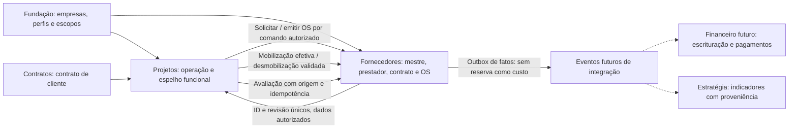

# Auditoria 05A — Arq Fornecedores

**Data:** 06/11/2026. **Natureza:** auditoria estática e planejamento; nenhuma implementação, carga real, execução de legado, chamada Clicksign/SMTP/IA ou alteração do aplicativo original.

**Parecer:** **REAPROVEITAMENTO RECOMENDADO COM ADAPTAÇÃO OBRIGATÓRIA DE SEGURANÇA, GOVERNANÇA E INTEGRAÇÃO.** A origem existe e possui fluxos maduros que devem ser preservados; não está demonstrada prontidão para transposição direta à Gestão Integrada. Desenvolvimento 05B depende de nova autorização do CEO. A auditoria não aprova deploy nem migração de dados.

## 1. Fonte, acesso e limites de evidência

Fonte acessível por leitura GitHub: [jandersontameirao-svg/arqueo-fornecedores](https://github.com/jandersontameirao-svg/arqueo-fornecedores), branch `main`, commit imutável **8b5c94098333922e9dcc00ca5c67b612da24a26a**. Árvore recursiva consultada sem truncamento, com **327 arquivos**: 26 páginas React, 85 componentes React (incluindo UI), schema com **40 declarações mysqlTable**, 25 arquivos de teste no servidor. O inventário de APIs abaixo registra **196 procedimentos tRPC declarados**: 179 no router principal, 11 em orgRouter, quatro em atenaRouter e dois em systemRouter; declaração não comprova operação em produção.

Cobertura consultada: árvore completa; package.json; App.tsx; drizzle/schema.ts; os quatro SQLs versionados e journal; scripts/migrate-vrm-modules.sql e migration-indexes-constraints.sql (somente definição de estrutura, sem execução); server/routers.ts e db.ts; context, trpc, tenant-guard, sdk, internalAuth, orgContext/orgRouter; publicApi, Clicksign/webhook, storage; assessments/offboarding/supplierRisks/riskScore; reports/export/notifications/mailer; ContractViewer; CI/vitest e testes de isolamento/Clicksign. Foram inspecionadas definições, relações, rotas, guardas e caminhos de persistência. Não foi realizada inspeção visual do produto nem execução integral de cada tela.

**Exclusões de dados:** a árvore contém um dump SQL em scripts e artefatos `.manus/db/`. Seus conteúdos **não foram abertos, copiados ou migrados**; presença não comprova validade de backup nem autoriza seu uso. Scripts de seed, limpeza, deploy, senha e backfill não foram executados. Não foram lidos segredos, conectadas bases ou testados serviços externos. O relatório não contém registros de fornecedores, dados bancários, documentos pessoais, tokens ou credenciais reais.

O destino de referência é a fundação PR #1 no SHA `b60ab6adf058b4cc5cce2dcadce2bb7efc6c6da3`. A PR #3 de Estratégia no SHA `467a9f7d56fddf286600983912bab3e333c0a770` é referência arquitetural, ainda aberta em rascunho e não integrada. Esta frente deve partir da branch da fundação em **audit/05a-fornecedores**, PR de documentação com diff apenas deste relatório. Não incorporar silenciosamente nem alterar a PR #3. Plano Mestre V03 não foi disponibilizado nesta frente; seus requisitos não podem ser certificados.

### Fatos versus propostas

- **CÓDIGO:** funcionalidade/estrutura identificada na fonte fixada e citada.
- **LACUNA:** requisito pedido não comprovado no código analisado.
- **PROPOSTA:** desenho para futura implementação autorizada; não executado.
- **REGRA APROVADA:** instrução expressa do CEO neste comando; não volta à aprovação como se estivesse indefinida.

## 2. Arquitetura e inventário funcional

A origem usa React 19, TypeScript 5.9, Vite 7, Wouter, TanStack Query, tRPC 11, Express 4, Drizzle/MySQL, Zod, Tailwind/Radix, Recharts, PDFKit/ExcelJS, parser PDF/DOCX e AWS SDK para R2. Há login interno bcrypt/JWT além de OAuth condicional da Manus. Há assistente/extração/geração com IA e plugin de runtime Manus. A compatibilidade React/TypeScript/MySQL favorece port substancial de UI/regras; não obriga manter SDK de autenticação ou infraestrutura externa. Evidência: [package.json](https://github.com/jandersontameirao-svg/arqueo-fornecedores/blob/8b5c94098333922e9dcc00ca5c67b612da24a26a/package.json), [server/_core/index.ts:1](https://github.com/jandersontameirao-svg/arqueo-fornecedores/blob/8b5c94098333922e9dcc00ca5c67b612da24a26a/server/_core/index.ts#L1), [client/src/App.tsx:1](https://github.com/jandersontameirao-svg/arqueo-fornecedores/blob/8b5c94098333922e9dcc00ca5c67b612da24a26a/client/src/App.tsx#L1).

| Capacidade existente | Evidência de código | Estado e atenção |
|---|---|---|
| Base geral de fornecedores, cadastro/edição/busca/filtros/importação | schema suppliers, suppliers.*, baseGeral.*, SupplierForm/Suppliers/SupplierDetail | CNPJ único no schema; contatos, endereço, banco/PIX e representantes. Cadastro mestre único pode ser reutilizado com correspondência e proteção de campos |
| Empresas prestadoras e profissionais PJ/MEI | supplierSchema, cnpj e dados do fornecedor | Estrutura genérica por documento; **tipologia PJ/MEI e validação jurídica completa não comprovadas**. Comentário schema fala CPF/CNPJ, mas criação/onboarding exige CNPJ de tamanho 14, importBatch aceita min 11. Não afirmar suporte completo a pessoa física |
| Vínculo fornecedor–empresa/unidade | supplier_company_links, SupplierLinks/SupplierLink, supplierCompanyLinks.* | Canônico na origem; inclui criticidade/categoria/homologação/responsável. supplier_links por strings é legado sem router ativo |
| Homologação/aprovações | approval_workflows/steps, Approvals, workflows.* | Duas etapas padrão no cadastro; aprovação/rejeição e histórico de autoria. Rever consistência step/workflow e transação |
| Documentos e conformidade | documents.*, SupplierDocuments, DocumentUpload, compliance.*, alerts | Tipos, validade, vencimentos, upload e downloads assinados; classificações por fornecedor/empresa precisam ser preservadas |
| Contatos e interações | SupplierContacts/Interactions/History, suppliers.*Contact, interactions.* | Cadastro de contato, registro de email/telefone/reunião/visita/nota, anexos e histórico |
| Avaliações de desempenho | SupplierEvaluations/Evaluations, evaluations.*, performance_evaluations | Cinco notas 0–100, média e período, pontos fortes/melhoria/comentários; preservar metodologia, corrigir atualização parcial |
| Risco de fornecedor | RiskScorePanel/SupplierRisksPanel, risk.*, risks.* | Score 0–1000, fatores e histórico; registro de riscos/issues com tratamento. Score alto representa maior risco, não melhor avaliação |
| Assessments | assessmentTemplates.*, assessments.*, AssessmentPortal | Questionários tipados/pesados, portal tokenizado e revisão; expiração/revogação e validação de respostas devem ser reforçadas |
| Offboarding | SupplierOffboardingPanel, offboarding.*, checklist | Checklist de encerramento, data/autoria dos itens; **não comprova encerramento de custo por data de desmobilização** |
| Contratos de prestadores | SupplierContracts/ContractEditor/Viewer/CreationModal, contracts.* | Manual/template/duplicação/IA; status, itens, partes, moeda, datas, versões e PDF |
| Aditivos e marcos de prestadores | ContractAmendments, amendments.*, milestones.* | Valores/prazo/escopo, marcos previstos e campos pago/pagoEm. Destino não deve manter um livro paralelo |
| Templates e extração | ContractTemplates/GenerateContract, templates.*, extraction_runs/fields | Placeholders/campos tipados, DOCX/PDF e revisão de dados extraídos; usar modo manual sem ativar IA |
| Assinatura Clicksign | clicksign.ts, webhook, contracts.sendToClicksign/sync/cancel/resend | Envelopes, signatários, tentativas/erros/status/eventos e versão pré-envio. Existência de código não comprova credenciais/configuração ou assinatura válida |
| Painéis/relatórios/exportação | Home/Painel/Reports, dashboard/reports/export | Estatísticas, criticidade/categorias, documentos/avaliações/auditoria e PDF/Excel |
| Usuários, grupos e permissões | Users, users.*, org.*, orgContext, tenant-guard | Dois modelos de papéis e múltiplas chaves de empresa/unidade convivem; não copiar como política definitiva |
| IA/assistente e notificações | AtenaAssistant, atenaRouter, llm, notifications/mailer | Dependências identificadas; **NÃO ATIVAR** no destino nesta fase |

Páginas identificadas na árvore: `AccessDenied.tsx`, `AddSupplierAI.tsx`, `Approvals.tsx`, `AssessmentPortal.tsx`, `Audit.tsx`, `Categories.tsx`, `Compliance.tsx`, `ContractTemplates.tsx`, `Documents.tsx`, `Evaluations.tsx`, `GenerateContract.tsx`, `Home.tsx`, `Interactions.tsx`, `InternalLogin.tsx`, `NotFound.tsx`, `Onboarding.tsx`, `Painel.tsx`, `Reports.tsx`, `SelectBusinessUnit.tsx`, `SelectCompany.tsx`, `SupplierDetail.tsx`, `SupplierForm.tsx`, `SupplierLink.tsx`, `Suppliers.tsx`, `UnitSuppliers.tsx`, `Users.tsx`. Presença de página não constitui prova de paridade de cada interação. Componentes de domínio incluem contratos, aditivos, importação documental, signatários, avaliações, contatos, documentos, workflow, histórico, vínculos, risco e offboarding. Formulários, tabelas e UX maduros devem ser caracterizados e portados, sem substituí-los por cards demonstrativos.

## 3. Banco, governança e migrações

A origem mistura IDs numéricos, `companyId` string legado, `orgCompanyId`, `groupId` apontando business_units, `organizationalGroupId` e `orgBusinessUnitId`. Empresas têm apenas businessUnitId atual, sem intervalos históricos. Contrato aceita `single/all_group` e contractCompanySlug, além do escopo organizacional. Isso não pode equivaler automaticamente ao acesso corporativo autorizado da fundação.

No destino, reutilizar `companies`, `organization_scopes`, `company_unit_history`, `company_module_entitlements`, perfis e concessões existentes. Criar tabela de correspondência `source_system/source_entity/source_id → destination_id` com proveniência; nunca inferir empresa por slug, nome ou ID negativo especial. Holding é única; África/UTU e Vinho não passam a participar do operacional por existirem na origem.

**Deriva demonstrada do schema:** o journal lista 0000_sharp_swarm, 0001_powerful_freak e 0002_noisy_bastion. O primeiro cria 34 tabelas, enquanto schema.ts declara 40. As seis adicionais são supplier_risk_scores, supplier_risks, assessment_templates, supplier_assessments, offboarding_checklists e atena_chats, definidas também em SQL manual separado. Existe ainda 0001_yellow_hairball.sql fora do journal. O script manual de índices propõe unicidade fornecedor/empresa que não consta como índice composto no schema.ts consultado. Portanto **não está demonstrado que db:migrate sozinho reproduza o banco da aplicação**. Não aplicar SQL legado diretamente ao destino; derivar migrações novas sequenciais, checksum, reversão testada e adoção explícita, preservando arquivos da fundação e sem inventar histórico.

Exigir reconciliação offline de schema declarado versus DDL versionado antes de port de banco. Os scripts manuais não provam execução nem estado do banco real. Não há comprovação nesta auditoria de backup completo, restauração testada ou rollback reversível de todas as mudanças da origem. Evidências: [drizzle/meta/_journal.json](https://github.com/jandersontameirao-svg/arqueo-fornecedores/blob/8b5c94098333922e9dcc00ca5c67b612da24a26a/drizzle/meta/_journal.json), [drizzle/0000_sharp_swarm.sql](https://github.com/jandersontameirao-svg/arqueo-fornecedores/blob/8b5c94098333922e9dcc00ca5c67b612da24a26a/drizzle/0000_sharp_swarm.sql), [scripts/migrate-vrm-modules.sql](https://github.com/jandersontameirao-svg/arqueo-fornecedores/blob/8b5c94098333922e9dcc00ca5c67b612da24a26a/scripts/migrate-vrm-modules.sql), [scripts/migration-indexes-constraints.sql](https://github.com/jandersontameirao-svg/arqueo-fornecedores/blob/8b5c94098333922e9dcc00ca5c67b612da24a26a/scripts/migration-indexes-constraints.sql).

## 4. Segurança e integridade — riscos demonstrados e tratamento

| ID / severidade | Evidência estática | Implicação e correção exigida no plano |
|---|---|---|
| F05-01 **CRÍTICO** | [server/_core/tenant-guard.ts:64](https://github.com/jandersontameirao-svg/arqueo-fornecedores/blob/8b5c94098333922e9dcc00ca5c67b612da24a26a/server/_core/tenant-guard.ts#L64): fornecedor com organizationalGroupId ausente é devolvido a qualquer autenticado | Fail-open legado pode expor cadastro/PII. Quarentena para registro sem classificação; negar por padrão, revisão controlada de ownership, testes leitura/escrita/export/anexo |
| F05-02 **ALTO** | tenant-guard autoriza supplier/document/contract por grupo; fallback via fornecedor. [server/_core/tenant-guard.ts:103](https://github.com/jandersontameirao-svg/arqueo-fornecedores/blob/8b5c94098333922e9dcc00ca5c67b612da24a26a/server/_core/tenant-guard.ts#L103) | Compartilhar mestre não autoriza todos documentos, contratos, banco/PIX e avaliações de todas empresas. Recurso e campo devem validar empresa/ação; não depender apenas do dropdown |
| F05-03 **CRÍTICO para port direto** | [server/publicApi.ts:40](https://github.com/jandersontameirao-svg/arqueo-fornecedores/blob/8b5c94098333922e9dcc00ca5c67b612da24a26a/server/publicApi.ts#L40) e [server/publicApi.ts:142](https://github.com/jandersontameirao-svg/arqueo-fornecedores/blob/8b5c94098333922e9dcc00ca5c67b612da24a26a/server/publicApi.ts#L142): chave global, consultas sem principal, criação sem grupo, hard delete | Autenticação por chave não é segregação. Substituir por principal de serviço com empresa/módulo/ação e negar API externa agora; não copiar bypass à fundação |
| F05-04 **ALTO** | [server/internalAuth.ts:50](https://github.com/jandersontameirao-svg/arqueo-fornecedores/blob/8b5c94098333922e9dcc00ca5c67b612da24a26a/server/internalAuth.ts#L50) verifica isActive no login, mas [server/_core/sdk.ts:291](https://github.com/jandersontameirao-svg/arqueo-fornecedores/blob/8b5c94098333922e9dcc00ca5c67b612da24a26a/server/_core/sdk.ts#L291) lê usuário em cada request sem rejeitar isActive=false | Desativar conta não demonstra revogação de sessão existente. Revalidar status e grants por request, usar sessão da GI; blocklist em memória se perde em restart |
| F05-05 **ALTO** | [server/db.ts:643](https://github.com/jandersontameirao-svg/arqueo-fornecedores/blob/8b5c94098333922e9dcc00ca5c67b612da24a26a/server/db.ts#L643) e suppliers.delete removem fornecedor, documentos, contratos, versões/eventos e avaliações; auditoria posterior | Risco de perda de governança/evidência. Arquivamento/desativação por padrão; exclusão excepcional com retenção/aprovação; operação e auditoria transacionais |
| F05-06 **ALTO** | [server/routers.ts:1787](https://github.com/jandersontameirao-svg/arqueo-fornecedores/blob/8b5c94098333922e9dcc00ca5c67b612da24a26a/server/routers.ts#L1787) autoriza workflowId e stepId separadamente | Não comprova que etapa pertence ao workflow informado nem sequência/alçada. Resolver workflow a partir da etapa, validar estado e concorrência, decisão+auditoria atomicamente |
| F05-07 **ALTO** | [server/routers.ts:2028](https://github.com/jandersontameirao-svg/arqueo-fornecedores/blob/8b5c94098333922e9dcc00ca5c67b612da24a26a/server/routers.ts#L2028) calcula overallScore apenas com notas presentes no patch | Editar uma dimensão pode gerar média errada das cinco notas preservadas. Mesclar registro vigente, recalcular todas dimensões válidas, versionar fórmula e provar regressão antes de alimentar histórico por Projetos |
| F05-08 **ALTO** | schema supplier_company_links sem índice composto; create faz check prévio + insert [server/db.ts:2311](https://github.com/jandersontameirao-svg/arqueo-fornecedores/blob/8b5c94098333922e9dcc00ca5c67b612da24a26a/server/db.ts#L2311) | Duas requisições podem duplicar vínculo se constraint manual não existir. Índice canônico e transação/idempotência, com reativação de vínculo desativado e vigência |
| F05-09 **ALTO** | [server/orgContext.ts:1](https://github.com/jandersontameirao-svg/arqueo-fornecedores/blob/8b5c94098333922e9dcc00ca5c67b612da24a26a/server/orgContext.ts#L1), papéis globais + allowlist por email e funções de admin legadas | Não mapear admin → diretor com poderes irrestritos. Migração de direitos explícita, grants/deny da fundação e nenhuma autorização fixa por nome/email de pessoa |
| F05-10 **ALTO** | [server/clicksignWebhook.ts:27](https://github.com/jandersontameirao-svg/arqueo-fornecedores/blob/8b5c94098333922e9dcc00ca5c67b612da24a26a/server/clicksignWebhook.ts#L27) usa JSON.stringify(req.body), escreve evento/status em passos separados; [server/clicksign.ts:790](https://github.com/jandersontameirao-svg/arqueo-fornecedores/blob/8b5c94098333922e9dcc00ca5c67b612da24a26a/server/clicksign.ts#L790) falha fechado em produção sem secret, permite dev | Não há chave única de evento ou política de replay/ordenação comprovada; validação sobre bytes deve seguir contrato oficial. Criar inbox idempotente, raw body, assinatura, tenant derivado do envelope, transições monotônicas e trilha antes de futura ativação |
| F05-11 **MÉDIO/ALTO** | [server/assessments.ts:80](https://github.com/jandersontameirao-svg/arqueo-fornecedores/blob/8b5c94098333922e9dcc00ca5c67b612da24a26a/server/assessments.ts#L80) token aleatório, sem campo de expiração/revogação; gravação read-then-update | Reforçar expiração, hash do token, one-time/compare-and-swap e validação por pergunta. Respostas arbitrárias não podem reduzir risco indevidamente |
| F05-12 **ALTO** | [server/publicApi.ts:95](https://github.com/jandersontameirao-svg/arqueo-fornecedores/blob/8b5c94098333922e9dcc00ca5c67b612da24a26a/server/publicApi.ts#L95) auditoria best-effort; múltiplos fluxos fazem gravação seguida de log independente | Escrita pode existir sem evento de auditoria ou sem workflow. Exigir alteração + outbox/auditoria atômicas; jobs/canais negados sem concessão |
| F05-13 **MÉDIO/ALTO** | [server/routers.ts:3223](https://github.com/jandersontameirao-svg/arqueo-fornecedores/blob/8b5c94098333922e9dcc00ca5c67b612da24a26a/server/routers.ts#L3223) PDF protegido apenas por leitura, usa Python3.11/WeasyPrint fixo; export aceita campos informados | Separar export de read; whitelist de campos/PII, sandbox de renderização, saída sintética e teste. Não pressupor disponibilidade do binário no destino |
| F05-14 **ALTO operacional** | [server/_core/index.ts:43](https://github.com/jandersontameirao-svg/arqueo-fornecedores/blob/8b5c94098333922e9dcc00ca5c67b612da24a26a/server/_core/index.ts#L43) pode registrar OAuth e serviços legados; IA e mailer são chamados em fluxos de domínio | Nenhum serviço externo deve disparar ao portar telas/testes. Providers disabled-by-default, mocks e bloqueio de egress para testes; sessão da GI independente |
| F05-15 **ALTO de governança** | Dump e artefatos de consulta presentes na árvore, conteúdos não inspecionados | Não copiar para destino. Triagem autorizada de exposição/retensão em tarefa separada; não concluir existência de segredo ativo ou dados específicos sem inspeção autorizada |

Pontos positivos comprovados: Zod, bcrypt, JWT HS256, validação de roles por backend, guards de entidade, key comparison em tempo constante, webhook fechado em produção sem secret, signed URLs R2 com prazo, rate limit de login/onboarding/extração e testes de isolamento existem. Esses mecanismos devem orientar adaptação, não mascaram os caminhos permissivos acima.

## 5. Matriz REAPROVEITAR / ADAPTAR / RECONSTRUIR / NÃO MIGRAR

Classificação é da decisão técnica para o destino, não autorização de execução.

| Família / origem | Classificação | Condição de paridade / destino |
|---|---|---|
| Radix/UI, tabelas, filtros, formulários e estilos Grupo Arqueo | **REAPROVEITAR** | Testes e screenshots sintéticos antes/depois; integração visual na navegação superior da GI |
| Cadastro mestre/contatos/categorias/validação de endereço | **ADAPTAR** | Manter capacidades, IDs corporativos e campos protegidos; documentar PJ/MEI/CPF/CNPJ e validação |
| SupplierDetail e abas maduras | **REAPROVEITAR** | Mesmos fluxos funcionais sob backend da GI; sem substituir por demonstração |
| supplier_company_links / homologação por empresa | **ADAPTAR** | Referências canônicas, unicidade, vigência e níveis de visibilidade; sem copiar businessUnitId atual como histórico |
| supplier_links e companyId strings legados | **NÃO MIGRAR** como estrutura ativa | Somente proveniência/correspondência/histórico autorizado; não apagar dados originais |
| Formulários/workflows de homologação | **ADAPTAR** | Preservar etapas/UX; corrigir pertencimento, alçadas, concorrência e auditoria |
| Documentos/contratos/versions/signers/aditivos/templates | **ADAPTAR** | Fonte canônica Fornecedores para prestadores, owner empresa explícito e export/anexo por ação |
| Avaliações, histórico, score e riscos | **ADAPTAR** | Preservar fatores/metodologia; corrigir média parcial, origem Projeto/OS e dedupe antes de consolidar |
| Relatórios PDF/Excel e geração contratual | **ADAPTAR** | Reusar layout/regra; substituir dependências rígidas, limitar campos e testar export por escopo |
| Login/sessões/OAuth Manus/allowlists pessoais e REST chave global | **RECONSTRUIR** integração com fundação | Reusar autenticação independente já validada; não importar bypass, tokens ou privilégio fixo |
| Storage privado e download assinado | **ADAPTAR** | Interface independente com capability anexos/download/export; nenhum bucket/credencial existente conectado |
| Adapter Clicksign | **ADAPTAR**, desligado | Preservar contrato/status/evidência; inbox/outbox/idempotência/replay; ativação futura exige autorização separada |
| Portal tokenizado de assessment/onboarding | **ADAPTAR** | Token com validade/escopo, rate limit, submissão atômica e política LGPD |
| Offboarding checklist | **ADAPTAR** | Preservar checklist; separar de desmobilização por OS e data efetiva |
| Espelhamento funcional em Projetos + contratação/OS + reservas/mobilizações | **RECONSTRUIR apenas a camada faltante** | Reusar telas/serviços Fornecedores; nenhum novo mestre paralelo. Não há OS/mobilização efetiva comprovada na origem |
| Eventos futuros de compromisso/custo/financeiro | **RECONSTRUIR contrato de integração** | Não implementar Financeiro; outbox/ids/timestamps/competência/moeda e ajustes |
| SDK/provider IA/ATENA/Manus, histórico privado de chat, chamadas externas | **NÃO MIGRAR** como dependência ativa | Interfaces futuras independentes e desligadas; preservar apenas origem autorizada de campos quando necessário |
| Dump, .manus/db, tokens/sessões, segredos, seeds reais e scripts deploy/limpeza | **NÃO MIGRAR** | Somente procedimento separado e autorizado de dados mínimos em ambiente isolado |

O ZIP de Projetos continua indisponível em 04A. A lacuna de OS/mobilização acima refere-se somente à fonte Fornecedores analisada: não demonstra ausência no aplicativo Projetos. Caracterizar a fonte correta antes de escolher reconstrução de qualquer fluxo operacional maduro; espelhamento e implantação em Projetos dependem da conclusão de 04A e nova autorização 04B.

## 6. Integração canônica entre 03A / 04A / 05A

As regras desta seção já foram aprovadas no comando mestre. O desenho de APIs/eventos é **PROPOSTA**, não implementação.

| Informação / ação | Autoridade canônica | Uso integrado sem duplicação |
|---|---|---|
| Empresa, unidade ativa por vigência, usuários/perfis/grants | Fundação comum | Três módulos referenciam os mesmos IDs e habilitações; não recriar users/companies/business_units |
| Contrato de cliente, aditivo, obrigação e receita esperada | **Contratos** | Projeto operacional referencia o contrato cliente; assinatura pode ser posterior à abertura autorizada de projeto |
| Cadastro mestre fornecedor/PJ/MEI e homologação por empresa | **Fornecedores** | Projeto usa consulta/componente/serviço compartilhado; sem cópia local de fornecedor |
| Contrato de prestador e OS de fornecimento | **Fornecedores** | Projetos inicia contratação e emite OS por comando ao módulo canônico; response retorna ID/revisão únicos |
| Contratação operacional e OS por Ana | **Fornecedores, via UX integrada em Projetos** | Concessões por pessoa/empresa/módulo/ação e delegação; nunca autorização fixa pelo nome “Ana” |
| Reserva provisória e solicitação de recurso | Projetos para estado operacional, Fornecedores para vínculo/OS | **Reserva não gera custo nem compromisso financeiro**; não confundir com mobilização |
| Mobilização/desmobilização efetiva | Projetos registra e valida fato operacional; Fornecedores mantém OS/condições | Compromisso/custo nasce conforme mobilização efetiva e condições homologadas da OS; sem inferir que reserva/assinatura isolada inicia tudo |
| Retroatividade | Projetos valida evento/data/evidência; Fornecedores aplica efeito na OS | Desmobilização retroativa interrompe custo na data efetiva; recorded_at registra quando foi validada; ajuste compensatório, nunca apagar evento |
| Avaliação por entrega/OS/projeto | **Fornecedores** conserva avaliação/histórico | Projetos envia avaliação com origem e chave idempotente; painel do fornecedor lê o mesmo registro autorizado |
| Planejamento/indicadores | Estratégia PR #3 | Consome indicadores autorizados/proveniência futura; não assume autoridade sobre contrato/OS/custo operacional |
| Compromisso, realizado e pagamento | Sem novo livro agora; Financeiro futuro será autoridade de escrituração/pagamento | Definir eventos e projeções gerenciais, não marcar “pago” por aprovação operacional nem criar contas a pagar duplicadas |

### Contratos de interface propostos

Usar nomes de comandos/eventos como especificação, não endpoints já existentes:
`Supplier.Lookup/LinkToCompany`, `SupplierEngagement.Request/Approve`, `SupplierOrder.Issue/Amend/Cancel`, `Mobilization.Confirm`, `Demobilization.Validate`, `SupplierEvaluation.Record/Correct`. O espelho funcional em Projetos reutiliza componentes e os mesmos serviços autorizados. O backend valida principal, empresa, ownership do fornecedor/vínculo/contrato, empresa do projeto, estado e referências; nenhum ID estrangeiro recebido é confiável por si só.

Envelope mínimo: `event_id`, `event_type`, `schema_version`, `source`, `entity_id`, `entity_revision`, `company_id`, `unit_at_effective_date`, `effective_at`, `recorded_at`, `currency`, `quantity`, `rate`, `evidence_id`, `authorized_actor`, `correlation_id`, `idempotency_key`. Valores monetários em decimal, timezone/unidade de medição definidos, tenant derivado do recurso validado. Outbox transacional + inbox do consumidor e unique de idempotência; replay não duplica contrato, OS, custo ou avaliação.

Sequência exemplificativa: reserva → solicitação → homologação/contratação autorizada → OS emitida → mobilização efetiva → contribuição de compromisso/custo conforme OS → validação de entrega/desmobilização → ajuste efetivo → avaliação. Exceções e ordem legal exigem regras explícitas; abertura autorizada de projeto **não depende de assinatura formal do contrato cliente** e não dispensa autorização de despesa/OS. Reserva/solicitação não devem gerar custo. Aprovação, assinatura, aceite, compromisso, realizado e pago são estados distintos.

UTU e Vinho 24 Horas não podem abrir Fornecedores/Contratos/Projetos/Financeiro, mesmo com grant pessoal ou acesso corporativo, enquanto a habilitação continuar exclusivamente estratégica. Fornecedor compartilhado no Grupo não torna todos contratos, notas, documentos, dados bancários e avaliações automaticamente visíveis a qualquer empresa.

## 7. Etapas futuras, testes e critérios de aceite

| Etapa futura | Trabalho proposto | Teste / aceite indispensável |
|---|---|---|
| 05B.0 Caracterização/portabilidade | Fixar fonte, catalogar UX/testes sintéticos, corresponder IDs/empresa, reconciliar DDL/journal | Build sem providers externos; comparação de telas/fluxos maduros; inventário de todas tabelas reproduzido por migrações reversíveis |
| 05B.1 Segurança/mestre | Sessão GI, guard central, quarantine sem scope, PII por campo e vínculo canônico temporal | DIRETORES/GERENTES/OPERADORES com grant/deny; sessão desativada negada; leitura/editar/busca/export/anexo/job por empresa; UTU/Vinho sempre negadas |
| 05B.2 Cadastro/homologação | Portar formulários, contatos, documentos, workflow e índices | Salvar/recarregar/editar; concorrência duplicate CPF/CNPJ/vínculo; stepId de outro workflow rejeitado; auditoria atômica; rollback sem perda indevida |
| 05B.3 Prestadores/templates | Portar contratos/aditivos/itens/versões/assinantes e PDF/Excel com providers off | Contrato prestador distinto de cliente, referência não duplicada; revisão preservada; export negado a leitor sem export; arquivo fora do escopo negado |
| 05B.4 Espelho operacional | Projetos reutiliza serviços/componentes; OS/mobilização/desmobilização | Duplo clique/retry não cria novo cadastro/OS; reserva custa zero; projeto pré-assinatura só com autorização; Ana só com concessão aplicável |
| 05B.5 Competência e eventos | Condições OS, fatos temporais, retroatividade, projeções sem Financeiro | Compromisso e realizado separados; desmobilização retroativa validada interrompe custo na data efetiva, ajusta por evento; transferência não muda unidade histórica; moedas não misturadas |
| 05B.6 Avaliações/risco | Portar avaliações/histórico/risco/assessment/offboarding | Notas 0–100; patch mesclado antes da média; Projetos envia mesma avaliação uma vez; correção preserva história e versão de fórmula; token expirado/replay negado |
| 05B.7 Homologação | E2E integrado sintético e operação assistida interna | Persistência, recarga, edição, versão, export/autorização e histórico; comparação funcional por capacidade; CI isolada, nenhum tráfego externo |

Antes de cada etapa: comando autorizado do CEO, branch/PR própria, nenhum merge/deploy automático. Testes sintéticos devem cobrir múltiplas empresas/unidades, três perfis, negações explícitas, holding autorizada, concorrência e falhas entre escrita/log/outbox. Armazenamento/signatura/SMTP/IA devem usar doubles locais, sem credenciais reais ou chamadas de produção.

## 8. Testes/CI observados e requisitos não comprovados

No SHA da origem foi observado check GitHub **check = success**:
[run 38619220531](https://github.com/jandersontameirao-svg/arqueo-fornecedores/actions/runs/38619220531), [job 116042078451](https://github.com/jandersontameirao-svg/arqueo-fornecedores/actions/runs/38619220531/job/116042078451). O workflow declara pnpm frozen-lockfile, Node 20, typecheck e vitest; não declara build completo, MySQL isolado, auditoria de dependências, E2E, rollback ou desativação explícita de egress. Não se infere que cada integração externa foi exercitada ou homologada porque o check está verde.

Há 25 arquivos de teste na árvore, listados no apêndice. Alguns usam mocks/simulações; scope-isolation.test.ts simula filtros locais. clicksign.test.ts condiciona integração à presença de credencial e aceita HTTP 401/403 como conectividade; isso não comprova assinatura funcional. Não executar a suíte original sem isolamento, pois há testes capazes de usar rede/credenciais. Nenhum teste do legado foi executado nesta auditoria. Testes da fundação/PR #3 não homologam o módulo Fornecedores.

Não comprovados: esquema efetivo de produção; dados disponíveis/necessários; cobertura jurídica PJ/MEI/CPF; OS e reservas/mobilizações/custo por atividade; desmobilização retroativa; correspondência de contratos entre aplicativos; backup/restore; disponibilidade R2/WeasyPrint/Clicksign; licenciamento completo de dependências/assets; alçadas/SLAs; performance/responsividade/acessibilidade de todos fluxos. Nada disso foi presumido a partir de README, comentário ou quantidade de arquivos.

## 9. Decisões que ainda exigem CEO

Não reabrir as regras já aprovadas: mestre único Fornecedores, espelho em Projetos, autoridade sobre contratos de prestadores, Ana com gestão operacional, reserva sem custo, efeito da mobilização/OS e desmobilização retroativa validada, histórico de avaliações, unidade única temporal, UTU/Vinho exclusivamente estratégicas e ausência de integrações externas.

Decidir/homologar antes da execução correspondente:
1. Alçadas por valor/risco, separação solicitante/aprovador/emissor OS e substituição/delegação de Ana por concessões, sem hardcode.
2. Exceções para urgência, fornecedor pendente/suspenso, OS antes de contrato de prestador e projeto pré-assinatura: quais evidências/aprovadores, sem revogar a regra de abertura autorizada pré-assinatura de cliente.
3. Semântica contratual de compromisso/custo: diárias, jornada, mínimos, cancelamento, períodos, moeda e arredondamento; reserva continuará sem custo.
4. Janela, evidência, aprovador operacional e tratamento de competência já fechada para retroatividade; correções por eventos compensatórios, nunca apagar história.
5. Visibilidade por campo (banco/PIX/PII/documentos compartilhados), retenção/LGPD, arquivamento e exclusão excepcional.
6. Modelo jurídico/cadastral PJ/MEI/CPF/CNPJ, unicidade e validações; não presumir que formulário atual atende todos.
7. Critérios/pesos de avaliação e score, tratamento de dados ausentes e aprovação da correção de média; correção de resultado sabidamente incorreto é requisito técnico antes de uso.
8. Homologação de templates/relatórios e futura adoção/provedor de storage/Clicksign em comando específico; nenhuma conexão autorizada agora.
9. Plano de carga mínima caso necessário, com classificação de dados e staging isolado; não autoriza importar dump ou buscar produção.
10. Autorização expressa para iniciar 05B e dependências de 03B/04B, sem inferir merge da fundação ou Estratégia.

## 10. Comando futuro preparado — NÃO EXECUTADO

> **CODEX — COMANDO 05B (proposta, aguarda autorização do CEO).**
> Implementar o módulo integrado Arq Fornecedores no repositório Gestão Integrada, em branch própria baseada na fundação aprovada, usando como fonte o SHA 8b5c94098333922e9dcc00ca5c67b612da24a26a e este relatório. Reaproveitar substancialmente UI e funcionalidades maduras; começar por segurança/escopos e migrações reproduzíveis, corrigindo F05-01 a F05-14 no desenho antes de portar caminhos afetados. Reutilizar mestres da GI e contrato canônico de prestadores em Fornecedores, com espelho funcional em Projetos. Implementar por incrementos verticais aprovados cadastro/homologação/documentos, contratos/templates, contratação/OS, fatos temporais e avaliações. Não ativar Clicksign/SMTP/IA/Manus/ATENA nem implementar Financeiro; providers locais desligados e eventos futuros apenas. Validar persistência, recarga, edição, versão, export/anexo e autorização por empresa/ação com dados sintéticos; rollback/reaplicação, concorrência e Playwright. Não migrar dados reais, apagar capacidades, alterar originais, fazer merge ou deploy. Atualizar matriz/PR e aguardar revisão em cada entrega.

Este texto não inicia desenvolvimento, provisionamento, migração de dados, merge ou deploy.

## Apêndice A — todas as 40 tabelas declaradas

Catálogo do schema fixado; não é afirmação sobre tabelas/dados existentes no banco real.

| Fonte | Tabela | Função / destino planejado |
|---|---|---|
| [drizzle/schema.ts:5](https://github.com/jandersontameirao-svg/arqueo-fornecedores/blob/8b5c94098333922e9dcc00ca5c67b612da24a26a/drizzle/schema.ts#L5) | `organizational_groups` | Grupos econômicos legados; mapear proveniência para Holding/unidades aprovadas, sem criar novas Holdings por inferência. |
| [drizzle/schema.ts:22](https://github.com/jandersontameirao-svg/arqueo-fornecedores/blob/8b5c94098333922e9dcc00ca5c67b612da24a26a/drizzle/schema.ts#L22) | `users` | Identidade, passwordHash, openId e papéis legados; reaproveitar dados autorizados via correspondência, não autenticação/sessões. |
| [drizzle/schema.ts:42](https://github.com/jandersontameirao-svg/arqueo-fornecedores/blob/8b5c94098333922e9dcc00ca5c67b612da24a26a/drizzle/schema.ts#L42) | `supplier_categories` | Categorias de fornecimento; preservar nomes/regras após homologação do catálogo. |
| [drizzle/schema.ts:57](https://github.com/jandersontameirao-svg/arqueo-fornecedores/blob/8b5c94098333922e9dcc00ca5c67b612da24a26a/drizzle/schema.ts#L57) | `suppliers` | Mestre por cnpj único, contatos, endereço, banco/PIX, representantes e classificação legada. |
| [drizzle/schema.ts:118](https://github.com/jandersontameirao-svg/arqueo-fornecedores/blob/8b5c94098333922e9dcc00ca5c67b612da24a26a/drizzle/schema.ts#L118) | `supplier_company_links` | Vínculo canônico fornecedor–empresa com homologação, criticidade, responsável e escopo; businessUnitId atual sem vigência. |
| [drizzle/schema.ts:149](https://github.com/jandersontameirao-svg/arqueo-fornecedores/blob/8b5c94098333922e9dcc00ca5c67b612da24a26a/drizzle/schema.ts#L149) | `supplier_contacts` | Contatos do fornecedor; dados pessoais exigem escopo por campo. |
| [drizzle/schema.ts:165](https://github.com/jandersontameirao-svg/arqueo-fornecedores/blob/8b5c94098333922e9dcc00ca5c67b612da24a26a/drizzle/schema.ts#L165) | `documents` | Metadados/arquivo, validade, fornecedor e escopo; preservar histórico, não URLs expiradas. |
| [drizzle/schema.ts:197](https://github.com/jandersontameirao-svg/arqueo-fornecedores/blob/8b5c94098333922e9dcc00ca5c67b612da24a26a/drizzle/schema.ts#L197) | `approval_workflows` | Workflow de homologação por fornecedor, etapa atual/total/status. |
| [drizzle/schema.ts:215](https://github.com/jandersontameirao-svg/arqueo-fornecedores/blob/8b5c94098333922e9dcc00ca5c67b612da24a26a/drizzle/schema.ts#L215) | `approval_steps` | Etapas, aprovador e comentários; validar pertencimento ao workflow. |
| [drizzle/schema.ts:233](https://github.com/jandersontameirao-svg/arqueo-fornecedores/blob/8b5c94098333922e9dcc00ca5c67b612da24a26a/drizzle/schema.ts#L233) | `audit_logs` | Eventos de create/update/delete/approve/reject/upload/download; adaptar autoria imutável. |
| [drizzle/schema.ts:258](https://github.com/jandersontameirao-svg/arqueo-fornecedores/blob/8b5c94098333922e9dcc00ca5c67b612da24a26a/drizzle/schema.ts#L258) | `interactions` | Interações e anexos com fornecedor; escopo e autoria. |
| [drizzle/schema.ts:284](https://github.com/jandersontameirao-svg/arqueo-fornecedores/blob/8b5c94098333922e9dcc00ca5c67b612da24a26a/drizzle/schema.ts#L284) | `performance_evaluations` | Qualidade, entrega, preço, comunicação, compliance, nota geral e período; ligar origem Projeto/OS. |
| [drizzle/schema.ts:313](https://github.com/jandersontameirao-svg/arqueo-fornecedores/blob/8b5c94098333922e9dcc00ca5c67b612da24a26a/drizzle/schema.ts#L313) | `compliance_alerts` | Alertas de vencimento, falta documental, compliance e revisão. |
| [drizzle/schema.ts:333](https://github.com/jandersontameirao-svg/arqueo-fornecedores/blob/8b5c94098333922e9dcc00ca5c67b612da24a26a/drizzle/schema.ts#L333) | `contracts` | Contratos de prestadores, moeda/valor/condições, conteúdo, anexos, assinatura e escopos paralelos. |
| [drizzle/schema.ts:400](https://github.com/jandersontameirao-svg/arqueo-fornecedores/blob/8b5c94098333922e9dcc00ca5c67b612da24a26a/drizzle/schema.ts#L400) | `contract_items` | Itens, quantidades e preços do contrato de prestador; não livro financeiro. |
| [drizzle/schema.ts:416](https://github.com/jandersontameirao-svg/arqueo-fornecedores/blob/8b5c94098333922e9dcc00ca5c67b612da24a26a/drizzle/schema.ts#L416) | `contract_templates` | Modelos e placeholders contratuais; mapear versão/escopo. |
| [drizzle/schema.ts:439](https://github.com/jandersontameirao-svg/arqueo-fornecedores/blob/8b5c94098333922e9dcc00ca5c67b612da24a26a/drizzle/schema.ts#L439) | `template_fields` | Campos tipados de template; preservar formulários. |
| [drizzle/schema.ts:459](https://github.com/jandersontameirao-svg/arqueo-fornecedores/blob/8b5c94098333922e9dcc00ca5c67b612da24a26a/drizzle/schema.ts#L459) | `extraction_runs` | Histórico/proveniência de extração documental; provider desligado. |
| [drizzle/schema.ts:493](https://github.com/jandersontameirao-svg/arqueo-fornecedores/blob/8b5c94098333922e9dcc00ca5c67b612da24a26a/drizzle/schema.ts#L493) | `extracted_fields` | Valores extraídos, confiança, revisão e origem manual/IA; preservar proveniência, sem chamar IA. |
| [drizzle/schema.ts:512](https://github.com/jandersontameirao-svg/arqueo-fornecedores/blob/8b5c94098333922e9dcc00ca5c67b612da24a26a/drizzle/schema.ts#L512) | `contract_amendments` | Aditivos financeiros/escopo/prazo/mistos; versionar efeitos e vigência. |
| [drizzle/schema.ts:535](https://github.com/jandersontameirao-svg/arqueo-fornecedores/blob/8b5c94098333922e9dcc00ca5c67b612da24a26a/drizzle/schema.ts#L535) | `financial_milestones` | Marcos planejados/pagos/atrasados; destino guarda obrigações previstas, pagamento vem do Financeiro futuro. |
| [drizzle/schema.ts:557](https://github.com/jandersontameirao-svg/arqueo-fornecedores/blob/8b5c94098333922e9dcc00ca5c67b612da24a26a/drizzle/schema.ts#L557) | `business_units` | Unidades legadas; reutilizar unidade corporativa canônica, não manter cadastro concorrente. |
| [drizzle/schema.ts:576](https://github.com/jandersontameirao-svg/arqueo-fornecedores/blob/8b5c94098333922e9dcc00ca5c67b612da24a26a/drizzle/schema.ts#L576) | `user_business_units` | Vínculos legados de usuários por área; converter para concessões do destino. |
| [drizzle/schema.ts:587](https://github.com/jandersontameirao-svg/arqueo-fornecedores/blob/8b5c94098333922e9dcc00ca5c67b612da24a26a/drizzle/schema.ts#L587) | `companies` | Empresas com businessUnitId atual; reutilizar companies/company_unit_history do destino. |
| [drizzle/schema.ts:611](https://github.com/jandersontameirao-svg/arqueo-fornecedores/blob/8b5c94098333922e9dcc00ca5c67b612da24a26a/drizzle/schema.ts#L611) | `supplier_links` | Vínculo legado por strings/nome de grupo; router removido, mapear histórico sem copiar como mestre ativo. |
| [drizzle/schema.ts:639](https://github.com/jandersontameirao-svg/arqueo-fornecedores/blob/8b5c94098333922e9dcc00ca5c67b612da24a26a/drizzle/schema.ts#L639) | `document_expiration_notifications` | Dedupe de avisos documentais; migrar política por canal, sem enviar notificações agora. |
| [drizzle/schema.ts:654](https://github.com/jandersontameirao-svg/arqueo-fornecedores/blob/8b5c94098333922e9dcc00ca5c67b612da24a26a/drizzle/schema.ts#L654) | `contract_expiration_notifications` | Dedupe de avisos contratuais; prazo efetivo original/aditivo. |
| [drizzle/schema.ts:671](https://github.com/jandersontameirao-svg/arqueo-fornecedores/blob/8b5c94098333922e9dcc00ca5c67b612da24a26a/drizzle/schema.ts#L671) | `contract_versions` | Snapshots e número de versão; preservar aprovação/proveniência. |
| [drizzle/schema.ts:691](https://github.com/jandersontameirao-svg/arqueo-fornecedores/blob/8b5c94098333922e9dcc00ca5c67b612da24a26a/drizzle/schema.ts#L691) | `contract_signers` | Signatários, papel, status e IDs do provedor; sem republicar PII. |
| [drizzle/schema.ts:714](https://github.com/jandersontameirao-svg/arqueo-fornecedores/blob/8b5c94098333922e9dcc00ca5c67b612da24a26a/drizzle/schema.ts#L714) | `contract_clicksign_events` | Eventos de envelope/documento/signatário; preservar evidências, deduplicar/replay controlar. |
| [drizzle/schema.ts:739](https://github.com/jandersontameirao-svg/arqueo-fornecedores/blob/8b5c94098333922e9dcc00ca5c67b612da24a26a/drizzle/schema.ts#L739) | `supplier_document_links` | Documentos vinculados ao fornecedor, inclusive dados enviados externamente. |
| [drizzle/schema.ts:765](https://github.com/jandersontameirao-svg/arqueo-fornecedores/blob/8b5c94098333922e9dcc00ca5c67b612da24a26a/drizzle/schema.ts#L765) | `user_group_roles` | Concessões legadas por grupo; reconstituir política da fundação. |
| [drizzle/schema.ts:779](https://github.com/jandersontameirao-svg/arqueo-fornecedores/blob/8b5c94098333922e9dcc00ca5c67b612da24a26a/drizzle/schema.ts#L779) | `user_company_roles` | Concessões por empresa; não copiar admin global automaticamente. |
| [drizzle/schema.ts:794](https://github.com/jandersontameirao-svg/arqueo-fornecedores/blob/8b5c94098333922e9dcc00ca5c67b612da24a26a/drizzle/schema.ts#L794) | `user_business_unit_roles` | Concessões por unidade; adaptar vigência e segregação. |
| [drizzle/schema.ts:811](https://github.com/jandersontameirao-svg/arqueo-fornecedores/blob/8b5c94098333922e9dcc00ca5c67b612da24a26a/drizzle/schema.ts#L811) | `supplier_risk_scores` | Histórico append de score 0–1000 e breakdown; preservar versão de fórmula. |
| [drizzle/schema.ts:828](https://github.com/jandersontameirao-svg/arqueo-fornecedores/blob/8b5c94098333922e9dcc00ca5c67b612da24a26a/drizzle/schema.ts#L828) | `supplier_risks` | Registro de riscos/issues com probabilidade/impacto/severidade/plano de tratamento. |
| [drizzle/schema.ts:852](https://github.com/jandersontameirao-svg/arqueo-fornecedores/blob/8b5c94098333922e9dcc00ca5c67b612da24a26a/drizzle/schema.ts#L852) | `assessment_templates` | Templates JSON de questionário, tipos/perguntas/pesos. |
| [drizzle/schema.ts:870](https://github.com/jandersontameirao-svg/arqueo-fornecedores/blob/8b5c94098333922e9dcc00ca5c67b612da24a26a/drizzle/schema.ts#L870) | `supplier_assessments` | Token, respostas, revisão, score e timestamps; recriar tokens, não migrar links ativos. |
| [drizzle/schema.ts:893](https://github.com/jandersontameirao-svg/arqueo-fornecedores/blob/8b5c94098333922e9dcc00ca5c67b612da24a26a/drizzle/schema.ts#L893) | `offboarding_checklists` | Checklist TPRM/LGPD de encerramento; não equivale à desmobilização retroativa por OS. |
| [drizzle/schema.ts:913](https://github.com/jandersontameirao-svg/arqueo-fornecedores/blob/8b5c94098333922e9dcc00ca5c67b612da24a26a/drizzle/schema.ts#L913) | `atena_chats` | Histórico de conversa de IA; NÃO MIGRAR conteúdo privado nesta fase, nem habilitar serviço. |

## Apêndice B — catálogo completo de procedimentos tRPC declarados

O prefixo HTTP é `/api/trpc`. Legenda de guardas da origem: public sem sessão; protected exige usuário; manager exige role admin/manager; admin exige role admin. **Essas guardas não provam segregação por empresa/ação**; assertions adicionais variam por procedimento. Não reutilizar política sem adaptação. Inventário mecânico dos 179 procedimentos no router principal (método query/mutation), conferido com a estrutura dos subrouters:

| Procedimento | Tipo | Guarda | Evidência |
|---|---|---|---|
| `storage.getSignedUrl` | mutation | protected | [server/routers.ts:335](https://github.com/jandersontameirao-svg/arqueo-fornecedores/blob/8b5c94098333922e9dcc00ca5c67b612da24a26a/server/routers.ts#L335) |
| `auth.me` | query | public | [server/routers.ts:351](https://github.com/jandersontameirao-svg/arqueo-fornecedores/blob/8b5c94098333922e9dcc00ca5c67b612da24a26a/server/routers.ts#L351) |
| `auth.logout` | mutation | public | [server/routers.ts:352](https://github.com/jandersontameirao-svg/arqueo-fornecedores/blob/8b5c94098333922e9dcc00ca5c67b612da24a26a/server/routers.ts#L352) |
| `auth.setMyPassword` | mutation | protected | [server/routers.ts:372](https://github.com/jandersontameirao-svg/arqueo-fornecedores/blob/8b5c94098333922e9dcc00ca5c67b612da24a26a/server/routers.ts#L372) |
| `users.list` | query | admin | [server/routers.ts:394](https://github.com/jandersontameirao-svg/arqueo-fornecedores/blob/8b5c94098333922e9dcc00ca5c67b612da24a26a/server/routers.ts#L394) |
| `users.getById` | query | protected | [server/routers.ts:398](https://github.com/jandersontameirao-svg/arqueo-fornecedores/blob/8b5c94098333922e9dcc00ca5c67b612da24a26a/server/routers.ts#L398) |
| `users.updateRole` | mutation | admin | [server/routers.ts:408](https://github.com/jandersontameirao-svg/arqueo-fornecedores/blob/8b5c94098333922e9dcc00ca5c67b612da24a26a/server/routers.ts#L408) |
| `users.updateStatus` | mutation | admin | [server/routers.ts:426](https://github.com/jandersontameirao-svg/arqueo-fornecedores/blob/8b5c94098333922e9dcc00ca5c67b612da24a26a/server/routers.ts#L426) |
| `users.create` | mutation | admin | [server/routers.ts:444](https://github.com/jandersontameirao-svg/arqueo-fornecedores/blob/8b5c94098333922e9dcc00ca5c67b612da24a26a/server/routers.ts#L444) |
| `users.update` | mutation | admin | [server/routers.ts:470](https://github.com/jandersontameirao-svg/arqueo-fornecedores/blob/8b5c94098333922e9dcc00ca5c67b612da24a26a/server/routers.ts#L470) |
| `users.delete` | mutation | admin | [server/routers.ts:496](https://github.com/jandersontameirao-svg/arqueo-fornecedores/blob/8b5c94098333922e9dcc00ca5c67b612da24a26a/server/routers.ts#L496) |
| `users.listWithAreas` | query | admin | [server/routers.ts:516](https://github.com/jandersontameirao-svg/arqueo-fornecedores/blob/8b5c94098333922e9dcc00ca5c67b612da24a26a/server/routers.ts#L516) |
| `users.resetPassword` | mutation | admin | [server/routers.ts:531](https://github.com/jandersontameirao-svg/arqueo-fornecedores/blob/8b5c94098333922e9dcc00ca5c67b612da24a26a/server/routers.ts#L531) |
| `users.setPassword` | mutation | admin | [server/routers.ts:556](https://github.com/jandersontameirao-svg/arqueo-fornecedores/blob/8b5c94098333922e9dcc00ca5c67b612da24a26a/server/routers.ts#L556) |
| `categories.list` | query | protected | [server/routers.ts:581](https://github.com/jandersontameirao-svg/arqueo-fornecedores/blob/8b5c94098333922e9dcc00ca5c67b612da24a26a/server/routers.ts#L581) |
| `categories.create` | mutation | manager | [server/routers.ts:585](https://github.com/jandersontameirao-svg/arqueo-fornecedores/blob/8b5c94098333922e9dcc00ca5c67b612da24a26a/server/routers.ts#L585) |
| `categories.update` | mutation | manager | [server/routers.ts:604](https://github.com/jandersontameirao-svg/arqueo-fornecedores/blob/8b5c94098333922e9dcc00ca5c67b612da24a26a/server/routers.ts#L604) |
| `categories.delete` | mutation | admin | [server/routers.ts:625](https://github.com/jandersontameirao-svg/arqueo-fornecedores/blob/8b5c94098333922e9dcc00ca5c67b612da24a26a/server/routers.ts#L625) |
| `suppliers.list` | query | protected | [server/routers.ts:642](https://github.com/jandersontameirao-svg/arqueo-fornecedores/blob/8b5c94098333922e9dcc00ca5c67b612da24a26a/server/routers.ts#L642) |
| `suppliers.getById` | query | protected | [server/routers.ts:681](https://github.com/jandersontameirao-svg/arqueo-fornecedores/blob/8b5c94098333922e9dcc00ca5c67b612da24a26a/server/routers.ts#L681) |
| `suppliers.create` | mutation | manager | [server/routers.ts:687](https://github.com/jandersontameirao-svg/arqueo-fornecedores/blob/8b5c94098333922e9dcc00ca5c67b612da24a26a/server/routers.ts#L687) |
| `suppliers.importBatch` | mutation | manager | [server/routers.ts:751](https://github.com/jandersontameirao-svg/arqueo-fornecedores/blob/8b5c94098333922e9dcc00ca5c67b612da24a26a/server/routers.ts#L751) |
| `suppliers.update` | mutation | manager | [server/routers.ts:810](https://github.com/jandersontameirao-svg/arqueo-fornecedores/blob/8b5c94098333922e9dcc00ca5c67b612da24a26a/server/routers.ts#L810) |
| `suppliers.delete` | mutation | manager | [server/routers.ts:831](https://github.com/jandersontameirao-svg/arqueo-fornecedores/blob/8b5c94098333922e9dcc00ca5c67b612da24a26a/server/routers.ts#L831) |
| `suppliers.approve` | mutation | admin | [server/routers.ts:849](https://github.com/jandersontameirao-svg/arqueo-fornecedores/blob/8b5c94098333922e9dcc00ca5c67b612da24a26a/server/routers.ts#L849) |
| `suppliers.reject` | mutation | admin | [server/routers.ts:864](https://github.com/jandersontameirao-svg/arqueo-fornecedores/blob/8b5c94098333922e9dcc00ca5c67b612da24a26a/server/routers.ts#L864) |
| `suppliers.getContacts` | query | protected | [server/routers.ts:880](https://github.com/jandersontameirao-svg/arqueo-fornecedores/blob/8b5c94098333922e9dcc00ca5c67b612da24a26a/server/routers.ts#L880) |
| `suppliers.createContact` | mutation | manager | [server/routers.ts:887](https://github.com/jandersontameirao-svg/arqueo-fornecedores/blob/8b5c94098333922e9dcc00ca5c67b612da24a26a/server/routers.ts#L887) |
| `suppliers.updateContact` | mutation | manager | [server/routers.ts:910](https://github.com/jandersontameirao-svg/arqueo-fornecedores/blob/8b5c94098333922e9dcc00ca5c67b612da24a26a/server/routers.ts#L910) |
| `suppliers.deleteContact` | mutation | manager | [server/routers.ts:928](https://github.com/jandersontameirao-svg/arqueo-fornecedores/blob/8b5c94098333922e9dcc00ca5c67b612da24a26a/server/routers.ts#L928) |
| `suppliers.uploadDocsForExtraction` | mutation | manager | [server/routers.ts:940](https://github.com/jandersontameirao-svg/arqueo-fornecedores/blob/8b5c94098333922e9dcc00ca5c67b612da24a26a/server/routers.ts#L940) |
| `suppliers.extractFromDocs` | mutation | manager | [server/routers.ts:961](https://github.com/jandersontameirao-svg/arqueo-fornecedores/blob/8b5c94098333922e9dcc00ca5c67b612da24a26a/server/routers.ts#L961) |
| `suppliers.saveViaAI` | mutation | manager | [server/routers.ts:1141](https://github.com/jandersontameirao-svg/arqueo-fornecedores/blob/8b5c94098333922e9dcc00ca5c67b612da24a26a/server/routers.ts#L1141) |
| `risk.latest` | query | protected | [server/routers.ts:1286](https://github.com/jandersontameirao-svg/arqueo-fornecedores/blob/8b5c94098333922e9dcc00ca5c67b612da24a26a/server/routers.ts#L1286) |
| `risk.preview` | query | protected | [server/routers.ts:1294](https://github.com/jandersontameirao-svg/arqueo-fornecedores/blob/8b5c94098333922e9dcc00ca5c67b612da24a26a/server/routers.ts#L1294) |
| `risk.history` | query | protected | [server/routers.ts:1302](https://github.com/jandersontameirao-svg/arqueo-fornecedores/blob/8b5c94098333922e9dcc00ca5c67b612da24a26a/server/routers.ts#L1302) |
| `risk.compute` | mutation | manager | [server/routers.ts:1310](https://github.com/jandersontameirao-svg/arqueo-fornecedores/blob/8b5c94098333922e9dcc00ca5c67b612da24a26a/server/routers.ts#L1310) |
| `offboarding.get` | query | protected | [server/routers.ts:1337](https://github.com/jandersontameirao-svg/arqueo-fornecedores/blob/8b5c94098333922e9dcc00ca5c67b612da24a26a/server/routers.ts#L1337) |
| `offboarding.start` | mutation | manager | [server/routers.ts:1344](https://github.com/jandersontameirao-svg/arqueo-fornecedores/blob/8b5c94098333922e9dcc00ca5c67b612da24a26a/server/routers.ts#L1344) |
| `offboarding.updateItems` | mutation | manager | [server/routers.ts:1359](https://github.com/jandersontameirao-svg/arqueo-fornecedores/blob/8b5c94098333922e9dcc00ca5c67b612da24a26a/server/routers.ts#L1359) |
| `offboarding.setStatus` | mutation | manager | [server/routers.ts:1375](https://github.com/jandersontameirao-svg/arqueo-fornecedores/blob/8b5c94098333922e9dcc00ca5c67b612da24a26a/server/routers.ts#L1375) |
| `assessmentTemplates.list` | query | protected | [server/routers.ts:1392](https://github.com/jandersontameirao-svg/arqueo-fornecedores/blob/8b5c94098333922e9dcc00ca5c67b612da24a26a/server/routers.ts#L1392) |
| `assessmentTemplates.create` | mutation | manager | [server/routers.ts:1396](https://github.com/jandersontameirao-svg/arqueo-fornecedores/blob/8b5c94098333922e9dcc00ca5c67b612da24a26a/server/routers.ts#L1396) |
| `assessmentTemplates.update` | mutation | manager | [server/routers.ts:1417](https://github.com/jandersontameirao-svg/arqueo-fornecedores/blob/8b5c94098333922e9dcc00ca5c67b612da24a26a/server/routers.ts#L1417) |
| `assessments.listBySupplier` | query | protected | [server/routers.ts:1435](https://github.com/jandersontameirao-svg/arqueo-fornecedores/blob/8b5c94098333922e9dcc00ca5c67b612da24a26a/server/routers.ts#L1435) |
| `assessments.create` | mutation | manager | [server/routers.ts:1443](https://github.com/jandersontameirao-svg/arqueo-fornecedores/blob/8b5c94098333922e9dcc00ca5c67b612da24a26a/server/routers.ts#L1443) |
| `assessments.review` | mutation | manager | [server/routers.ts:1460](https://github.com/jandersontameirao-svg/arqueo-fornecedores/blob/8b5c94098333922e9dcc00ca5c67b612da24a26a/server/routers.ts#L1460) |
| `assessments.portalGet` | query | public | [server/routers.ts:1471](https://github.com/jandersontameirao-svg/arqueo-fornecedores/blob/8b5c94098333922e9dcc00ca5c67b612da24a26a/server/routers.ts#L1471) |
| `assessments.portalSubmit` | mutation | public | [server/routers.ts:1479](https://github.com/jandersontameirao-svg/arqueo-fornecedores/blob/8b5c94098333922e9dcc00ca5c67b612da24a26a/server/routers.ts#L1479) |
| `risks.list` | query | protected | [server/routers.ts:1486](https://github.com/jandersontameirao-svg/arqueo-fornecedores/blob/8b5c94098333922e9dcc00ca5c67b612da24a26a/server/routers.ts#L1486) |
| `risks.create` | mutation | manager | [server/routers.ts:1493](https://github.com/jandersontameirao-svg/arqueo-fornecedores/blob/8b5c94098333922e9dcc00ca5c67b612da24a26a/server/routers.ts#L1493) |
| `risks.update` | mutation | manager | [server/routers.ts:1519](https://github.com/jandersontameirao-svg/arqueo-fornecedores/blob/8b5c94098333922e9dcc00ca5c67b612da24a26a/server/routers.ts#L1519) |
| `risks.delete` | mutation | manager | [server/routers.ts:1545](https://github.com/jandersontameirao-svg/arqueo-fornecedores/blob/8b5c94098333922e9dcc00ca5c67b612da24a26a/server/routers.ts#L1545) |
| `documents.list` | query | protected | [server/routers.ts:1561](https://github.com/jandersontameirao-svg/arqueo-fornecedores/blob/8b5c94098333922e9dcc00ca5c67b612da24a26a/server/routers.ts#L1561) |
| `documents.listAll` | query | protected | [server/routers.ts:1568](https://github.com/jandersontameirao-svg/arqueo-fornecedores/blob/8b5c94098333922e9dcc00ca5c67b612da24a26a/server/routers.ts#L1568) |
| `documents.getById` | query | protected | [server/routers.ts:1582](https://github.com/jandersontameirao-svg/arqueo-fornecedores/blob/8b5c94098333922e9dcc00ca5c67b612da24a26a/server/routers.ts#L1582) |
| `documents.create` | mutation | manager | [server/routers.ts:1588](https://github.com/jandersontameirao-svg/arqueo-fornecedores/blob/8b5c94098333922e9dcc00ca5c67b612da24a26a/server/routers.ts#L1588) |
| `documents.update` | mutation | manager | [server/routers.ts:1633](https://github.com/jandersontameirao-svg/arqueo-fornecedores/blob/8b5c94098333922e9dcc00ca5c67b612da24a26a/server/routers.ts#L1633) |
| `documents.delete` | mutation | manager | [server/routers.ts:1650](https://github.com/jandersontameirao-svg/arqueo-fornecedores/blob/8b5c94098333922e9dcc00ca5c67b612da24a26a/server/routers.ts#L1650) |
| `documents.getExpiring` | query | protected | [server/routers.ts:1665](https://github.com/jandersontameirao-svg/arqueo-fornecedores/blob/8b5c94098333922e9dcc00ca5c67b612da24a26a/server/routers.ts#L1665) |
| `documents.getUploadUrl` | mutation | manager | [server/routers.ts:1673](https://github.com/jandersontameirao-svg/arqueo-fornecedores/blob/8b5c94098333922e9dcc00ca5c67b612da24a26a/server/routers.ts#L1673) |
| `documents.upload` | mutation | manager | [server/routers.ts:1685](https://github.com/jandersontameirao-svg/arqueo-fornecedores/blob/8b5c94098333922e9dcc00ca5c67b612da24a26a/server/routers.ts#L1685) |
| `workflows.list` | query | protected | [server/routers.ts:1758](https://github.com/jandersontameirao-svg/arqueo-fornecedores/blob/8b5c94098333922e9dcc00ca5c67b612da24a26a/server/routers.ts#L1758) |
| `workflows.getBySupplierId` | query | protected | [server/routers.ts:1765](https://github.com/jandersontameirao-svg/arqueo-fornecedores/blob/8b5c94098333922e9dcc00ca5c67b612da24a26a/server/routers.ts#L1765) |
| `workflows.getPending` | query | manager | [server/routers.ts:1773](https://github.com/jandersontameirao-svg/arqueo-fornecedores/blob/8b5c94098333922e9dcc00ca5c67b612da24a26a/server/routers.ts#L1773) |
| `workflows.getSteps` | query | protected | [server/routers.ts:1780](https://github.com/jandersontameirao-svg/arqueo-fornecedores/blob/8b5c94098333922e9dcc00ca5c67b612da24a26a/server/routers.ts#L1780) |
| `workflows.approveStep` | mutation | manager | [server/routers.ts:1787](https://github.com/jandersontameirao-svg/arqueo-fornecedores/blob/8b5c94098333922e9dcc00ca5c67b612da24a26a/server/routers.ts#L1787) |
| `workflows.rejectStep` | mutation | manager | [server/routers.ts:1822](https://github.com/jandersontameirao-svg/arqueo-fornecedores/blob/8b5c94098333922e9dcc00ca5c67b612da24a26a/server/routers.ts#L1822) |
| `interactions.list` | query | protected | [server/routers.ts:1847](https://github.com/jandersontameirao-svg/arqueo-fornecedores/blob/8b5c94098333922e9dcc00ca5c67b612da24a26a/server/routers.ts#L1847) |
| `interactions.listRecent` | query | protected | [server/routers.ts:1854](https://github.com/jandersontameirao-svg/arqueo-fornecedores/blob/8b5c94098333922e9dcc00ca5c67b612da24a26a/server/routers.ts#L1854) |
| `interactions.create` | mutation | manager | [server/routers.ts:1861](https://github.com/jandersontameirao-svg/arqueo-fornecedores/blob/8b5c94098333922e9dcc00ca5c67b612da24a26a/server/routers.ts#L1861) |
| `interactions.update` | mutation | manager | [server/routers.ts:1887](https://github.com/jandersontameirao-svg/arqueo-fornecedores/blob/8b5c94098333922e9dcc00ca5c67b612da24a26a/server/routers.ts#L1887) |
| `interactions.delete` | mutation | manager | [server/routers.ts:1904](https://github.com/jandersontameirao-svg/arqueo-fornecedores/blob/8b5c94098333922e9dcc00ca5c67b612da24a26a/server/routers.ts#L1904) |
| `interactions.uploadAttachment` | mutation | manager | [server/routers.ts:1913](https://github.com/jandersontameirao-svg/arqueo-fornecedores/blob/8b5c94098333922e9dcc00ca5c67b612da24a26a/server/routers.ts#L1913) |
| `evaluations.list` | query | protected | [server/routers.ts:1983](https://github.com/jandersontameirao-svg/arqueo-fornecedores/blob/8b5c94098333922e9dcc00ca5c67b612da24a26a/server/routers.ts#L1983) |
| `evaluations.create` | mutation | manager | [server/routers.ts:1990](https://github.com/jandersontameirao-svg/arqueo-fornecedores/blob/8b5c94098333922e9dcc00ca5c67b612da24a26a/server/routers.ts#L1990) |
| `evaluations.update` | mutation | manager | [server/routers.ts:2028](https://github.com/jandersontameirao-svg/arqueo-fornecedores/blob/8b5c94098333922e9dcc00ca5c67b612da24a26a/server/routers.ts#L2028) |
| `evaluations.delete` | mutation | manager | [server/routers.ts:2074](https://github.com/jandersontameirao-svg/arqueo-fornecedores/blob/8b5c94098333922e9dcc00ca5c67b612da24a26a/server/routers.ts#L2074) |
| `evaluations.getLatest` | query | protected | [server/routers.ts:2090](https://github.com/jandersontameirao-svg/arqueo-fornecedores/blob/8b5c94098333922e9dcc00ca5c67b612da24a26a/server/routers.ts#L2090) |
| `compliance.getAlerts` | query | protected | [server/routers.ts:2100](https://github.com/jandersontameirao-svg/arqueo-fornecedores/blob/8b5c94098333922e9dcc00ca5c67b612da24a26a/server/routers.ts#L2100) |
| `compliance.resolveAlert` | mutation | manager | [server/routers.ts:2107](https://github.com/jandersontameirao-svg/arqueo-fornecedores/blob/8b5c94098333922e9dcc00ca5c67b612da24a26a/server/routers.ts#L2107) |
| `compliance.createAlert` | mutation | manager | [server/routers.ts:2119](https://github.com/jandersontameirao-svg/arqueo-fornecedores/blob/8b5c94098333922e9dcc00ca5c67b612da24a26a/server/routers.ts#L2119) |
| `audit.list` | query | protected | [server/routers.ts:2144](https://github.com/jandersontameirao-svg/arqueo-fornecedores/blob/8b5c94098333922e9dcc00ca5c67b612da24a26a/server/routers.ts#L2144) |
| `dashboard.stats` | query | protected | [server/routers.ts:2162](https://github.com/jandersontameirao-svg/arqueo-fornecedores/blob/8b5c94098333922e9dcc00ca5c67b612da24a26a/server/routers.ts#L2162) |
| `dashboard.suppliersByCategory` | query | protected | [server/routers.ts:2174](https://github.com/jandersontameirao-svg/arqueo-fornecedores/blob/8b5c94098333922e9dcc00ca5c67b612da24a26a/server/routers.ts#L2174) |
| `dashboard.suppliersByCriticality` | query | protected | [server/routers.ts:2181](https://github.com/jandersontameirao-svg/arqueo-fornecedores/blob/8b5c94098333922e9dcc00ca5c67b612da24a26a/server/routers.ts#L2181) |
| `dashboard.executive` | query | protected | [server/routers.ts:2191](https://github.com/jandersontameirao-svg/arqueo-fornecedores/blob/8b5c94098333922e9dcc00ca5c67b612da24a26a/server/routers.ts#L2191) |
| `onboarding.submit` | mutation | public | [server/routers.ts:2213](https://github.com/jandersontameirao-svg/arqueo-fornecedores/blob/8b5c94098333922e9dcc00ca5c67b612da24a26a/server/routers.ts#L2213) |
| `notifications.checkExpiringDocuments` | mutation | admin | [server/routers.ts:2262](https://github.com/jandersontameirao-svg/arqueo-fornecedores/blob/8b5c94098333922e9dcc00ca5c67b612da24a26a/server/routers.ts#L2262) |
| `notifications.checkExpiring7Days` | mutation | admin | [server/routers.ts:2268](https://github.com/jandersontameirao-svg/arqueo-fornecedores/blob/8b5c94098333922e9dcc00ca5c67b612da24a26a/server/routers.ts#L2268) |
| `notifications.checkExpiringContracts7Days` | mutation | admin | [server/routers.ts:2273](https://github.com/jandersontameirao-svg/arqueo-fornecedores/blob/8b5c94098333922e9dcc00ca5c67b612da24a26a/server/routers.ts#L2273) |
| `notifications.sendTestNotification` | mutation | admin | [server/routers.ts:2277](https://github.com/jandersontameirao-svg/arqueo-fornecedores/blob/8b5c94098333922e9dcc00ca5c67b612da24a26a/server/routers.ts#L2277) |
| `reports.monthlySummary` | query | protected | [server/routers.ts:2290](https://github.com/jandersontameirao-svg/arqueo-fornecedores/blob/8b5c94098333922e9dcc00ca5c67b612da24a26a/server/routers.ts#L2290) |
| `reports.suppliers` | mutation | protected | [server/routers.ts:2303](https://github.com/jandersontameirao-svg/arqueo-fornecedores/blob/8b5c94098333922e9dcc00ca5c67b612da24a26a/server/routers.ts#L2303) |
| `reports.documents` | mutation | protected | [server/routers.ts:2323](https://github.com/jandersontameirao-svg/arqueo-fornecedores/blob/8b5c94098333922e9dcc00ca5c67b612da24a26a/server/routers.ts#L2323) |
| `reports.evaluations` | mutation | protected | [server/routers.ts:2339](https://github.com/jandersontameirao-svg/arqueo-fornecedores/blob/8b5c94098333922e9dcc00ca5c67b612da24a26a/server/routers.ts#L2339) |
| `reports.audit` | mutation | admin | [server/routers.ts:2351](https://github.com/jandersontameirao-svg/arqueo-fornecedores/blob/8b5c94098333922e9dcc00ca5c67b612da24a26a/server/routers.ts#L2351) |
| `reports.expiringDocuments` | mutation | protected | [server/routers.ts:2365](https://github.com/jandersontameirao-svg/arqueo-fornecedores/blob/8b5c94098333922e9dcc00ca5c67b612da24a26a/server/routers.ts#L2365) |
| `contracts.listBySupplier` | query | protected | [server/routers.ts:2377](https://github.com/jandersontameirao-svg/arqueo-fornecedores/blob/8b5c94098333922e9dcc00ca5c67b612da24a26a/server/routers.ts#L2377) |
| `contracts.getById` | query | protected | [server/routers.ts:2387](https://github.com/jandersontameirao-svg/arqueo-fornecedores/blob/8b5c94098333922e9dcc00ca5c67b612da24a26a/server/routers.ts#L2387) |
| `contracts.getEffectiveEndDate` | query | protected | [server/routers.ts:2396](https://github.com/jandersontameirao-svg/arqueo-fornecedores/blob/8b5c94098333922e9dcc00ca5c67b612da24a26a/server/routers.ts#L2396) |
| `contracts.getTemplates` | query | protected | [server/routers.ts:2403](https://github.com/jandersontameirao-svg/arqueo-fornecedores/blob/8b5c94098333922e9dcc00ca5c67b612da24a26a/server/routers.ts#L2403) |
| `contracts.create` | mutation | manager | [server/routers.ts:2407](https://github.com/jandersontameirao-svg/arqueo-fornecedores/blob/8b5c94098333922e9dcc00ca5c67b612da24a26a/server/routers.ts#L2407) |
| `contracts.update` | mutation | manager | [server/routers.ts:2469](https://github.com/jandersontameirao-svg/arqueo-fornecedores/blob/8b5c94098333922e9dcc00ca5c67b612da24a26a/server/routers.ts#L2469) |
| `contracts.delete` | mutation | manager | [server/routers.ts:2524](https://github.com/jandersontameirao-svg/arqueo-fornecedores/blob/8b5c94098333922e9dcc00ca5c67b612da24a26a/server/routers.ts#L2524) |
| `contracts.generateWithAI` | mutation | manager | [server/routers.ts:2540](https://github.com/jandersontameirao-svg/arqueo-fornecedores/blob/8b5c94098333922e9dcc00ca5c67b612da24a26a/server/routers.ts#L2540) |
| `contracts.createTemplate` | mutation | manager | [server/routers.ts:2603](https://github.com/jandersontameirao-svg/arqueo-fornecedores/blob/8b5c94098333922e9dcc00ca5c67b612da24a26a/server/routers.ts#L2603) |
| `contracts.extractPlaceholders` | query | protected | [server/routers.ts:2619](https://github.com/jandersontameirao-svg/arqueo-fornecedores/blob/8b5c94098333922e9dcc00ca5c67b612da24a26a/server/routers.ts#L2619) |
| `contracts.fillFromTemplate` | mutation | manager | [server/routers.ts:2625](https://github.com/jandersontameirao-svg/arqueo-fornecedores/blob/8b5c94098333922e9dcc00ca5c67b612da24a26a/server/routers.ts#L2625) |
| `contracts.listVersions` | query | protected | [server/routers.ts:2671](https://github.com/jandersontameirao-svg/arqueo-fornecedores/blob/8b5c94098333922e9dcc00ca5c67b612da24a26a/server/routers.ts#L2671) |
| `contracts.createVersion` | mutation | manager | [server/routers.ts:2678](https://github.com/jandersontameirao-svg/arqueo-fornecedores/blob/8b5c94098333922e9dcc00ca5c67b612da24a26a/server/routers.ts#L2678) |
| `contracts.listSigners` | query | protected | [server/routers.ts:2714](https://github.com/jandersontameirao-svg/arqueo-fornecedores/blob/8b5c94098333922e9dcc00ca5c67b612da24a26a/server/routers.ts#L2714) |
| `contracts.addSigner` | mutation | manager | [server/routers.ts:2721](https://github.com/jandersontameirao-svg/arqueo-fornecedores/blob/8b5c94098333922e9dcc00ca5c67b612da24a26a/server/routers.ts#L2721) |
| `contracts.updateSigner` | mutation | manager | [server/routers.ts:2747](https://github.com/jandersontameirao-svg/arqueo-fornecedores/blob/8b5c94098333922e9dcc00ca5c67b612da24a26a/server/routers.ts#L2747) |
| `contracts.removeSigner` | mutation | manager | [server/routers.ts:2766](https://github.com/jandersontameirao-svg/arqueo-fornecedores/blob/8b5c94098333922e9dcc00ca5c67b612da24a26a/server/routers.ts#L2766) |
| `contracts.isClicksignConfigured` | query | protected | [server/routers.ts:2785](https://github.com/jandersontameirao-svg/arqueo-fornecedores/blob/8b5c94098333922e9dcc00ca5c67b612da24a26a/server/routers.ts#L2785) |
| `contracts.getSignatureStatus` | query | protected | [server/routers.ts:2790](https://github.com/jandersontameirao-svg/arqueo-fornecedores/blob/8b5c94098333922e9dcc00ca5c67b612da24a26a/server/routers.ts#L2790) |
| `contracts.sendToClicksign` | mutation | manager | [server/routers.ts:2817](https://github.com/jandersontameirao-svg/arqueo-fornecedores/blob/8b5c94098333922e9dcc00ca5c67b612da24a26a/server/routers.ts#L2817) |
| `contracts.resendNotification` | mutation | manager | [server/routers.ts:3014](https://github.com/jandersontameirao-svg/arqueo-fornecedores/blob/8b5c94098333922e9dcc00ca5c67b612da24a26a/server/routers.ts#L3014) |
| `contracts.cancelClicksign` | mutation | manager | [server/routers.ts:3081](https://github.com/jandersontameirao-svg/arqueo-fornecedores/blob/8b5c94098333922e9dcc00ca5c67b612da24a26a/server/routers.ts#L3081) |
| `contracts.syncClicksignStatus` | mutation | manager | [server/routers.ts:3161](https://github.com/jandersontameirao-svg/arqueo-fornecedores/blob/8b5c94098333922e9dcc00ca5c67b612da24a26a/server/routers.ts#L3161) |
| `contracts.listClicksignEvents` | query | protected | [server/routers.ts:3197](https://github.com/jandersontameirao-svg/arqueo-fornecedores/blob/8b5c94098333922e9dcc00ca5c67b612da24a26a/server/routers.ts#L3197) |
| `contracts.listAll` | query | protected | [server/routers.ts:3205](https://github.com/jandersontameirao-svg/arqueo-fornecedores/blob/8b5c94098333922e9dcc00ca5c67b612da24a26a/server/routers.ts#L3205) |
| `contracts.generatePDF` | mutation | protected | [server/routers.ts:3223](https://github.com/jandersontameirao-svg/arqueo-fornecedores/blob/8b5c94098333922e9dcc00ca5c67b612da24a26a/server/routers.ts#L3223) |
| `amendments.listByContract` | query | protected | [server/routers.ts:3393](https://github.com/jandersontameirao-svg/arqueo-fornecedores/blob/8b5c94098333922e9dcc00ca5c67b612da24a26a/server/routers.ts#L3393) |
| `amendments.getById` | query | protected | [server/routers.ts:3400](https://github.com/jandersontameirao-svg/arqueo-fornecedores/blob/8b5c94098333922e9dcc00ca5c67b612da24a26a/server/routers.ts#L3400) |
| `amendments.create` | mutation | manager | [server/routers.ts:3408](https://github.com/jandersontameirao-svg/arqueo-fornecedores/blob/8b5c94098333922e9dcc00ca5c67b612da24a26a/server/routers.ts#L3408) |
| `amendments.update` | mutation | manager | [server/routers.ts:3443](https://github.com/jandersontameirao-svg/arqueo-fornecedores/blob/8b5c94098333922e9dcc00ca5c67b612da24a26a/server/routers.ts#L3443) |
| `amendments.delete` | mutation | manager | [server/routers.ts:3469](https://github.com/jandersontameirao-svg/arqueo-fornecedores/blob/8b5c94098333922e9dcc00ca5c67b612da24a26a/server/routers.ts#L3469) |
| `amendments.extractFromPDF` | mutation | manager | [server/routers.ts:3485](https://github.com/jandersontameirao-svg/arqueo-fornecedores/blob/8b5c94098333922e9dcc00ca5c67b612da24a26a/server/routers.ts#L3485) |
| `milestones.listByContract` | query | protected | [server/routers.ts:3575](https://github.com/jandersontameirao-svg/arqueo-fornecedores/blob/8b5c94098333922e9dcc00ca5c67b612da24a26a/server/routers.ts#L3575) |
| `milestones.listByAmendment` | query | protected | [server/routers.ts:3582](https://github.com/jandersontameirao-svg/arqueo-fornecedores/blob/8b5c94098333922e9dcc00ca5c67b612da24a26a/server/routers.ts#L3582) |
| `milestones.create` | mutation | manager | [server/routers.ts:3589](https://github.com/jandersontameirao-svg/arqueo-fornecedores/blob/8b5c94098333922e9dcc00ca5c67b612da24a26a/server/routers.ts#L3589) |
| `milestones.update` | mutation | manager | [server/routers.ts:3615](https://github.com/jandersontameirao-svg/arqueo-fornecedores/blob/8b5c94098333922e9dcc00ca5c67b612da24a26a/server/routers.ts#L3615) |
| `milestones.delete` | mutation | manager | [server/routers.ts:3641](https://github.com/jandersontameirao-svg/arqueo-fornecedores/blob/8b5c94098333922e9dcc00ca5c67b612da24a26a/server/routers.ts#L3641) |
| `templates.listAll` | query | protected | [server/routers.ts:3654](https://github.com/jandersontameirao-svg/arqueo-fornecedores/blob/8b5c94098333922e9dcc00ca5c67b612da24a26a/server/routers.ts#L3654) |
| `templates.create` | mutation | manager | [server/routers.ts:3658](https://github.com/jandersontameirao-svg/arqueo-fornecedores/blob/8b5c94098333922e9dcc00ca5c67b612da24a26a/server/routers.ts#L3658) |
| `templates.update` | mutation | manager | [server/routers.ts:3670](https://github.com/jandersontameirao-svg/arqueo-fornecedores/blob/8b5c94098333922e9dcc00ca5c67b612da24a26a/server/routers.ts#L3670) |
| `templates.delete` | mutation | manager | [server/routers.ts:3692](https://github.com/jandersontameirao-svg/arqueo-fornecedores/blob/8b5c94098333922e9dcc00ca5c67b612da24a26a/server/routers.ts#L3692) |
| `templates.generateWithAI` | mutation | manager | [server/routers.ts:3706](https://github.com/jandersontameirao-svg/arqueo-fornecedores/blob/8b5c94098333922e9dcc00ca5c67b612da24a26a/server/routers.ts#L3706) |
| `templates.uploadWord` | mutation | manager | [server/routers.ts:3753](https://github.com/jandersontameirao-svg/arqueo-fornecedores/blob/8b5c94098333922e9dcc00ca5c67b612da24a26a/server/routers.ts#L3753) |
| `templates.extractFromPDF` | mutation | manager | [server/routers.ts:3780](https://github.com/jandersontameirao-svg/arqueo-fornecedores/blob/8b5c94098333922e9dcc00ca5c67b612da24a26a/server/routers.ts#L3780) |
| `templates.analyzeFileForAutofill` | mutation | manager | [server/routers.ts:3892](https://github.com/jandersontameirao-svg/arqueo-fornecedores/blob/8b5c94098333922e9dcc00ca5c67b612da24a26a/server/routers.ts#L3892) |
| `templates.analyzeFileForTemplate` | mutation | manager | [server/routers.ts:4023](https://github.com/jandersontameirao-svg/arqueo-fornecedores/blob/8b5c94098333922e9dcc00ca5c67b612da24a26a/server/routers.ts#L4023) |
| `templates.getFields` | query | protected | [server/routers.ts:4122](https://github.com/jandersontameirao-svg/arqueo-fornecedores/blob/8b5c94098333922e9dcc00ca5c67b612da24a26a/server/routers.ts#L4122) |
| `templates.saveFields` | mutation | manager | [server/routers.ts:4128](https://github.com/jandersontameirao-svg/arqueo-fornecedores/blob/8b5c94098333922e9dcc00ca5c67b612da24a26a/server/routers.ts#L4128) |
| `templates.generateContract` | mutation | manager | [server/routers.ts:4169](https://github.com/jandersontameirao-svg/arqueo-fornecedores/blob/8b5c94098333922e9dcc00ca5c67b612da24a26a/server/routers.ts#L4169) |
| `templates.extractFromPdf` | mutation | manager | [server/routers.ts:4223](https://github.com/jandersontameirao-svg/arqueo-fornecedores/blob/8b5c94098333922e9dcc00ca5c67b612da24a26a/server/routers.ts#L4223) |
| `templates.confirmExtractedFields` | mutation | protected | [server/routers.ts:4351](https://github.com/jandersontameirao-svg/arqueo-fornecedores/blob/8b5c94098333922e9dcc00ca5c67b612da24a26a/server/routers.ts#L4351) |
| `templates.getExtractionRun` | query | protected | [server/routers.ts:4381](https://github.com/jandersontameirao-svg/arqueo-fornecedores/blob/8b5c94098333922e9dcc00ca5c67b612da24a26a/server/routers.ts#L4381) |
| `templates.countByBusinessUnit` | query | protected | [server/routers.ts:4394](https://github.com/jandersontameirao-svg/arqueo-fornecedores/blob/8b5c94098333922e9dcc00ca5c67b612da24a26a/server/routers.ts#L4394) |
| `export.suppliers` | mutation | manager | [server/routers.ts:4405](https://github.com/jandersontameirao-svg/arqueo-fornecedores/blob/8b5c94098333922e9dcc00ca5c67b612da24a26a/server/routers.ts#L4405) |
| `businessUnits.list` | query | protected | [server/routers.ts:4447](https://github.com/jandersontameirao-svg/arqueo-fornecedores/blob/8b5c94098333922e9dcc00ca5c67b612da24a26a/server/routers.ts#L4447) |
| `businessUnits.listAll` | query | admin | [server/routers.ts:4455](https://github.com/jandersontameirao-svg/arqueo-fornecedores/blob/8b5c94098333922e9dcc00ca5c67b612da24a26a/server/routers.ts#L4455) |
| `businessUnits.getById` | query | protected | [server/routers.ts:4458](https://github.com/jandersontameirao-svg/arqueo-fornecedores/blob/8b5c94098333922e9dcc00ca5c67b612da24a26a/server/routers.ts#L4458) |
| `businessUnits.getCompanies` | query | protected | [server/routers.ts:4463](https://github.com/jandersontameirao-svg/arqueo-fornecedores/blob/8b5c94098333922e9dcc00ca5c67b612da24a26a/server/routers.ts#L4463) |
| `businessUnits.getUserAccess` | query | admin | [server/routers.ts:4469](https://github.com/jandersontameirao-svg/arqueo-fornecedores/blob/8b5c94098333922e9dcc00ca5c67b612da24a26a/server/routers.ts#L4469) |
| `businessUnits.assignUser` | mutation | admin | [server/routers.ts:4474](https://github.com/jandersontameirao-svg/arqueo-fornecedores/blob/8b5c94098333922e9dcc00ca5c67b612da24a26a/server/routers.ts#L4474) |
| `businessUnits.removeUser` | mutation | admin | [server/routers.ts:4479](https://github.com/jandersontameirao-svg/arqueo-fornecedores/blob/8b5c94098333922e9dcc00ca5c67b612da24a26a/server/routers.ts#L4479) |
| `businessUnits.create` | mutation | admin | [server/routers.ts:4485](https://github.com/jandersontameirao-svg/arqueo-fornecedores/blob/8b5c94098333922e9dcc00ca5c67b612da24a26a/server/routers.ts#L4485) |
| `businessUnits.update` | mutation | admin | [server/routers.ts:4495](https://github.com/jandersontameirao-svg/arqueo-fornecedores/blob/8b5c94098333922e9dcc00ca5c67b612da24a26a/server/routers.ts#L4495) |
| `businessUnits.delete` | mutation | admin | [server/routers.ts:4508](https://github.com/jandersontameirao-svg/arqueo-fornecedores/blob/8b5c94098333922e9dcc00ca5c67b612da24a26a/server/routers.ts#L4508) |
| `companies.listByUnit` | query | protected | [server/routers.ts:4518](https://github.com/jandersontameirao-svg/arqueo-fornecedores/blob/8b5c94098333922e9dcc00ca5c67b612da24a26a/server/routers.ts#L4518) |
| `companies.listAll` | query | protected | [server/routers.ts:4524](https://github.com/jandersontameirao-svg/arqueo-fornecedores/blob/8b5c94098333922e9dcc00ca5c67b612da24a26a/server/routers.ts#L4524) |
| `companies.getById` | query | protected | [server/routers.ts:4531](https://github.com/jandersontameirao-svg/arqueo-fornecedores/blob/8b5c94098333922e9dcc00ca5c67b612da24a26a/server/routers.ts#L4531) |
| `companies.create` | mutation | admin | [server/routers.ts:4538](https://github.com/jandersontameirao-svg/arqueo-fornecedores/blob/8b5c94098333922e9dcc00ca5c67b612da24a26a/server/routers.ts#L4538) |
| `companies.update` | mutation | admin | [server/routers.ts:4557](https://github.com/jandersontameirao-svg/arqueo-fornecedores/blob/8b5c94098333922e9dcc00ca5c67b612da24a26a/server/routers.ts#L4557) |
| `supplierCompanyLinks.getBySupplier` | query | protected | [server/routers.ts:4584](https://github.com/jandersontameirao-svg/arqueo-fornecedores/blob/8b5c94098333922e9dcc00ca5c67b612da24a26a/server/routers.ts#L4584) |
| `supplierCompanyLinks.getByCompany` | query | protected | [server/routers.ts:4592](https://github.com/jandersontameirao-svg/arqueo-fornecedores/blob/8b5c94098333922e9dcc00ca5c67b612da24a26a/server/routers.ts#L4592) |
| `supplierCompanyLinks.getByBusinessUnit` | query | protected | [server/routers.ts:4600](https://github.com/jandersontameirao-svg/arqueo-fornecedores/blob/8b5c94098333922e9dcc00ca5c67b612da24a26a/server/routers.ts#L4600) |
| `supplierCompanyLinks.countByBusinessUnit` | query | protected | [server/routers.ts:4607](https://github.com/jandersontameirao-svg/arqueo-fornecedores/blob/8b5c94098333922e9dcc00ca5c67b612da24a26a/server/routers.ts#L4607) |
| `supplierCompanyLinks.countByCompanyStringId` | query | protected | [server/routers.ts:4614](https://github.com/jandersontameirao-svg/arqueo-fornecedores/blob/8b5c94098333922e9dcc00ca5c67b612da24a26a/server/routers.ts#L4614) |
| `supplierCompanyLinks.unitStats` | query | protected | [server/routers.ts:4622](https://github.com/jandersontameirao-svg/arqueo-fornecedores/blob/8b5c94098333922e9dcc00ca5c67b612da24a26a/server/routers.ts#L4622) |
| `supplierCompanyLinks.create` | mutation | manager | [server/routers.ts:4637](https://github.com/jandersontameirao-svg/arqueo-fornecedores/blob/8b5c94098333922e9dcc00ca5c67b612da24a26a/server/routers.ts#L4637) |
| `supplierCompanyLinks.update` | mutation | manager | [server/routers.ts:4715](https://github.com/jandersontameirao-svg/arqueo-fornecedores/blob/8b5c94098333922e9dcc00ca5c67b612da24a26a/server/routers.ts#L4715) |
| `supplierCompanyLinks.deactivate` | mutation | manager | [server/routers.ts:4749](https://github.com/jandersontameirao-svg/arqueo-fornecedores/blob/8b5c94098333922e9dcc00ca5c67b612da24a26a/server/routers.ts#L4749) |
| `baseGeral.findByCnpj` | query | protected | [server/routers.ts:4769](https://github.com/jandersontameirao-svg/arqueo-fornecedores/blob/8b5c94098333922e9dcc00ca5c67b612da24a26a/server/routers.ts#L4769) |
| `baseGeral.list` | query | protected | [server/routers.ts:4777](https://github.com/jandersontameirao-svg/arqueo-fornecedores/blob/8b5c94098333922e9dcc00ca5c67b612da24a26a/server/routers.ts#L4777) |
| `globalSearch.search` | query | protected | [server/routers.ts:4786](https://github.com/jandersontameirao-svg/arqueo-fornecedores/blob/8b5c94098333922e9dcc00ca5c67b612da24a26a/server/routers.ts#L4786) |

Subrouters montados no mesmo appRouter:

| Grupo | Procedimentos declarados | Guarda / evidência |
|---|---|---|
| org | context, myRoles, groups.list, groups.get | protected; [server/orgRouter.ts:55](https://github.com/jandersontameirao-svg/arqueo-fornecedores/blob/8b5c94098333922e9dcc00ca5c67b612da24a26a/server/orgRouter.ts#L55) |
| org | assignGroupRole, assignCompanyRole, assignBusinessUnitRole, removeGroupRole, removeCompanyRole, removeBusinessUnitRole, getUserRoles | orgAdmin (role admin) + verificações de grupo; [server/orgRouter.ts:119](https://github.com/jandersontameirao-svg/arqueo-fornecedores/blob/8b5c94098333922e9dcc00ca5c67b612da24a26a/server/orgRouter.ts#L119) |
| atena | inconsistencies, chat, getHistory, clearHistory | protected; **desligar no destino**; [server/routers/atena.ts:13](https://github.com/jandersontameirao-svg/arqueo-fornecedores/blob/8b5c94098333922e9dcc00ca5c67b612da24a26a/server/routers/atena.ts#L13) |
| system | health | public; [server/_core/systemRouter.ts:6](https://github.com/jandersontameirao-svg/arqueo-fornecedores/blob/8b5c94098333922e9dcc00ca5c67b612da24a26a/server/_core/systemRouter.ts#L6) |
| system | notifyOwner | admin; canal externo não deve ser ativado; [server/_core/systemRouter.ts:16](https://github.com/jandersontameirao-svg/arqueo-fornecedores/blob/8b5c94098333922e9dcc00ca5c67b612da24a26a/server/_core/systemRouter.ts#L16) |

Não há router ativo supplierLinks legado: comentário explícito ao fim de routers.ts; funções DB e tabela permanecem para compatibilidade.

### REST, autenticação e callbacks

| Método / caminho | Autenticação da origem | Evidência / observação |
|---|---|---|
| GET /api/v1/ping | Público | publicApi.ts liveness |
| GET /api/v1/fornecedores | API_KEY global | Lista/filtros/paginação em memória, sem principal por empresa |
| GET /api/v1/fornecedores/:id | API_KEY global | Detalhe/contatos; sem guard de empresa |
| POST /api/v1/fornecedores | API_KEY global | Cria com grupo nulo e workflow complementar best-effort |
| PUT /api/v1/fornecedores/:id | API_KEY global | Patch, auditoria best-effort |
| DELETE /api/v1/fornecedores/:id | API_KEY global | Hard delete e auditoria best-effort |
| POST /api/auth/login | email/senha + rate limit | internalAuth.ts |
| POST /api/clicksign/webhook | HMAC conforme configuração/ambiente | clicksignWebhook.ts, produção falha fechado sem secret |
| GET /api/oauth/callback | Fluxo OAuth condicional | _core/oauth.ts; registrado somente com configuração |

Não foram chamadas essas rotas no serviço real. Arquivos de evidência: [server/publicApi.ts](https://github.com/jandersontameirao-svg/arqueo-fornecedores/blob/8b5c94098333922e9dcc00ca5c67b612da24a26a/server/publicApi.ts), [server/internalAuth.ts](https://github.com/jandersontameirao-svg/arqueo-fornecedores/blob/8b5c94098333922e9dcc00ca5c67b612da24a26a/server/internalAuth.ts), [server/clicksignWebhook.ts](https://github.com/jandersontameirao-svg/arqueo-fornecedores/blob/8b5c94098333922e9dcc00ca5c67b612da24a26a/server/clicksignWebhook.ts), [server/_core/oauth.ts](https://github.com/jandersontameirao-svg/arqueo-fornecedores/blob/8b5c94098333922e9dcc00ca5c67b612da24a26a/server/_core/oauth.ts).

## Apêndice C — dependências/integrações e testes identificados

| Dependência | Uso no código | Decisão |
|---|---|---|
| MySQL/mysql2/Drizzle | Persistência, schema e consultas | Adaptar ao DB/migrações GI; não conectar origem |
| tRPC/TanStack/Zod | Contratos e hooks React | Pode ser mantido sob sessão e guards GI se reduzir retrabalho; não criar segunda identidade |
| Manus OAuth/SDK/runtime | Login condicional e plugin | Não migrar como dependência obrigatória |
| Providers de IA/assistente/extrator | Geração/extração/chat e armazenamento de conversa | Desligados; interfaces futuras sem provider ativo |
| Clicksign API/webhook | Envelope/documentos/assinantes/eventos | Adapter preservável, ativação não autorizada |
| Cloudflare R2/S3 SDK | Upload, signed download, exclusão | Interface privada local/mock agora; nenhuma credencial/bucket copiado |
| SMTP/nodemailer/notifyOwner | Avisos de vencimento, cadastro e aprovação | Não enviar mensagens; canal futuro por autorização e jobs escopados |
| PDFKit/ExcelJS | Export de fornecedores | Reusar renderizadores com whitelist/permissão por ação |
| Python3.11/WeasyPrint | PDF contratual HTML | Substituir dependência rígida por adapter/sandbox reproduzível, testar saída |
| pdf-parse/mammoth | Extração documental | Reusar parsers isolados com limites de arquivo/MIME e sem rede |

Arquivos de teste encontrados (presença não é aprovação funcional): `server/api-full-test.test.ts`, `server/auth.logout.test.ts`, `server/clicksign.test.ts`, `server/contracts.test.ts`, `server/group-segregation.test.ts`, `server/inspect-procedures.test.ts`, `server/internal-auth.test.ts`, `server/notifications.test.ts`, `server/openai-integration.test.ts`, `server/orgContext.test.ts`, `server/scope-isolation.test.ts`, `server/selected-company-numeric-id.test.ts`, `server/superadmin.security.test.ts`, `server/supplier-ai.test.ts`, `server/supplier-business-unit.test.ts`, `server/supplier-link-refactor.test.ts`, `server/supplier-link-visibility.test.ts`, `server/supplier-links.test.ts`, `server/supplier-navigation.test.ts`, `server/supplier-org-group-fix.test.ts`, `server/supplier-visibility-audit.test.ts`, `server/suppliers.test.ts`, `server/users-crud.test.ts`, `server/v5-improvements.test.ts`, `server/v6-restructure.test.ts`.

**Resultado desta auditoria:** documentação e plano revisáveis, fonte disponível e evidências estáticas fixadas. Nenhuma implementação, migração real, modificação de outros aplicativos/PR #3, merge ou deploy.

