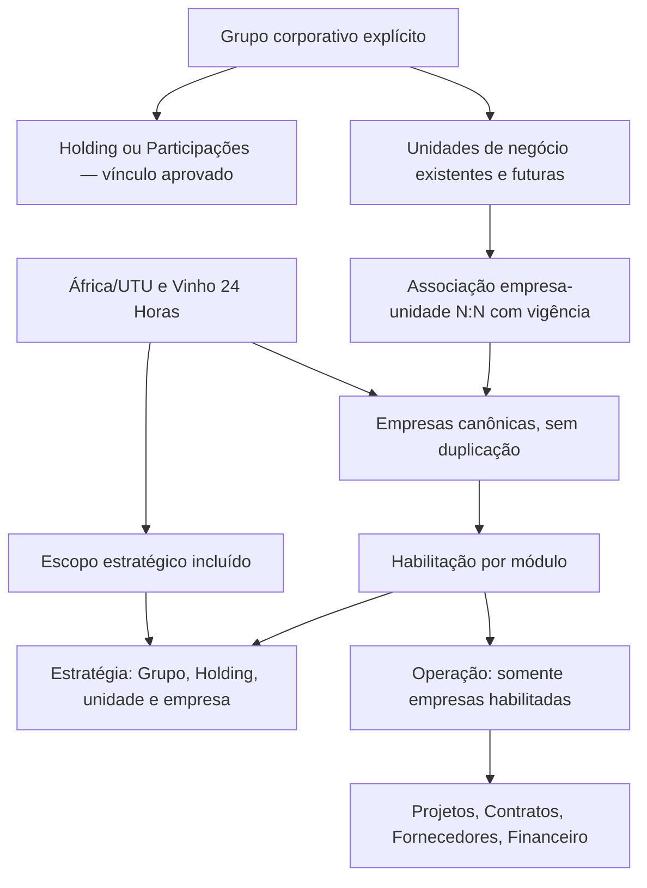
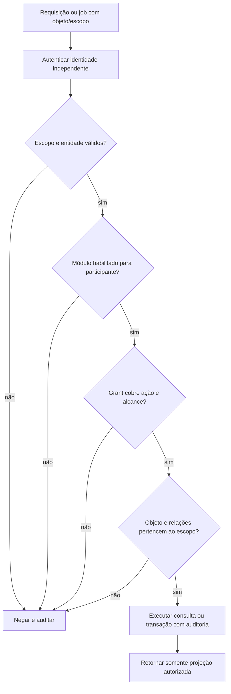
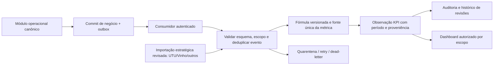
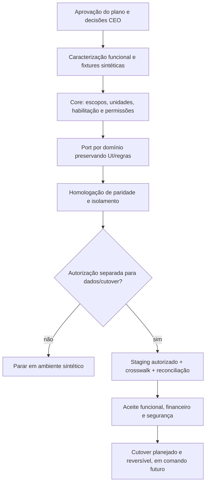

# COMANDO 02A — Auditoria e plano de reaproveitamento do SGE Grupo Arqueo

Data da análise: 05/11/2026 (UTC).\n\n**Parecer técnico: APROVAR COM RESSALVAS o plano de migração para avaliação do CEO. Não aprovar cópia direta do SGE, migração de dados reais ou início automático do Comando 02B.**

O SGE deve ser a base funcional do módulo Estratégia. A fundação é a base de identidade, isolamento e operação independente, não um substituto simplificado das metodologias existentes. Priorizar portabilidade de componentes, regras e contratos; reconstruir fronteiras inseguras/acopladas, preservando a capacidade de negócio.

## Sumário dos entregáveis

| Entregável | Local neste documento |
|---|---|
| A. Inventário de funcionalidades | Seção 3 e anexos I–III |
| B. REAPROVEITAR / ADAPTAR / RECONSTRUIR / NÃO MIGRAR | Seção 4 e anexo II |
| C. Governança e comparação dos bancos | Seções 5–7 |
| D. Arquitetura do módulo Estratégia | Seções 8–10 |
| E. Fluxogramas | Seção 11 |
| F. Etapas e critérios de aceite | Seção 12 |
| G. Decisões do CEO | Seção 13 |

## 1. Fontes, cadeia de evidências e método

### Fonte primária: o anexo, não um repositório presumidamente equivalente

Arquivo disponibilizado: **1-SGE_Grupo_Arqueo_CodigoFonte_Completo.zip**, 1.239.821 bytes. O nome real fornecido difere da grafia “(1)” no comando; foi analisado o arquivo efetivamente anexado.

**SHA-256 integral: 0d0dbb8b44ae90f0d42a439fa2c9468e55a2cca5e6339a12b666e720c867b20e.**

Raiz: SGE_Grupo_Arqueo_CodigoFonte_Completo/. Extração local com verificação de caminhos e rejeição de symlinks; nenhum script do pacote foi executado.

- 521 entradas no ZIP: **491 arquivos e 30 entradas de diretório**, incluindo a raiz; 6.438.286 bytes descompactados.
- 262 arquivos TypeScript/TSX no pacote principal, incluindo **75 páginas**, componentes/hooks e **24 arquivos de testes**.
- Inventário estático de **301 arquivos de código, configuração e documentação**, 76.950 linhas: conteúdo percorrido para imports/exports, tabelas, RPCs e dependências. Revisão semântica aprofundada dos caminhos de governança, leitura/escrita, persistência, histórico, financeiro, autenticação, arquivos e integrações.
- Schema principal com **94 tabelas declaradas**; **14 migrações SQL** e diário Drizzle 0000–0013.
- ZIP interno docs/PlanejamentoEstrategico_SourceCode_ModuloAnterior.zip: 14 arquivos, incluindo dez TSX e quatro documentos; seus dez TSX são idênticos aos arquivos correspondentes do pacote principal. Não constituem dez funcionalidades adicionais nem uma segunda versão a migrar.
- **163 arquivos de consultas em .manus/db** foram identificados apenas por metadados e excluídos da análise de conteúdo/publicação por poderem conter dados reais. Seeds, insert-test-data.sql e artefatos de carga não foram executados nem usados como base cadastral.
- Lockfile, snapshots Drizzle e arquivos auxiliares foram inventariados como artefatos; não são prova de funcionamento nem devem ser copiados indiscriminadamente.
- O anexo não foi republicado: somente este relatório será enviado ao destino.

“Exame integral” significa inventário e varredura de toda a superfície de código selecionada, com aprofundamento dos fluxos críticos; não significa certificação linha a linha nem teste de execução de todos os módulos. O anexo III explicita a cobertura. Os casos incompletos estão diferenciados de funcionalidades operantes.

### Fundação de destino

[PR #1](https://github.com/jandersontameirao-svg/Gest-o-Integrada-/pull/1), ponta examinada **b60ab6adf058b4cc5cce2dcadce2bb7efc6c6da3**, ainda sem merge no início desta análise. Código funcional em ff81e43541f1260eef5791869bcba80334f37ace; b60ab6 adiciona apenas a auditoria 01B.

Fontes examinadas: shared/catalog.ts, server/app.ts, auth.ts, policy.ts, db.ts, crypto.ts, schema 001 up/down, migrate.ts, seed.ts, client/main.tsx, manifesto/lock, testes, CI e auditoria 01B.

A auditoria 01B anterior baseava-se em recortes de repositórios conectados. **Este relatório substitui o caráter preliminar da avaliação do SGE pelo exame do ZIP fornecido**, sem presumir equivalência entre seu conteúdo e qualquer commit externo.

### Plano Mestre V03

Não foi disponibilizado um documento identificado como Plano Mestre V03 no anexo ou na conversa; não foi localizado por nome nas fontes locais examinadas. Documentos de entrega, reorganização e integração presentes no ZIP não substituem o V03. Aderência integral, prioridades e critérios específicos do V03 permanecem **NÃO VERIFICÁVEIS**. O comando atual fornece requisitos explícitos para governança e preservação funcional, usados neste plano.

### Localização das evidências

Referências SGE abaixo usam **caminho relativo ao ZIP e linha**, não links para um repositório que possa divergir. O hash do pacote e o anexo III permitem reproduzir a análise. Referências GI são arquivos no SHA de destino acima.

| ID | Fonte | Evidência decisiva |
|---|---|---|
| S01 | drizzle/schema.ts:6–80, 793–803 | users/openId/papel global; áreas; empresas.areaId; usuário–empresa; relação empresa–área N:N |
| S02 | client/src/pages/PlanejamentoEstrategicoGrupo.tsx:109–125; PlanejamentoEstrategicoParticipacoes.tsx:73–89; PlanejamentoEstrategicoArea.tsx:167–169 | Escopos codificados como empresaId 0, -1 e -100-areaId |
| S03 | server/_core/trpc.ts:13–47; server/routers.ts:42–54, 668–746, 810–988 | Middleware protegido valida usuário; parte das listas é pública; nem todas as operações verificam vínculo |
| S04 | server/db.ts:876 e funções seguintes; server/routers.ts:1261–1333 | Consultas filtram ID fornecido sem ator; três mutations de metodologia devolvem sucesso sem persistir |
| S05 | client/src/pages/CincoForcasLite.tsx:35–49; StakeholdersLite.tsx e VrioLite.tsx, autoSave | Salvamento simulado; não confundir UI “salvo” com persistência |
| S06 | drizzle/schema.ts:140–312, 350–438, 580–655 | Objetivos/metas/KPIs, projetos/iniciativas/ações, ciclos; variantes de grupo; indicadores BSC |
| S07 | server/orcamento.ts:116–393; routers/orcamento.ts; ComparativoVersoes.tsx | Versões e comparativo de orçamento; importação/planejado versus executado |
| S08 | server/db.ts:1312–1450; components/VersionHistory.tsx | Versionamento/reversão de configuração de template, não do plano estratégico inteiro |
| S09 | server/routers/gestaoRiscos.ts:10–45; drizzle/schema.ts:1739–1840 | Severidade, planos e histórico de riscos; falha de histórico pode ser absorvida |
| S10 | server/_core/env.ts, sdk.ts, oauth.ts; storage.ts; _core/llm.ts:268; vite.config.ts | OAuth/session, Forge, armazenamento, IA e plugin runtime dependentes da plataforma de origem |
| S11 | server/_core/index.ts:44–71 | Uploads multipart registrados sem middleware de autenticação no caminho mostrado |
| S12 | server/integrations/sgcClient.ts; contractsGateway.ts; routers/contratosGateway.ts | SGC por token técnico, cache/gateway; coexistência com rotas contratuais locais |
| S13 | server/routers/dre.ts:38–50; routers/balanco.ts:25–66; routers/capitalGiro.ts:20–39 | Fórmulas implementadas; necessidade de caracterização e validação financeira |
| S14 | server/contratos/approval-service.ts:20–109 | Token público, expiração/uso, atualizações sequenciais sem transação nesse fluxo |
| S15 | server/notifications.ts; server/calendar.ts; integrations/organogramClient.ts | Alertas, calendário e organograma externos; não são automação de IA universal |
| D01 | GI server/policy.ts e server/app.ts | Autoriza empresa/módulo/ação; Holding corporativa; atualmente sem habilitação de módulo por empresa |
| D02 | GI db/migrations/001_foundation.up.sql e shared/catalog.ts | Cinco empresas, papéis/vínculos; sem unidades, escopos de planejamento ou entidades estratégicas |
| D03 | GI scripts/migrate.ts | Executor fixa a versão 001; precisa evoluir antes de novos schemas |
| D04 | GI .github/workflows/ci.yml, tests e lock | npm ci, build e MySQL; cobertura apenas da fundação |

## 2. Conclusões executivas

1. **Preservar o SGE como patrimônio funcional**: metodologias, telas completas/Lite, gráficos, formulários, fórmulas, relatórios, comparativos, orçamento, análise financeira, riscos, colaboração e configurações. Não substituir essas capacidades por cards vazios.
2. **Separar escopo estratégico de habilitação operacional**: África/UTU e Vinho 24 Horas devem poder planejar, medir e consolidar, sem obter automaticamente acesso a projetos operacionais, contratos, fornecedores ou lançamentos financeiros.
3. **Preservar Holding, Grupo e unidades sem fundi-los silenciosamente**: o código distingue Grupo (0) e Participações (-1). A equivalência jurídica/gerencial deve ser aprovada pelo CEO.
4. **Manter relação N:N empresa–unidade**, com vigência e política de consolidação. O campo singular empresas.areaId não deve apagar as associações de empresa_area_vinculo.
5. **Não migrar a fronteira de confiança atual**: consultas públicas e mutações sem autorização de escopo devem ser encapsuladas por autenticação e permissão de ação/objeto. Corrigir no plano não significa modificar os aplicativos originais.
6. **Priorizar adaptação sobre reescrita**: manter React/TS, regras independentes, gráficos e, se aprovado, tRPC dentro do módulo. Reescrever autenticação/escopos/adaptadores, não as metodologias.
7. **Não declarar maduros fluxos apenas aparentes**: Porter/Stakeholders/VRIO têm lacunas de persistência; ciclos trimestrais e plurianualidade completa não foram comprovados; versões de templates e orçamento não abrangem todo o plano.
8. **Nenhuma migração ou implementação ocorreu**. A análise é estática: não foi iniciada sessão Manus, chamada ATENA, acesso SGC/OrganoArq, serviço de IA, SMTP ou banco de produção.

## 3. A — Inventário de funcionalidades

Estados: **IMPLEMENTADO NO CÓDIGO** = existe caminho de código relevante; **PARCIAL** = persistência/ligação/cobertura incompleta; **MODELO** = estrutura declarada sem ciclo de uso comprovado. Nenhum estado substitui homologação em runtime.

| Capacidade | Fonte principal | Estado e preservação exigida |
|---|---|---|
| Grupo, Participações, unidades e empresas | PlanejamentoEstrategicoGrupo/Participacoes/Area/Empresa.tsx; AreasNegocio.tsx; schema | UI e relações implementadas, com IDs especiais; preservar todos os níveis e N:N |
| Usuários e vínculos | GestaoUsuarios.tsx; routers.ts:238–306; usuario_empresas | Admin/gestor/user globais e vínculos de empresa; granularidade por unidade/ação não comprovada |
| Identidade organizacional | IdentidadeOrganizacionalLite.tsx; identidade_organizacional/identidade_grupo | Missão, visão, valores e política; preservar variantes e configuração |
| Planejamento plurianual | Objetivos por ano, datas de projetos e interfaces de planejamento | PARCIAL: não localizada entidade de plano plurianual com horizonte, baseline e versões. Não afirmar inexistência do planejamento em uso; solicitar regra/modelo oficial |
| Ciclos anual/mensal/trimestral | ciclos:299; kpis.frequencia:204; kpi_valores | MODELO de ciclos mensal/anual; KPI admite trimestre. Não localizada referência a ciclos nas rotas/serviços examinados, além do schema. Trimestre de KPI não equivale a fechamento trimestral de plano |
| Objetivos e metas | objetivos/metas/desdobramento_metas; objetivos_grupo; PlanejamentoGrupo.tsx | CRUD e variantes; desdobramento declarado sem consumidor identificado pela busca de símbolo; preservar conteúdo e linhagem entre níveis |
| OKR | OkrLite.tsx; analise_okr; saveOkr/getOkr | Persistência de objetivos e resultados-chave; preservar campos/progresso/período e metas; expandir ciclo/versionamento sem reduzir |
| KPIs | KPIs.tsx; kpis/kpi_valores; grupoKpis | Frequência, valores/meta/realizado, RAG e vínculos; preservar histórico temporal e fórmulas após caracterização |
| BSC | BscLite.tsx; bsc_indicadores; saveIndicadores | Quatro perspectivas e persistência; mapear cliente/clientes sem perda de significado |
| PESTEL | AnalisePestelLite/Completa.tsx; pestel_fatores; pestel_plano_acao | Fatores, impacto/probabilidade, gráficos e resposta de risco; dois modelos de dados declarados exigem reconciliação |
| Porter | CincoForcasLite/Completa/Porter.tsx; cinco_forcas_porter; saveForcas | PARCIAL: Lite simula salvar; mutation consultada só retorna sucesso. Preservar análise, gráficos e campos; concluir persistência com aceite |
| Stakeholders | StakeholdersLite/AnaliseStakeholders/PortalStakeholders.tsx; analise_stakeholders | PARCIAL: autoSave simulado e mutation sem escrita; preservar matriz e acesso apropriado, não tornar estratégia pública por acidente |
| RBV/VRIO | VrioLite/AnaliseRbvVrio/AnalisesVRIO.tsx; server/vrio.ts; dois schemas | Há cálculo/classificação e serviço de persistência; referência de salvarRecursoVRIO não localizada fora do serviço no runtime pesquisado. Lite e mutation não comprovam integração completa |
| SWOT/TOWS | SwotLite/AnaliseSwoTtows.tsx; analise_swot_tows | Persistência, quadrantes/gráficos; preservar sem renomear destrutivamente taxonomias |
| Projetos estratégicos | projetos/projetos_grupo, ProjetosEmpresa/PlanejamentoGrupo.tsx | Projetos ligados a objetivos/KPIs. Não confundir com projeto operacional contratável |
| Iniciativas e ações | iniciativas/acoes/acoes_grupo; PlanoAcaoEmpresa; planos PESTEL | Ações com status/prazo/custo/responsáveis e diferentes vínculos; iniciativas possui modelo sem consumidor de símbolo comprovado |
| Riscos | GestaoRiscos/MatrizRisco/PainelRiscosClausulas; routers/gestaoRiscos | Matrizes 3x3/5x5, probabilidade/impacto, planos, histórico e dashboards; preservar escalas distintas e versões de metodologia |
| Dashboards | DashboardGrupo/Empresa/Comparativo/ResumoExecutivo; dashboards de análises/unidade/Participações | Diversas visões; algumas agregações não usam conjunto de empresas autorizado. Adaptar consultas, não empobrecer painéis |
| Análise preditiva | AnalisePreditiva.tsx; routers.ts:999–1097 | Heurísticas de prazo/status e progresso por datas; não chamar isso de previsão treinada por IA nem de execução física comprovada |
| Orçamento | GestaoOrcamentaria, OrçamentoPlanejado/Importacao/Relatorio/ComparativoVersoes; server/orcamento.ts | Categorias, subcategorias, versões, revisões, importação, planejado/realizado, custos, relatório detalhado; preservar a experiência e o domínio |
| DRE/forecast | DRE.tsx; routers/dre.ts; seis tabelas dre_* | Dados, plano de contas, natureza operacional, importação revisada, forecast, consolidação, indicadores e log. Validar fórmula para natureza ambos |
| Balanço | BalancoPatrimonial.tsx; routers/balanco.ts | Ativo/passivo/PL, uploads, comparações e indicadores; tabela audit existe, mas escrita nela não localizada pela busca de símbolo |
| Capital de giro | CapitalGiro.tsx; routers/capitalGiro.ts | PMR, PME, PMPF, CCC e ponderação por faturamento; preservar fórmula, revisando política de período/zero e consolidação |
| Clientes/contratos | GestaoClientes, Contratos, ContratoDetalhe, contratos.db.ts e gateway | Cadastro/vínculos, contratos/aditivos, marcos/medições, documentos, avaliação, risco e leitura SGC coexistem; consolidar fonte de verdade, sem perder interface/capacidade |
| Aprovações e avaliação | approval-service.ts; AvaliacaoContratos; schema avaliação/boletins | Metodologias, critérios, respostas e planos; aprovação via token tem riscos transacionais; realocar ao domínio responsável, não eliminar |
| Templates e relatórios | ConfigurarTemplate, TemplateGallery/Preview, PDFExport/ExportadorPDF; template_versions | Configuração, versões/reversão e exportadores existentes; há botões/telas de relatório sem fluxo completo. Homologar cada exportador, não presumir que todo PDF funciona |
| Colaboração | CommentSection, analise_comentarios, mencoes e anexos | Conteúdo, autoria, menções e arquivos; preservar permissões e retenção |
| Undo/redo e salvamento | useUndoRedo, useAutoSave/useSalvamento e indicadores | Reaproveitamento de UX; distinguir estado local de alteração persistida/versionada |
| Histórico/revisões | auditoria, riscos_historico, contratos_auditoria, dre_audit_log, versões de templates/orçamento | Implementações parciais por domínio; não localizado versionamento global e imutável de todo o plano |
| Seletor de metodologias | server/metodologias.ts; SeletorMetodologias | Identidade obrigatória; sem configuração retorna todas. Esse fallback não é permissão de acesso |
| IA existente | orçamento, DRE, balanço, riscos, PESTEL, OCR/CNPJ e contratos/ai-analyzer | Há prompts, extração e geração via invokeLLM/Forge; preservar intenção/artefatos, trocar transporte e impor escopo/revisão humana |
| Alertas e automações | notifications.ts, calendar.ts, email.ts | Verificações acionáveis e envio/calendário; não localizado agendador durável no entrypoint. Não presumir execução periódica já configurada |
| OrganoArq | organogramClient.ts; responsáveis nos objetivos/projetos | Consulta externa de posições/pessoas e IDs/nome/cargo; dependência separada da identidade de acesso |
| SGC | sgcDtos, sgcClient, contractsGateway, deep links, banner e documentos de integração | DTOs/timeouts/cache/referências externos; preservar contratos conceituais sem ativar chamadas agora |

### Funcionalidade declarada não equivale a persistência

A documentação do pacote descreve 14 cards por empresa; o código contém formulários que simulam o status salvo. Em particular, server/routers.ts:1308–1343 retorna mensagens de sucesso para Porter, Stakeholders e RBV/VRIO sem gravar. CincoForcasLite.tsx:45 comenta expressamente a simulação; as variantes StakeholdersLite e VrioLite seguem o mesmo padrão de temporização.

Isso é uma **lacuna de integridade funcional**, não autorização para remover metodologias. O aceite futuro deve incluir salvar, recarregar, editar e recuperar versão em cada escopo, com testes de falha e concorrência. Telas “Lite” não serão promovidas automaticamente como substitutas de variantes completas.

## 4. B — Matriz de reaproveitamento

Classes:
- **REAPROVEITAR**: portar componente/regra isolável, preservando semântica, após teste/licença/dependências.
- **ADAPTAR**: preservar capacidade e a maior parte viável do código, corrigindo contratos, escopos, persistência ou integração.
- **RECONSTRUIR**: nova fronteira técnica obrigatória; não significa recriar toda a função de negócio.
- **NÃO MIGRAR**: artefato ou dependência não deve entrar no destino. Nenhuma função empresarial será excluída sem aprovação.

| Componente | Classe | Tratamento e aceite |
|---|---|---|
| Componentes UI Radix/shadcn, PageHeader, gráficos, matrizes, Gantt | REAPROVEITAR | Inventariar props/classes/dependências; manter recursos, validar acessibilidade e contexto |
| Hooks locais undo/redo, helpers puros e montagem de relatório | REAPROVEITAR | Caracterizar comportamento; corrigir limitações de escopo/cancelamento sem perder UX |
| Fórmulas VRIO, risco e capital de giro | ADAPTAR | Extrair núcleo testável preservando fórmula baseline; decisão formal para qualquer alteração |
| Hubs Holding/Grupo/unidade/empresa e dashboards | ADAPTAR | Trocar IDs especiais por scope explícito; preservar layouts e relatórios por nível |
| PESTEL, SWOT/TOWS, OKR, BSC e seus gráficos | ADAPTAR | DTO compatível, plano/versão/ciclo/escopo obrigatórios, escrita transacional e histórico |
| Porter, Stakeholders e VRIO parcialmente persistidos | ADAPTAR | Preservar UI/modelos; implementar ligação de persistência faltante como correção aprovada, não downgrade |
| Seletor de metodologias | ADAPTAR | Configuração por escopo e versão; separar habilitação de apresentação de permissão |
| Objetivos, metas, projetos estratégicos, iniciativas e ações | ADAPTAR | Unificar linhagem sem colapsar grupo/empresa; completar elementos apenas modelados |
| Orçamento, revisões, comparativos e relatórios | ADAPTAR | Manter regras/UI; delegar realizado ao financeiro canônico e preservar versões planejadas |
| DRE, balanço e capital de giro | ADAPTAR | Manter análises e importação revisada onde módulos operacionais não existirem; não criar razão financeiro concorrente |
| Contratos/clientes/medições/avaliação | ADAPTAR | Funcionalidades pertencem ao domínio canônico Contratos/Clientes; Estratégia usa referências/projeções. Sem segunda base mestra |
| Colaboração, templates, PDFs e anexos | ADAPTAR | Preservar histórico/autoria; storage próprio, downloads autorizados e testes de exportação |
| Autenticação Manus/OAuth e sessão baseada em openId | RECONSTRUIR | Reutilizar identidade/sessão independente da GI; mapear identidade legada sem importar cookies/sessões |
| Autorização por grupo/unidade/empresa/ação | RECONSTRUIR | Guard no servidor e repositórios com ownership; nenhum endpoint aberto herdado |
| Governança e scope IDs | RECONSTRUIR | Entidades/FKs explícitas, N:N com vigência; conservar crosswalk de IDs legados |
| Versionamento integral do plano/ciclos plurianuais | RECONSTRUIR | Extensão não comprovada no baseline; preservar versões específicas existentes, não substituí-las por “última edição” |
| Auditoria de mutações e migração | ADAPTAR | Preservar eventos legados com proveniência; outbox/auditoria transacional e proteção append-only |
| Gateway SGC/OrganoArq | ADAPTAR | Preservar DTOs e testes como referência; adaptadores internos/independentes desligados até aprovação; nunca dependência de disponibilidade para editar plano |
| Prompts, esquemas de saída e casos de uso de IA | ADAPTAR | Manter intenção e outputs, avaliar com dados sintéticos; provider independente aprovado, limites e revisão |
| Forge LLM/storage/notificação, SDK OAuth e runtime Vite Manus | NÃO MIGRAR | Substituir transporte por interfaces independentes; manter os serviços de negócio correspondentes |
| Nova execução de IA, upload seguro, fila/outbox/scheduler | RECONSTRUIR | Autorização, isolamento, idempotência, budget, logs e storage segregado |
| IDs 0/-1/-100-areaId como chave de destino | NÃO MIGRAR | Conservar somente no mapeamento de origem, nunca como autoridade/chave de escopo nova |
| Usuários/empresas duplicados, cópia de contratos/financeiro como segunda fonte | NÃO MIGRAR | Reconciliar e referenciar domínio canônico; preservar payload histórico/proveniência em área controlada |
| .manus/db, dumps, seeds com dados, credenciais, sessões e tokens antigos | NÃO MIGRAR | Não publicar nem executar; dados reais exigiriam projeto e autorização distintos |
| ZIP interno com TSX idênticos | NÃO MIGRAR | Não duplicar arquivos/rotas; preservar seu registro de evidência e os documentos úteis |

O anexo II relaciona **todas as 94 tabelas** a domínios de destino e tratamento. “Não migrar cópia duplicada” não significa apagar registros da origem nem abandonar a capacidade.

## 5. C — Governança: origem versus fundação e desenho alvo

| Tema | SGE no ZIP | GI PR #1 | Proposta, sem implementação |
|---|---|---|---|
| Grupo/Holding | identidade_grupo e estruturas grupo; UI distingue Grupo=0 e Participações=-1 | Holding é empresa de ID holding; corporate é contexto agregado, não entidade persistida | GROUP e HOLDING explícitos; relação entre ambos e empresa jurídica da Holding aprovada pelo CEO |
| Unidades/áreas | areas_negocio; empresas.areaId; empresa_area_vinculo N:N | Ausentes | business_units com IDs estáveis; N:N efetiva; área não é empresa sintética |
| Empresas | INT autoincremental, nome/tipo/status e sgcEmpresaId | IDs VARCHAR(40) estáveis para cinco empresas | Reutilizar companies.id existente; novas entidades com identificador opaco, namespace e crosswalk, sem recadastrar a mesma organização por unidade |
| Usuário | openId e INT, papel global admin/gestor/user; usuario_empresas | UUID e memberships por empresa/papel | Uma identidade canônica; grants específicos por escopo/módulo/ação; vínculo profissional não é conta |
| Corporativo | NULL/IDs especiais e consultas globais | Holding com corporate e permissão do módulo | strategy:read_summary separado de strategy:read_detail/edit/approve/export; autorização corporativa de Estratégia não concede financeiro operacional |
| Participação em módulos | Não há fronteira uniforme entre planejamento e operação | Não há company_module_entitlements; corporate pode consultar todas as companies | Habilitação explícita por empresa/módulo, aplicada antes de qualquer exceção corporativa |
| Associação a unidade | Singular e N:N coexistem | Ausente | N:N canônica com effective_from/effective_to e política de rateio/consolidação; não inferir pelo nome |
| Histórico | Logs e versões por área | audit_events básica | Linhagem, versões aprovadas, escopo e composição histórica congelados |
| API/cliente | tRPC + React Query + SuperJSON + Zod | REST Express e fetch React | REST de identidade permanece; tRPC encapsulado no módulo Estratégia é opção preferida para preservar código, sob o mesmo guard |
| Dados/ORM | Drizzle/MySQL, IDs numéricos, schemas heterogêneos | SQL/MySQL2, FKs e parâmetros tipados | Preservar Drizzle tipado em estratégia com mapeamento das tabelas comuns; um único catálogo de migrações e nenhuma criação concorrente de users/companies |

### 5.1 Inclusão estratégica de África/UTU e Vinho 24 Horas

Esta instrução **refina o escopo anterior**: a exclusão da UTU dos módulos operacionais não deve excluí-la do planejamento. A plataforma deve contemplar planejamento por Holding, unidade e empresa, inclusive entidades de participação estratégica sem operação na GI.

Proposta:

- Manter as cinco empresas e seus IDs atuais. Reconhecer África/UTU e Vinho 24 Horas no registro corporativo como participantes de Estratégia, mediante identificação aprovada; não inferir razão social, país, documento ou vínculo jurídico a partir do rótulo.
- Representar África como unidade/recorte e UTU como empresa/participação **somente conforme decisão de governança do CEO**. Não assumir que “África/UTU” seja uma única pessoa jurídica.
- Em company_module_entitlements, conceder Estratégia aos participantes aprovados; os demais módulos permanecem desabilitados para essas entidades até decisão expressa.
- **Não basta adicionar companies**: o authorize atual da GI aceita corporate e a listagem de empresas não filtra participação por módulo. Sem alterar esse mecanismo antes, uma nova empresa estratégica apareceria na visão de módulos operacionais da Holding.
- O guard futuro verifica: autenticação → empresa/escopo válido → habilitação do módulo → grant/ação → ownership do objeto. corporate não ignora habilitação.
- Endpoints de contextos devem receber módulo/ação e retornar somente entidades habilitadas e autorizadas. Empresa exclusivamente estratégica não pode criar contrato, projeto operacional, fornecedor ou lançamento via API, importador, job ou ferramenta de IA.
- DRE, orçamento e indicadores de participantes sem financeiro operacional podem receber **observações estratégicas/importações manuais revisadas**, com proveniência e permissão de Estratégia. Isso não habilita razão, contas a pagar ou acesso detalhado do financeiro.
- Adesão futura a operação deve ser transição explícita, com aceite por módulo, sem recriar o cadastro.

### 5.2 Consolidação sem dupla contagem

Uma empresa pode integrar mais de uma unidade. Preservar a N:N exige política de agregação: contar empresa uma única vez no total corporativo; relatórios por unidade podem compartilhar visualização sem somar resultados duas vezes. Se houver alocação econômica, manter pesos e vigência por dimensão/período, com total reconciliado. Não usar a soma ingênua de dashboards de unidades como total do grupo.

Congelar composição societária/gerencial ou referenciá-la “as-of” na versão publicada do plano. Mudança de unidade hoje não pode reescrever silenciosamente relatórios de ontem. Suportar moedas/unidades e taxa de câmbio versionada; não presumir que todos os participantes usem BRL ou o mesmo calendário fiscal.

## 6. Segurança: riscos comprovados no código e correção prevista

Constatações estáticas, sem exploração nem acesso externo. Não concluir comprometimento real dos aplicativos a partir delas.

| ID | Risco/evidência | Prioridade e correção no plano |
|---|---|---|
| SEG01 | objetivosGrupo/projetosGrupo/acoesGrupo possuem consultas publicProcedure (S03) | Crítica antes de portar: retirar exposição anônima, mantendo capacidade sob sessão/escopo. Eventual portal público só com dados explicitamente publicados/aprovados |
| SEG02 | protectedProcedure só exige ctx.user; getByEmpresa/update/delete recebem IDs sem verificar todas as associações (S03/S04) | Alta: scopedProcedure + repositório com principal, scope e ação; ownership de todos os IDs e relações, inclusive anexos/exportações/consolidações |
| SEG03 | Uploads /api/upload e /api/upload-pdf sem auth no caminho registrado; uploadAnexo confia tamanhoBytes informado (S11; routers.ts:1653) | Alta: auth, quota/tamanho real do buffer, MIME/magic bytes, nome seguro, antivírus quando aplicável, storage privado e URLs curtas |
| SEG04 | Flags corporativas/fallback “todas metodologias” podem ser confundidas com privilégio; nenhuma unidade é grant nativo | Alta: grants de ação separados de seleção de UI; sem vínculo inferido nem wildcard de grupo por ID especial |
| SEG05 | Tokens de aprovação armazenados como token e uso/status/boletim atualizados sequencialmente (S14) | Alta: hash de token, escopo/audiência, expiração, uso único atômico, transação/histórico e rate limit; não importar tokens existentes |
| SEG06 | savePestel/saveSwot/saveOkr e configurações substituem conjuntos; parte sem transação/versionamento de plano (S04/S08) | Alta: transação, optimistic locking, revisão preservada e falha sem perda de versão anterior |
| SEG07 | registrarHistorico de riscos absorve falhas; auditoria geral do SGE e GI não é imutável por si | Alta operacional: escrever alteração e evento de auditoria atomicamente; falha de notificação pode ir à outbox, falha de auditoria não pode sumir |
| SEG08 | Console de savePestel inclui input; integrações propagam trechos de erros; acesso a consolidados não é sempre limitado | Alta: minimização/redação, correlation_id e separação entre permissão de resumo e detalhe |
| SEG09 | OAuth/SDK/ownerOpenId/Forge e plugin runtime acoplam disponibilidade/identidade à Manus | Alta: retirar dependências da execução do destino; conta independente; não reutilizar JWT, cookies, secrets ou loginMethod como autoridade |
| SEG10 | Fonte não declara FKs via .references e migrações consultadas não contêm FOREIGN KEY | Alta: validar órfãos e relações no staging; criar FKs/composição de escopo no destino, sem assumir integridade da origem |
| SEG11 | Serviço de IA recebe conteúdo de documentos; não há fronteira corporativa comum em todos os casos | Alta: autorização de entrada/saída e ferramentas, segregação de arquivos, defesa a prompt injection, redaction e confirmação humana |
| SEG12 | Fundação ainda não tem escopos de unidade ou entitlements; Holding poderá ver novas empresas | Alta: implementar governança antes de qualquer cadastro estratégico adicional, inclusive antes do port de UI |

Cenários mínimos de teste futuro: usuário A não lê/altera/exporta objeto B nem por relacionamento; gestor de unidade não obtém empresa fora de seu conjunto; grant de resumo não expõe detalhe; participante estratégico recebe 403 em operação mesmo com identidade corporativa; troca de unidade revoga acesso; impersonação via empresaId/scopeId/negativo não amplia acesso; jobs e ferramentas obedecem às mesmas regras; links expiram e concorrência não produz duas aprovações.

## 7. Comparação de banco e migração de relacionamentos

### 7.1 Diferenças estruturais

SGE: 94 tabelas declaradas, INTs locais, nomes camelCase/snake_case misturados, relações sem FKs declarativas, company nullable para alguns registros de grupo e sinais numéricos com semântica de escopo. Drizzle traz 14 arquivos de migração, sem pares down equivalentes aos do destino. A varredura encontrou CREATE TABLE para os 94 nomes do schema em alguma migração; isso **não prova** que a aplicação sequencial em banco vazio não tenha conflitos, mudanças de coluna ou tabelas históricas extras.

GI: nove tabelas da migração 001 (companies, users, roles, permissions, role_permissions, memberships, sessions, demo_records e audit_events), mais schema_migrations do executor. Nenhuma entidade estratégica ou unidade. FKs e CHECK do corporate existem; não há migração “do SGE” pronta.

Não executar db:push ou as migrações antigas sobre o schema GI: colidem nomes comuns e ignoram o mapeamento de identidades. Evoluir primeiro o executor 001 para sequência/checksum/lock/dirty testados; adicionar migrações novas da GI sob revisão. O código Drizzle de Estratégia pode mapear tabelas canônicas, sem ser autoridade concorrente de DDL.

### 7.2 Mapeamento proposto de chaves e escopos

| Origem | Destino proposto | Regra de reconciliação |
|---|---|---|
| users.id/openId | users.id canônico + external_identity_mappings | Sem merge por nome/e-mail sozinho; verificar identidade aprovada e reativar acesso por convite independente |
| empresas.id | companies.id existente ou novo registro aprovado | Crosswalk source_system/source_table/source_id→target_id com unicidade; verificar identidade jurídica/gerencial; não inferir mesma empresa por marca |
| areas_negocio.id | business_units.id opaco | Preservar nome/status e hierarquia aprovada; futuros cadastros sem mudar enum de código |
| empresas.areaId | associação primária legada, se confirmada | Reconciliar com empresa_area_vinculo, não descartar conflitos |
| empresa_area_vinculo | company_business_unit_memberships | N:N, vigência, origem e índice único de vínculo; conflitos/quebras em quarentena |
| NULL, 0, -1, -100-areaId | organization_scopes.id + tipo e FK reais | Decodificar conforme tabela/fluxo de origem; NULL não significa sempre a mesma coisa. Valores ambíguos não viram escopo corporativo automaticamente |
| objetivos e objetivos_grupo | strategy_objectives com legacy provenance | Não colapsar por título; verificar se são o mesmo objeto ou contextos distintos, preservar ambos até aprovação |
| projetos e projetos_grupo | strategy_projects | Mantêm sua natureza estratégica e vínculos com metas/objetivos/KPIs |
| template_versions, orcamento_versoes/revisoes | versões correspondentes + migration lineage | Conservar números/autor/data/status e payload; versão de template não é versão de plano |
| auditorias/históricos | legacy_audit_events normalizados/read-only + eventos novos | Preservar evento original, origem, autor legado e timestamp; ator sem conta não deve ganhar login |
| contratos/SGC IDs | referência ao contrato canônico por empresa | Sem cópia concorrente; resolver autoridade entre tabelas locais/SGC com decisão do dono do dado |
| financeiro/importações | observações/versionamento de planejamento e referências ao financeiro | Diferenciar realizado de origem, forecast e orçamento; nunca somar uma importação e o mesmo lançamento operacional duas vezes |

Manter IDs existentes da GI (VARCHAR(40)); não exigir conversão destrutiva dos cinco cadastros. Novas chaves podem ser UUIDs opacos no mesmo limite de campo. Preservar ID numérico **apenas como identidade externa**, com namespace e snapshot do arquivo.

### 7.3 Dados e auditoria preservados sem migração nesta fase

Esta entrega não contém dados reais nem exportação deles. Um eventual projeto de transferência de dados precisaria de autorização separada, inventário de campos sensíveis, retenção e ambiente controlado.

Plano desse projeto futuro: snapshot autorizado e criptografado → staging sem acesso público → crosswalk → validação de órfãos/taxonomias/escopos/moeda → relatórios de divergência → carga idempotente por lote com hash/proveniência → reconciliação contábil e funcional → aprovação → cutover reversível. Nenhum passo de carga foi executado.

Auditoria legada pode ser preservada como evidência somente leitura, sem fingir que eventos antigos foram gerados pelo novo sistema. Não sobrescrever autor original com usuário técnico importador. O importador tem seu próprio evento/batch e marca unresolved_actor quando necessário. Não presumir assinatura/imutabilidade retroativa.

## 8. D — Arquitetura proposta para Estratégia

### 8.1 Limites de módulos e máximo reaproveitamento

Proposta de monólito modular, sem criar outro aplicativo de autenticação:

- **Core/Governança**: identidade independente, sessão, empresas canônicas, unidades, escopos, grants, habilitação por módulo e trilha.
- **Estratégia/UI**: portar páginas e componentes SGE com React Query/tRPC e adaptadores; preservar formulários, análises completas/Lite, gráficos e exportação.
- **Estratégia/Application**: comandos/read models com principal, scope_id, plan_version_id, cycle_id e action explícitos.
- **Estratégia/Domain**: regras de metodologia, KPI, objetivo, risco e orçamento extraídas e caracterizadas.
- **Estratégia/Infrastructure**: Drizzle/MySQL2, transação com auditoria/outbox, armazenamento independente e projeções autorizadas.
- **Contratos/Projetos/Fornecedores/Financeiro**: autoridades operacionais; Estratégia não mantém cadastros mestres paralelos.
- **Adaptadores**: identidade, arquivos, IA, notificações, organograma e eventos sob interfaces controladas e desligadas por padrão quando externas.

Manter os REST existentes de identidade. Preferência técnica sujeita a aprovação: montar tRPC v11 em /api/v1/strategy/trpc sobre Express, reaproveitando schemas/DTOs/cliente; contexto deriva da sessão GI e scopedProcedure autoriza cada ação. Não adicionar OAuth Manus nem uma sessão tRPC independente. Se REST exclusivo for exigido, implementar camada de compatibilidade gerada/testada, sem reescrever a UI/regra indiscriminadamente.

Compatibilidades a resolver no port: Express 4→5 (async/rotas/middlewares), imports/aliases e TypeScript estrito, execução Node 24 sem construções não apagáveis quando usada sem bundle, datas/SuperJSON, decimais como valores exatos, Tailwind 4/Radix e patches do Wouter. Não copiar package.json inteiro; registrar dependências efetivamente necessárias e lock revisado.

### 8.2 Modelo lógico proposto — não é DDL implementado

| Entidade/família | Responsabilidade e invariantes |
|---|---|
| corporate_groups / holding_entities | Identidade organizacional do grupo e nível Holding; referências à empresa jurídica quando existir, sem confundir agregação com pessoa jurídica |
| business_units | Unidades existentes/futuras e eventual hierarquia; país/recorte opcionais, sem valores hardcoded |
| company_business_unit_memberships | Empresa–unidade N:N, vigência, associação principal aprovada e dados de alocação quando aplicáveis |
| organization_scopes | ID opaco, group_id, tipo GROUP/HOLDING/BUSINESS_UNIT/COMPANY e FKs; exatamente um alvo conforme tipo, unicidade por alvo e grupo |
| company_module_entitlements | Empresa/módulo/status/vigência; regra precede privilégio corporativo; Estratégia habilitada separadamente de operação |
| scope_role_assignments / role_permissions | Usuário/papel/escopo/módulo/ação e vigência; permissões de resumo, detalhe, edição, publicação, exportação, IA e gestão de acesso |
| strategy_plans / plan_versions | Horizonte start/end, dono/escopo, status rascunho/revisão/aprovado/arquivado, baseline, versão e aprovações; publicado não é alterado em silêncio |
| strategy_cycles | Tipos anual/trimestral/mensal, intervalo, calendário/fuso e fechamento, vinculados à versão; trimestre não apenas string de frequência |
| strategy_objectives / objective_alignment | Objetivos e desdobramento entre escopos; preservar origens, sem copiar automaticamente dados confidenciais ao filho |
| strategy_targets / target_breakdowns | Metas por ciclo/produto/canal, unidades e fórmula; preservar desdobramento |
| strategy_projects / initiatives / action_plans | Projeto estratégico, iniciativa e ação; vínculos a objetivos/KPIs e responsáveis, sem assumir execução operacional |
| strategic_operational_project_links | Relação N:N entre projetos de naturezas diferentes, contribuição/peso e vigência; nenhum ID de um domínio é tratado como outro |
| methodology_catalog / configurations / assessments | Identidade, PESTEL, Porter, Stakeholders, RBV/VRIO, SWOT/TOWS, OKR, BSC; payload tipado, versão de metodologia e ciclo |
| kpi_definitions / formula_versions / observations | Semântica da métrica, unidade/moeda, periodicidade, meta/realizado, fonte, período, revisão e qualidade; separação entre cálculo e completude |
| planning_budget_versions / lines / revisions | Orçamento de planejamento preservado; previsão versus realizado são naturezas distintas; autoridade de lançamento financeiro fica fora |
| risk_register / risk_assessments / response_plans | Metodologia/escala versionadas, responsável, severidade, status e histórico, ligação ao domínio de risco proprietário |
| report_templates / template_versions / exports | Configuração e histórico; export autorizado por mesmo escopo da tela e com classificação/proveniência |
| comments / mentions / attachment_references | Autoria e referências a storage privado; visibilidade e retenção derivadas do objeto |
| audit_events / legacy_audit_events / migration_batches | Evento novo transacional, histórico legado preservado e proveniência de mapeamento/lote |
| integration_outbox / ingestion_events / source_mappings | Integração idempotente e rastreável sem dual write; referência canônica e revisão da origem |

Não é necessário tornar toda entidade uma tabela nova se o modelo SGE puder ser adaptado sem perder integridade; estes são limites/invariantes para desenho e revisão do DDL. Evitar reescrita nominal de 94 tabelas por estética.

### 8.3 Matriz de permissões proposta

Perfis abaixo são proposta de negócio, não concessões já aprovadas:

| Perfil | Alcance sugerido | Limites |
|---|---|---|
| CEO/conselho autorizado | Resumo corporativo e aprovação nos escopos concedidos | Não recebe por inferência permissão irrestrita de operação ou administração técnica |
| Gestor Holding/Grupo | Planejar/consolidar no respectivo escopo | GROUP e HOLDING distintos até decisão; acesso detalhado só por grant |
| Gestor de unidade | Unidade e conjunto de empresas autorizado, com vigência | Não concede a si mesmo unidade/empresa nem vê todas as áreas por padrão |
| Gestor de empresa | Plano/ciclos/análises da empresa | Não acessa outras empresas por saber seus IDs |
| Analista/colaborador | Editar análises/ações atribuídas, ler contexto necessário | Sem publicação/aprovação/concessão automática |
| Auditor | Leitura e exportação autorizada de histórico | Sem editar planos ou apagar eventos |
| Conta técnica/worker | Evento/fonte/fórmula especificados | Sem login humano, sem wildcard e sem promover resumo a detalhe |
| Usuário estratégico UTU/Vinho | Estratégia nos escopos aprovados | Operação negada quando entitlement ausente, inclusive por importação e IA |

## 9. Integração sem duplicação e alimentação de indicadores

### 9.1 Autoridades de dados

| Informação | Fonte canônica proposta | Uso em Estratégia |
|---|---|---|
| Empresa/holding/unidade/usuário | Core/Governança | Referência; sem novo cadastro paralelo por metodologia |
| Contrato/aditivo/marco/medição | Módulo Contratos, após reconciliação das fontes | Referência e observação versionada; conservar capacidades analíticas/avaliações |
| Projeto operacional | Módulo Projetos | Entregas/custos/cronograma como fontes; não confundir com projeto estratégico |
| Projeto estratégico/iniciativa | Estratégia | Objetivo, contribuição, hipóteses, ações e orçamento estratégico |
| Cadastro/qualificação de fornecedor | Arq Fornecedores | Indicadores autorizados, sem replicar mestre |
| Lançamento/realizado/competência | Financeiro | Projeção de métricas; orçamento/forecast preservados como cenários, não razão |
| DRE/balanço informado de participante estratégico externo à operação | Observação/importação estratégica validada | Fonte manual/external_report com versão e responsável; não marcada como lançamento operacional |
| Pessoa/cargo/posição | Futuro cadastro canônico de profissionais/organização, se aprovado | Responsável por ID estável; snapshot nome/cargo para histórico; sem duplicar conta |

Conservar relatórios e UI de contratos/financeiro existentes, encaminhando suas escritas ao domínio competente. Não habilitar o gateway externo do ZIP para “preencher” funcionalidades automaticamente.

### 9.2 Contrato dos indicadores

Cada definição: métrica, proprietário, scope_id, unidade/moeda, frequência/ciclo, fórmula e versão, dimensões, fonte autorizada, política de consolidação, competência/caixa, atraso tolerado e classificação de confidencialidade.

Cada observação: observation_id, scope_id/company_id quando aplicável, plan_version/cycle, metric_id/formula_version, valor decimal, unidade/moeda, período e timezone, source_system/entity/id/revision, data de ocorrência/ingestão, quality_status e correlation_id. Não armazenar número binário de ponto flutuante como autoridade monetária.

Fluxo proposto: operação grava evento + outbox na mesma transação → consumidor valida identidade/habilitação/esquema → deduplica (producer,event_id) e mapeia entidade → calcula/atualiza projeção → grava observação e auditoria → dashboard consulta conjunto autorizado.

Correções/reprocessamentos preservam a observação anterior e source_revision; não somam o mesmo fato duas vezes. Contratos e financeiro não podem ambos ser fonte do mesmo faturamento sem regra explícita. Eventos atrasados e cancelados geram revisões rastreáveis. Dead-letter, retries e replay determinístico; nenhuma falha vira valor zero silencioso.

Para metas de resultado, separar **completude do preenchimento** (ex.: quantidade de fatores PESTEL) de **atingimento/desempenho**. Preservar os dois quando já apresentados; não afirmar que 100% dos campos significa sucesso estratégico.

### 9.3 Fórmulas financeiras e parecer especializado

Preservar fórmulas como baseline de caracterização e submeter alterações ao dono financeiro. Exemplo encontrado em routers/dre.ts:38–50: para natureza ambos, custoVar escolhe CSP e não inclui CMV nesse ramo. Isso pode representar regra pretendida ou defeito; não foi validado contra política contábil.

Fixture sintética proposta para homologação, **não dado real**: receita líquida 100, CMV 10, CSP 20, custo direto 5. O ramo atual para ambos produz lucro bruto 75; regra que deduza ambos produziria 65. A decisão correta deve ser formalizada, sem alterar valores/fórmulas no port silenciosamente.

Também revisar moeda/câmbio, ausência de dado versus zero, datas de referência do CCC consolidado, ponderações, indicadores de liquidez e porcentagens. Fixar testes de regressão e versão de fórmula para manter comparabilidade histórica.

## 10. Dependências Manus, IA e alternativas independentes

| Dependência localizada | Alternativa proposta | Preservação/limite |
|---|---|---|
| sdk.ts/oauth.ts, OAUTH_SERVER_URL, VITE_APP_ID, ownerOpenId | Sessão GI e cadastro/invite independente | Preservar atribuição/autoria pelo crosswalk; sem importar cookies/autoridade de owner |
| vite-plugin-manus-runtime, ManusDialog e hosts de origem | Vite/React próprios, build e CI do destino | Remover runtime/transporte, não as telas empresariais |
| storage.ts e Forge API de upload/download | Interface de storage privado com SDK independente/S3 compatível, provedor a aprovar | Preservar metadados/versões; nenhuma URL legada usada como bypass |
| _core/llm.ts / invokeLLM | LLMProvider independente, escolha/credenciais aprovadas em etapa futura | Preservar prompts/esquemas/intenção; não executar agora nem assumir modelo/provedor idêntico |
| notifyOwner/_core/notification | Notificação interna + outbox; SMTP/webhook apenas quando autorizado | Destinatário por escopo, sem “dono global” recebendo dados de todas as empresas por padrão |
| dataApi, mapa, imagem, áudio | Adaptadores independentes somente para recursos realmente usados | Inventariar chamadas; recursos auxiliares não devem carregar Forge desnecessário |
| SGC e OrganoArq | Portas de domínio/DTOs, referências canônicas e adaptadores opcionais desligados | Não integrar à ATENA OS nem usar tokens do ZIP; dependências externas aprovadas separadamente |
| Calendário/e-mail | Geradores puros reaproveitados, envio autorizado por fila | Revisar fuso UTC/local e saída de dados para calendários; nenhum envio realizado |

IA proposta: entrada somente de objetos autorizados; contexto de escopo fixado no servidor; anexos tratados como entrada não confiável; ferramentas sem poder de trocar empresa ou permissões. Saída passa por esquema, validação e revisão humana antes de alterar plano/publicar/aprovar gasto. Registrar prompt/modelo/fórmula/versão, escopo, custo, origem e ação do revisor, minimizando dados sensíveis. Jobs com quotas e cancelamento; nenhuma autorização ao modelo para executar SQL genérico.

O AIChatBox não comprova um serviço de chat estratégico completo e autônomo. A análise preditiva atual é heurística; não substituir sua semântica por uma chamada de IA opaca. Prompts, avaliação e automações serão preservados/portados com contratos testáveis, sem obrigação de preservar transporte Forge.

## 11. E — Fluxogramas propostos

### 11.1 Governança e habilitação

A associação N:N não transfere automaticamente acesso nem permite somar duas vezes a mesma empresa. GROUP/HOLDING não são um ID mágico; a equivalência entre os níveis depende do CEO.

### 11.2 Autorização antes de ler ou escrever

### 11.3 Integração operacional e KPI

### 11.4 Migração futura sujeita a autorização

## 12. F — Plano por etapas e critérios de aceite

Todas as etapas abaixo são **proposta**, não trabalho iniciado do 02B. Não existe autorização implícita para dados reais, integrações ou deploy.

| Etapa | Conteúdo | Critérios objetivos de aceite | Dependência/retorno |
|---|---|---|---|
| 0 — Aprovar escopo e fontes | CEO valida V03, níveis de governança, entidades participantes e matriz de preservação | Decisões D01–D12 registradas; fonte ZIP/hash reconhecida; lista de funções proibidas de remover; dúvidas de plurianualidade/ciclos respondidas | Sem aprovação, permanecer no relatório |
| 1 — Caracterização do SGE | Isolar suite e fixtures sintéticas; registrar fluxos e outputs baseline por funcionalidade | Matriz função→tela→RPC→tabela→teste; separar funcional de simulado; executar check/build/test no sandbox sem Manus/SGC/SMTP/produção; zero regressões não aprovadas | Adaptadores falsos determinísticos, nunca desabilitar segurança para fazer testes passarem |
| 2 — Governança e pré-requisitos do core | Migrações sequenciais/checksum, escopos reais, unidades N:N, entitlements, grants | Up/idempotência/down por versão; preservação da 001; testes negativos por ação/empresa/unidade e UTU/Vinho negados em operação; datas de vigência e total sem dupla contagem | Retornar feature flags/schema compatível sem apagar base |
| 3 — Identidade e dados mestres | Crosswalk e regras de reconciliação, sem credenciais antigas | Nenhuma duplicação por unidade/nome; identidade não unida só por e-mail; atores históricos preservados sem criar acesso; divergências em quarentena | Somente fixtures nesta etapa aprovada de desenvolvimento |
| 4 — Port metodológico e UX | Portar telas/hubs/gráficos e persistência das metodologias, identidade e colaboração | Todas as oito metodologias e seletor preservados; salvar/recarregar/editar/versionar/exportar em cada escopo autorizado; falha não exibe “salvo”; complete/Lite com equivalência aprovada | Persistência incompleta vira entrega explícita, não função removida |
| 5 — Planejamento e execução estratégica | Planos plurianuais, ciclos anual/trimestral/mensal, objetivos/metas/KPIs, projetos/iniciativas/ações | Horizonte/coerência temporal, alinhamento entre níveis, fechamento/reabertura aprovados; projetos estratégicos separados dos operacionais; versões publicadas imutáveis e concorrência testada | Requisitos não demonstrados no SGE precisam de aceite de produto, não invenção silenciosa |
| 6 — Orçamento, análises financeiras e contratos | Portar capacidades preservando fonte única e autoridade por módulo | Comparativo/versões de orçamento íntegros; DRE/balanço/CCC caracterizados; fórmula ambos decidida; sem dupla contagem e sem cadastro paralelo de contrato/cliente | Operação não habilitada recebe apenas observações/importação estratégica revisada |
| 7 — Integração de KPIs | Outbox/ingestão/projeções e fontes manuais controladas | Reprocessar evento não duplica métrica; correção preserva anterior; atraso/falha distinto de zero; escopos/moedas/versões de fórmula reconciliados; export não vaza detalhe | Testes de consumidor/contrato com dados sintéticos |
| 8 — IA e automações independentes | Portar prompts/casos de uso, filas, notificações e avaliação | Nenhuma chamada Manus/ATENA; provider somente após aprovação; isolamento e prompt injection avaliados; revisão humana nas ações; custos/quotas/logs por escopo | Sem credenciais/integrações nesta análise |
| 9 — Homologação integral | Regressão UI/API, métodos, relatórios, histórico, segurança e desempenho | Checklist assinado de paridade funcional; testes de leitura/escrita/export/arquivo/job; auditoria transacional e append-only, restauração ensaiada; sem redução não autorizada | Código só pronto para revisão, sem merge/deploy automático |
| 10 — Projeto de dados/cutover futuro | Apenas se autorizado separadamente: staging/carga incremental/reconciliação/cutover | Contagens e checksums/relacionamentos aprovados, períodos/versões/autoria preservados, testes financeiro/jurídico, rollback de dados com restauração e congelamento/dual run de leitura definido | Este comando não autoriza nem executa a etapa |

### Regressões e invariantes obrigatórios

- Nível Holding e Grupo não desaparece; empresas futuras e N:N não exigem empresa sintética/ID negativo.
- África/UTU e Vinho são testados como participantes estratégicos, com bloqueio operacional inclusive para usuário corporativo.
- Empresa em duas unidades não duplica valor corporativo; snapshots históricos usam composição/periodicidade apropriada.
- Conservação de contagens e relações por namespace; IDs iguais de duas tabelas/fontes não colidem.
- Objetivo e KPI com escopos incompatíveis não se vinculam sem regra e autorização explícitas.
- Todas as metodologias continuam disponíveis conforme configuração aprovada; desativar apresentação não apaga histórico nem concede acesso.
- Reabrir período/versionar fórmula não apaga valores publicados; edição concorrente produz conflito controlado.
- PDFs e downloads usam o mesmo escopo da API; nome do arquivo/URL não é prova de autorização.
- Aprovação pública concorrente só pode ser consumida uma vez, com evento e alteração na mesma transação.
- Falha de IA, storage ou integração não destrói edição manual; ausência de dado não vira zero nem “salvo”.
- Nenhuma nova migration destrói a base anterior no down sem documentação/aceite; rollback de DDL não é backup de dados.
- Quaisquer exclusões/fusões de funções e diferenças numéricas precisam de decisão registrada antes do port.

### Como medir “preservar ao máximo”

Não usar uma porcentagem arbitrária de linhas copiadas. Manter catálogo de componentes e capacidades com: origem/hash, classe, destino, alteração necessária, teste de paridade e aprovação da diferença. Medir cobertura de funcionalidades/campos/relatórios, histórico e governança, além de código efetivamente portado. Reescrita de um guard não justifica reescrita da metodologia inteira.

## 13. G — Decisões que exigem aprovação do CEO

As exigências expressas de incluir África/UTU e Vinho em Estratégia e preservar funcionalidades já estão estabelecidas. As decisões abaixo refinam sua execução; não reabrem essas exigências.

| ID | Decisão | Recomendação e efeito |
|---|---|---|
| D01 | Identidade e relação Grupo Arqueo / Holding / Grupo Arqueo Participações | Manter escopos distintos até confirmar equivalência. Não fundir 0/-1 com empresa holding automaticamente |
| D02 | Unidades existentes/futuras e vínculos de África/UTU e Vinho | Confirmar cadastro jurídico/gerencial, recortes, N:N e vigência; não inferir lista real dos seeds |
| D03 | Habilitação por módulo desses participantes | Incluir Estratégia; operação desabilitada até autorização por módulo. Validar o que significa análise financeira estratégica sem operação |
| D04 | Acesso corporativo, unitário e individual | Aprovar matriz resumo/detalhe/editar/publicar/aprovar/exportar/IA; sem privilégio universal implícito |
| D05 | V03, horizonte plurianual e calendário | Fornecer versão oficial; definir ciclos, trimestre, fechamento, reabertura e política de versão aprovada |
| D06 | Regra de consolidação entre unidades e moedas | Decidir atribuição exclusiva/compartilhada/rateio, pesos, intercompany, moeda funcional/câmbio e datas de referência com responsável financeiro |
| D07 | Autoridades de contratos, projetos e financeiro | Aprovar fonte canônica e destino das capacidades atuais sem eliminá-las; diferenciar projetos estratégicos/operacionais e significado de seus vínculos |
| D08 | Adaptação com tRPC e preservação de UI | Preferência por manter cliente/DTOs dentro da GI para maximizar reaproveitamento; confirmar padrão de API e dependências |
| D09 | Lacunas funcionais e paridade | Aceitar completar persistência das metodologias e versionamento global; nenhuma função poderá ser removida ou simplificada sem aprovação específica |
| D10 | Fórmulas/indicadores e risco | Responsável financeiro valida ambos na DRE, CCC, completude versus desempenho e escalas de risco; preservar baseline e versionar mudanças |
| D11 | IA e serviços externos | Aprovar casos de uso, fornecedor independente, dados permitidos, orçamento, revisão humana e automações. Não autoriza Manus/ATENA |
| D12 | Histórico, retenção e migração futura | Definir políticas com responsáveis; dados reais/cutover requerem autorização própria. Não importar contas/tokens/sessões nem reescrever autoria histórica |
| D13 | Aceite para Comando 02B | Aprovar plano, ordem das etapas e critérios. Esta PR não inicia desenvolvimento e não aprova merge/deploy |
| D14 | Fonte funcional homologada | Confirmar ZIP como baseline; diferenças para aplicativo em uso ou repositórios devem ser reconciliadas, não presumidas |

## 14. Verificações, limitações e parecer

### Executado nesta análise

- Inventário do ZIP, hash, extração com controles de caminho/symlink e identificação de materiais excluídos.
- Varredura dos 301 arquivos selecionados e 14 arquivos do pacote interno, com rastreio de tabelas/imports/RPCs/referências e revisão aprofundada dos caminhos citados.
- Inventário de 94 tabelas e comparação nominal com CREATE TABLE das 14 migrações; sem replay de banco.
- Inventário de 24 arquivos de testes com **189 declarações literais it/test**; isso não é número de testes executados/aprovados.
- Comparação com fundação e leitura dos checks: ponta b60ab6 da PR #1 com **2/2 checks aprovados**, runs [42128174845](https://github.com/jandersontameirao-svg/Gest-o-Integrada-/actions/runs/42128174845) e [42128166226](https://github.com/jandersontameirao-svg/Gest-o-Integrada-/actions/runs/42128166226).
- O plano e seus anexos são documentais; CI da PR desta publicação será registrada separadamente, sem atribuir à análise estática aprovação runtime do SGE.

### Não executado / não verificável

Não foram executados build, suite do ZIP ou migrations do SGE: parte dos testes/chamadas pode depender de banco/serviços legados; executá-los sem isolamento poderia tocar dados ou integrações proibidas. Não houve sessão Manus, chamadas ATENA/SGC/OrganoArq/IA/e-mail nem migração de produção. Não há comprovação de que todos os módulos do ZIP funcionem end-to-end. As 24 suites não foram substituídas, desabilitadas ou declaradas verdes.

V03, modelo jurídico oficial das entidades/unidades, políticas de moeda/consolidação, critérios do CEO, população real de dados e homologação do aplicativo em uso permanecem pendentes. O pacote descreve funcionalidades, mas não prova sua utilização real nem a integridade dos dados.

### Parecer

**Viável e recomendável reaproveitar substancialmente o SGE**, preservando metodologias, formulários, gráficos, análises financeiras, orçamento, colaboração, relatórios e histórico. O caminho seguro é adaptação modular com caracterização e nova governança explícita, não implantação paralela do aplicativo nem cópia direta de seu middleware.

**APROVAR COM RESSALVAS o desenho proposto para deliberação do CEO**, condicionando autorização de desenvolvimento às decisões da seção 13 e ao escopo inicial aprovado. Bloqueios técnicos antes de qualquer port operacional: identidade independente, escopos/habilitação/grants, migrações evolutivas, ownership e integridade de relacionamentos, auditoria transacional e caracterização das fórmulas/persistência.

Esta entrega não altera aplicativos originais, não migra dados, não elimina funções e **não inicia o Comando 02B**. Sem merge, deploy ou alterações administrativas.

## Anexo I — Índice de evidências críticas por arquivo

| Arquivo no ZIP | SHA-256 integral |
|---|---|
| drizzle/schema.ts | abdba644693ae8d14d02ffba8ae77192b0cb4cd881682258eb1b75338b91f3d0 |
| server/routers.ts | ada2218c64cb4b11af1178ea2dcce51fa1eee1877f9cacbb325c69e4f1dc38dd |
| server/db.ts | 2884b367ec1f2df667caeffeb4727551a8ebc63afd9418aba5a7f5457898d403 |
| server/_core/trpc.ts | 95679492e0478938f9bab6e3388ba6a95d3ab3329e6ff2eb9686e638cd07d98e |
| server/_core/index.ts | 83955edb5659212b806e61ff1de0a6d49100ee1068b9c2cd715cced21baba5f9 |
| server/routers/dre.ts | fb42d26b9dd6b2f22900cd539b296159b400418bcea517b949aee0fb2e3770be |

As linhas se referem aos arquivos extraídos sem alteração. O código do ZIP não foi incorporado ao repositório, inclusive para não publicar artefatos que possam conter dados reais.

## Anexo II — mapeamento das 94 tabelas declaradas

Mapa lógico para revisão: não é DDL nem autorização de carga. ADAPTAR preserva a capacidade; tabelas de domínios canônicos não devem ser copiadas para uma segunda base de Estratégia. Histórico mantém autoria/proveniência, inclusive atores não reconciliados.

| Símbolo e tabela SGE | Linha do schema | Classe | Domínio/tratamento proposto |
|---|---:|---|---|
| `users` / `users` | 6 | ADAPTAR | identidade única + external_identity_mappings (sem sessões/openId como autoridade) |
| `areasNegocio` / `areas_negocio` | 24 | ADAPTAR | business_units |
| `empresas` / `empresas` | 40 | ADAPTAR | companies canônicas + module_entitlements |
| `usuarioEmpresas` / `usuario_empresas` | 60 | ADAPTAR | scope_role_assignments reconciliados |
| `identidadeOrganizacional` / `identidade_organizacional` | 73 | ADAPTAR | Identidade por escopo explícito; não fundir níveis sem decisão |
| `historicoFaturamento` / `historico_faturamento` | 90 | ADAPTAR | Dimensões/contexto de planejamento e fatos históricos; reconciliar cadastro/fonte canônicos |
| `produtos` / `produtos` | 108 | ADAPTAR | Dimensões/contexto de planejamento e fatos históricos; reconciliar cadastro/fonte canônicos |
| `canais` / `canais` | 124 | ADAPTAR | Dimensões/contexto de planejamento e fatos históricos; reconciliar cadastro/fonte canônicos |
| `objetivos` / `objetivos` | 140 | ADAPTAR | Objetivos/metas/desdobramento e alinhamento; preservar variante e namespace |
| `metas` / `metas` | 160 | ADAPTAR | Objetivos/metas/desdobramento e alinhamento; preservar variante e namespace |
| `desdobramentoMetas` / `desdobramento_metas` | 176 | ADAPTAR | Objetivos/metas/desdobramento e alinhamento; preservar variante e namespace |
| `kpis` / `kpis` | 193 | ADAPTAR | Definições/observações de KPI; período, fonte e fórmula versionados |
| `kpiValores` / `kpi_valores` | 217 | ADAPTAR | Definições/observações de KPI; período, fonte e fórmula versionados |
| `projetos` / `projetos` | 236 | ADAPTAR | Projetos estratégicos e relações; link separado para projeto operacional |
| `iniciativas` / `iniciativas` | 257 | ADAPTAR | Iniciativas/planos de ação; completar ligação de modelos sem consumidor comprovado |
| `acoes` / `acoes` | 279 | ADAPTAR | Iniciativas/planos de ação; completar ligação de modelos sem consumidor comprovado |
| `ciclos` / `ciclos` | 299 | ADAPTAR | strategy_cycles; modelo mensal/anual preservado e trimestral/horizonte explicitados |
| `auditoria` / `auditoria` | 317 | ADAPTAR | Histórico legado somente leitura + auditoria normalizada; preservar origem e eventos |
| `identidadeGrupo` / `identidade_grupo` | 334 | ADAPTAR | Identidade por escopo explícito; não fundir níveis sem decisão |
| `objetivosGrupo` / `objetivos_grupo` | 350 | ADAPTAR | Objetivos/metas/desdobramento e alinhamento; preservar variante e namespace |
| `projetosGrupo` / `projetos_grupo` | 375 | ADAPTAR | Projetos estratégicos e relações; link separado para projeto operacional |
| `projetoGrupoKpis` / `projeto_grupo_kpis` | 400 | ADAPTAR | Projetos estratégicos e relações; link separado para projeto operacional |
| `objetivoGrupoKpis` / `objetivo_grupo_kpis` | 413 | ADAPTAR | Objetivos/metas/desdobramento e alinhamento; preservar variante e namespace |
| `acoesGrupo` / `acoes_grupo` | 427 | ADAPTAR | Iniciativas/planos de ação; completar ligação de modelos sem consumidor comprovado |
| `analisePestel` / `analise_pestel` | 449 | ADAPTAR | Assessments tipados por metodologia/escopo/ciclo/versão; reconciliar variantes e completar persistência |
| `pestelFatores` / `pestel_fatores` | 475 | ADAPTAR | Assessments tipados por metodologia/escopo/ciclo/versão; reconciliar variantes e completar persistência |
| `cincoForcasPorter` / `cinco_forcas_porter` | 492 | ADAPTAR | Assessments tipados por metodologia/escopo/ciclo/versão; reconciliar variantes e completar persistência |
| `analiseStakeholders` / `analise_stakeholders` | 521 | ADAPTAR | Assessments tipados por metodologia/escopo/ciclo/versão; reconciliar variantes e completar persistência |
| `analiseRbvVrio` / `analise_rbv_vrio` | 540 | ADAPTAR | Assessments tipados por metodologia/escopo/ciclo/versão; reconciliar variantes e completar persistência |
| `analiseSwoTtows` / `analise_swot_tows` | 562 | ADAPTAR | Assessments tipados por metodologia/escopo/ciclo/versão; reconciliar variantes e completar persistência |
| `analiseOkr` / `analise_okr` | 580 | ADAPTAR | Assessments tipados por metodologia/escopo/ciclo/versão; reconciliar variantes e completar persistência |
| `analiseVrio` / `analise_vrio` | 612 | ADAPTAR | Assessments tipados por metodologia/escopo/ciclo/versão; reconciliar variantes e completar persistência |
| `bscIndicadores` / `bsc_indicadores` | 639 | ADAPTAR | Assessments tipados por metodologia/escopo/ciclo/versão; reconciliar variantes e completar persistência |
| `templateConfigs` / `template_configs` | 657 | ADAPTAR | report_templates/template_versions; não confundir com versão do plano |
| `templateVersions` / `template_versions` | 681 | ADAPTAR | report_templates/template_versions; não confundir com versão do plano |
| `analiseComentarios` / `analise_comentarios` | 706 | ADAPTAR | Colaboração e anexos autorizados com autoria e storage privado |
| `comentarioMencoes` / `comentario_mencoes` | 723 | ADAPTAR | Colaboração e anexos autorizados com autoria e storage privado |
| `comentarioAnexos` / `comentario_anexos` | 738 | ADAPTAR | Colaboração e anexos autorizados com autoria e storage privado |
| `pestelPlanoAcao` / `pestel_plano_acao` | 755 | ADAPTAR | Registro/avaliação/resposta de risco por escopo, método e versão |
| `empresaAreaVinculo` / `empresa_area_vinculo` | 793 | ADAPTAR | company_business_unit_memberships com vigência |
| `orcamentoConfiguracoes` / `orcamento_configuracoes` | 810 | ADAPTAR | Planejamento orçamentário: manter cenários, versões e revisões; realizado referencia fonte canônica |
| `orcamentoCategorias` / `orcamento_categorias` | 824 | ADAPTAR | Planejamento orçamentário: manter cenários, versões e revisões; realizado referencia fonte canônica |
| `orcamentoSubcategorias` / `orcamento_subcategorias` | 842 | ADAPTAR | Planejamento orçamentário: manter cenários, versões e revisões; realizado referencia fonte canônica |
| `orcamentoVersoes` / `orcamento_versoes` | 859 | ADAPTAR | Planejamento orçamentário: manter cenários, versões e revisões; realizado referencia fonte canônica |
| `orcamentoPlanejadoLinhas` / `orcamento_planejado_linhas` | 881 | ADAPTAR | Planejamento orçamentário: manter cenários, versões e revisões; realizado referencia fonte canônica |
| `orcamentoImportacoes` / `orcamento_importacoes` | 910 | ADAPTAR | Planejamento orçamentário: manter cenários, versões e revisões; realizado referencia fonte canônica |
| `orcamentoExecutadoLinhas` / `orcamento_executado_linhas` | 935 | ADAPTAR | Planejamento orçamentário: manter cenários, versões e revisões; realizado referencia fonte canônica |
| `orcamentoRevisoes` / `orcamento_revisoes` | 962 | ADAPTAR | Planejamento orçamentário: manter cenários, versões e revisões; realizado referencia fonte canônica |
| `empresaMetodologias` / `empresa_metodologias` | 979 | ADAPTAR | Configuração por escopo/versão; seleção não concede permissão |
| `contratosClientes` / `contratos_clientes` | 999 | ADAPTAR | Contratos/Clientes/Avaliação canônicos; referências e projeções em Estratégia, sem segunda fonte mestra |
| `empresaCliente` / `empresa_cliente` | 1039 | ADAPTAR | Contratos/Clientes/Avaliação canônicos; referências e projeções em Estratégia, sem segunda fonte mestra |
| `contratos` / `contratos` | 1052 | ADAPTAR | Contratos/Clientes/Avaliação canônicos; referências e projeções em Estratégia, sem segunda fonte mestra |
| `contratosAditivos` / `contratos_aditivos` | 1101 | ADAPTAR | Contratos/Clientes/Avaliação canônicos; referências e projeções em Estratégia, sem segunda fonte mestra |
| `contratosMarcos` / `contratos_marcos` | 1126 | ADAPTAR | Contratos/Clientes/Avaliação canônicos; referências e projeções em Estratégia, sem segunda fonte mestra |
| `contratosBoletins` / `contratos_boletins` | 1151 | ADAPTAR | Contratos/Clientes/Avaliação canônicos; referências e projeções em Estratégia, sem segunda fonte mestra |
| `contratosAprovacoes` / `contratos_aprovacoes` | 1183 | ADAPTAR | Contratos/Clientes/Avaliação canônicos; referências e projeções em Estratégia, sem segunda fonte mestra |
| `contratosRiscos` / `contratos_riscos` | 1202 | ADAPTAR | Contratos/Clientes/Avaliação canônicos; referências e projeções em Estratégia, sem segunda fonte mestra |
| `contratosDocumentos` / `contratos_documentos` | 1230 | ADAPTAR | Contratos/Clientes/Avaliação canônicos; referências e projeções em Estratégia, sem segunda fonte mestra |
| `contratosAuditoria` / `contratos_auditoria` | 1256 | ADAPTAR | Histórico legado somente leitura + auditoria normalizada; preservar origem e eventos |
| `contratosSincronizacao` / `contratos_sincronizacao` | 1274 | ADAPTAR | Contratos/Clientes/Avaliação canônicos; referências e projeções em Estratégia, sem segunda fonte mestra |
| `boletinsMedicao` / `boletins_medicao` | 1298 | ADAPTAR | Contratos/Clientes/Avaliação canônicos; referências e projeções em Estratégia, sem segunda fonte mestra |
| `boletinsMedicaoItens` / `boletins_medicao_itens` | 1352 | ADAPTAR | Contratos/Clientes/Avaliação canônicos; referências e projeções em Estratégia, sem segunda fonte mestra |
| `boletinsAprovadores` / `boletins_aprovadores` | 1371 | ADAPTAR | Contratos/Clientes/Avaliação canônicos; referências e projeções em Estratégia, sem segunda fonte mestra |
| `boletinsAprovacaoHistorico` / `boletins_aprovacao_historico` | 1389 | ADAPTAR | Contratos/Clientes/Avaliação canônicos; referências e projeções em Estratégia, sem segunda fonte mestra |
| `boletinsAprovacaoLinks` / `boletins_aprovacao_links` | 1407 | ADAPTAR | Contratos/Clientes/Avaliação canônicos; referências e projeções em Estratégia, sem segunda fonte mestra |
| `boletinsAprovacaoTokens` / `boletins_aprovacao_tokens` | 1424 | ADAPTAR | Contratos/Clientes/Avaliação canônicos; referências e projeções em Estratégia, sem segunda fonte mestra |
| `boletinsClienteAprovacoes` / `boletins_cliente_aprovacoes` | 1443 | ADAPTAR | Contratos/Clientes/Avaliação canônicos; referências e projeções em Estratégia, sem segunda fonte mestra |
| `aprovacaoAcoes` / `aprovacao_acoes` | 1463 | ADAPTAR | Contratos/Clientes/Avaliação canônicos; referências e projeções em Estratégia, sem segunda fonte mestra |
| `contratosResponsaveis` / `contratos_responsaveis` | 1493 | ADAPTAR | Contratos/Clientes/Avaliação canônicos; referências e projeções em Estratégia, sem segunda fonte mestra |
| `marcosAlertas` / `marcos_alertas` | 1510 | ADAPTAR | Contratos/Clientes/Avaliação canônicos; referências e projeções em Estratégia, sem segunda fonte mestra |
| `contratosRecomendacoes` / `contratos_recomendacoes` | 1535 | ADAPTAR | Contratos/Clientes/Avaliação canônicos; referências e projeções em Estratégia, sem segunda fonte mestra |
| `iaAnaliseHistorico` / `ia_analise_historico` | 1559 | ADAPTAR | Contratos/Clientes/Avaliação canônicos; referências e projeções em Estratégia, sem segunda fonte mestra |
| `sequencias` / `sequencias` | 1578 | ADAPTAR | Contratos/Clientes/Avaliação canônicos; referências e projeções em Estratégia, sem segunda fonte mestra |
| `avaliacaoMetodologias` / `avaliacao_metodologias` | 1594 | ADAPTAR | Contratos/Clientes/Avaliação canônicos; referências e projeções em Estratégia, sem segunda fonte mestra |
| `avaliacaoCriteriosGrupos` / `avaliacao_criterios_grupos` | 1613 | ADAPTAR | Contratos/Clientes/Avaliação canônicos; referências e projeções em Estratégia, sem segunda fonte mestra |
| `avaliacaoCriterios` / `avaliacao_criterios` | 1629 | ADAPTAR | Contratos/Clientes/Avaliação canônicos; referências e projeções em Estratégia, sem segunda fonte mestra |
| `contratosAvaliacoes` / `contratos_avaliacoes` | 1646 | ADAPTAR | Contratos/Clientes/Avaliação canônicos; referências e projeções em Estratégia, sem segunda fonte mestra |
| `avaliacaoAvaliadores` / `avaliacao_avaliadores` | 1670 | ADAPTAR | Contratos/Clientes/Avaliação canônicos; referências e projeções em Estratégia, sem segunda fonte mestra |
| `avaliacaoRespostas` / `avaliacao_respostas` | 1689 | ADAPTAR | Contratos/Clientes/Avaliação canônicos; referências e projeções em Estratégia, sem segunda fonte mestra |
| `avaliacaoPlanos` / `avaliacao_planos` | 1704 | ADAPTAR | Contratos/Clientes/Avaliação canônicos; referências e projeções em Estratégia, sem segunda fonte mestra |
| `avaliacaoPlanoItens` / `avaliacao_plano_itens` | 1722 | ADAPTAR | Contratos/Clientes/Avaliação canônicos; referências e projeções em Estratégia, sem segunda fonte mestra |
| `riscosEmpresa` / `riscos_empresa` | 1739 | ADAPTAR | Registro/avaliação/resposta de risco por escopo, método e versão |
| `planosAcaoRisco` / `planos_acao_risco` | 1779 | ADAPTAR | Registro/avaliação/resposta de risco por escopo, método e versão |
| `riscosHistorico` / `riscos_historico` | 1816 | ADAPTAR | Histórico legado somente leitura + auditoria normalizada; preservar origem e eventos |
| `capitalGiroDados` / `capital_giro_dados` | 1845 | ADAPTAR | Análises financeiras estratégicas/observações; manter fórmulas e importações revisadas, sem razão concorrente |
| `dreNaturezaOperacional` / `dre_natureza_operacional` | 1877 | ADAPTAR | Análises financeiras estratégicas/observações; manter fórmulas e importações revisadas, sem razão concorrente |
| `drePlanoContas` / `dre_plano_contas` | 1890 | ADAPTAR | Análises financeiras estratégicas/observações; manter fórmulas e importações revisadas, sem razão concorrente |
| `dreUploads` / `dre_uploads` | 1907 | ADAPTAR | Análises financeiras estratégicas/observações; manter fórmulas e importações revisadas, sem razão concorrente |
| `dreDados` / `dre_dados` | 1935 | ADAPTAR | Análises financeiras estratégicas/observações; manter fórmulas e importações revisadas, sem razão concorrente |
| `dreForecast` / `dre_forecast` | 1963 | ADAPTAR | Análises financeiras estratégicas/observações; manter fórmulas e importações revisadas, sem razão concorrente |
| `dreAuditLog` / `dre_audit_log` | 1985 | ADAPTAR | Histórico legado somente leitura + auditoria normalizada; preservar origem e eventos |
| `balanco_patrimonial_dados` / `balanco_patrimonial_dados` | 2006 | ADAPTAR | Análises financeiras estratégicas/observações; manter fórmulas e importações revisadas, sem razão concorrente |
| `balanco_patrimonial_uploads` / `balanco_patrimonial_uploads` | 2059 | ADAPTAR | Análises financeiras estratégicas/observações; manter fórmulas e importações revisadas, sem razão concorrente |
| `balanco_patrimonial_audit_log` / `balanco_patrimonial_audit_log` | 2085 | ADAPTAR | Histórico legado somente leitura + auditoria normalizada; preservar origem e eventos |

## Anexo III — cobertura de fontes do ZIP

Varredura de conteúdo para imports, exports, tabelas, procedimentos e referências em 301 arquivos de código/configuração/documentação selecionados; total de 76.950 linhas. SHA-256 abreviado (16 hex) abaixo, vinculado ao hash integral do ZIP da seção 1. Isso registra cobertura estática, não aprovação semântica de cada linha ou execução dos módulos. Artefatos de consultas, seeds de dados, lock e snapshots são tratados separadamente, não importados.

| Caminho relativo à raiz do ZIP | Linhas | SHA-256 (prefixo) |
|---|---:|---|
| `.project-config.json` | 55 | `942070d5efc58377` |
| `ENTREGA_CODIGO_FONTE.md` | 45 | `11b746b06839b677` |
| `PLANO_REORGANIZACAO.md` | 192 | `375463bdc5ff17aa` |
| `SGC_INTEGRATION.md` | 226 | `96e22f1b40c2da06` |
| `add_remaining_charts.py` | 51 | `1f51d3f841a0e67f` |
| `client/index.html` | 24 | `25885c7b16866a6c` |
| `client/public/logo-arqueo.svg` | 1 | `146d27962237cade` |
| `client/src/App.tsx` | 165 | `c501b67e0dcbdec8` |
| `client/src/_core/hooks/useAuth.ts` | 84 | `77477fe341900c75` |
| `client/src/components/AIChatBox.tsx` | 335 | `c97ae745ae8f4db0` |
| `client/src/components/AnalisadorVRIO.tsx` | 322 | `f4d98d7295958deb` |
| `client/src/components/AnalisesNavigation.tsx` | 122 | `cc38188908362692` |
| `client/src/components/BreadcrumbNav.tsx` | 39 | `df9662af6d3f279e` |
| `client/src/components/CNPJCardUpload.tsx` | 169 | `f80a86709189c09d` |
| `client/src/components/CommentSection.tsx` | 417 | `581226275bb7bae4` |
| `client/src/components/DashboardAcoes.tsx` | 289 | `45fbe213e5bd931b` |
| `client/src/components/DashboardLayout.tsx` | 269 | `e59102e580b90da2` |
| `client/src/components/DashboardLayoutSkeleton.tsx` | 46 | `7b6eab8ac4d4118b` |
| `client/src/components/ErrorBoundary.tsx` | 62 | `3b0bdb7a19758fcd` |
| `client/src/components/ExportadorPDF.tsx` | 118 | `0130cfb429110796` |
| `client/src/components/ExportarPDF.tsx` | 75 | `2527e90650a4d132` |
| `client/src/components/GanttChart.tsx` | 187 | `1dd35ff3701daea6` |
| `client/src/components/Graficos5Forcas.tsx` | 40 | `1d90e501d9641ec1` |
| `client/src/components/GraficosOKR.tsx` | 44 | `14c760b6a062b49e` |
| `client/src/components/GraficosPestel.tsx` | 42 | `daab40d6eb070ab4` |
| `client/src/components/GraficosRBV.tsx` | 37 | `7e3d07e37823f6d2` |
| `client/src/components/GraficosSWOT.tsx` | 38 | `2603909bb3862076` |
| `client/src/components/GraficosStakeholders.tsx` | 32 | `8a2f153345e6d84d` |
| `client/src/components/KpiValoresDialog.tsx` | 298 | `3fc34484ae297496` |
| `client/src/components/ManusDialog.tsx` | 89 | `66237a756ee50b41` |
| `client/src/components/Map.tsx` | 155 | `931413fea95936e6` |
| `client/src/components/MatrizRisco.tsx` | 208 | `287540aa566bb2a0` |
| `client/src/components/MatrizRisco5x5.tsx` | 457 | `02c0dde9b5f2b85b` |
| `client/src/components/MatrizRiscoInterativa.tsx` | 458 | `d65e0a533c58638e` |
| `client/src/components/NotificationButton.tsx` | 43 | `3cad52020a0d9d5f` |
| `client/src/components/PageHeader.tsx` | 68 | `b6738eeeb35029df` |
| `client/src/components/PageHeaderWithBack.tsx` | 52 | `258f74830edf4021` |
| `client/src/components/PlanoDeAcaoPestel.tsx` | 386 | `30460f53df1e1632` |
| `client/src/components/PlanoDeAcaoPestelIntegrado.tsx` | 469 | `8d22bd8505598328` |
| `client/src/components/SGCBanner.tsx` | 68 | `1e01a9990a723e82` |
| `client/src/components/SalvandoIndicador.tsx` | 139 | `879a7cae30a87130` |
| `client/src/components/SeletorMetodologias.tsx` | 246 | `755dad44ef30b5c5` |
| `client/src/components/TemplateGallery.tsx` | 158 | `0c98cd89882433ea` |
| `client/src/components/TemplatePreview.tsx` | 143 | `1c14b7a54318c7f2` |
| `client/src/components/UndoRedoToolbar.tsx` | 61 | `babd10af28570f86` |
| `client/src/components/VersionHistory.tsx` | 144 | `dd79397848dea5fc` |
| `client/src/components/capital-giro/FormularioDados.tsx` | 273 | `e21493f37e9fbf55` |
| `client/src/components/ui/accordion.tsx` | 64 | `7b96cf50388ad3d0` |
| `client/src/components/ui/alert-dialog.tsx` | 155 | `aeecd7967eb0be3b` |
| `client/src/components/ui/alert.tsx` | 66 | `eccfc7f6ca9d5140` |
| `client/src/components/ui/aspect-ratio.tsx` | 9 | `654f5d6e9ed17472` |
| `client/src/components/ui/avatar.tsx` | 51 | `c2382ff71d7ef349` |
| `client/src/components/ui/badge.tsx` | 46 | `51fd797c59e63d16` |
| `client/src/components/ui/breadcrumb.tsx` | 109 | `dd84657e30691ea7` |
| `client/src/components/ui/button-group.tsx` | 83 | `ba1d824f0f4d8b5d` |
| `client/src/components/ui/button.tsx` | 60 | `b08b4785e03566c7` |
| `client/src/components/ui/calendar.tsx` | 211 | `89308bce82e8b23b` |
| `client/src/components/ui/card.tsx` | 92 | `1397e7d264d90162` |
| `client/src/components/ui/carousel.tsx` | 239 | `42f66e6fde568c20` |
| `client/src/components/ui/chart.tsx` | 355 | `47c4de202fe1dc22` |
| `client/src/components/ui/checkbox.tsx` | 30 | `4fc309590e66d3c4` |
| `client/src/components/ui/collapsible.tsx` | 31 | `95b5b9ea89a41050` |
| `client/src/components/ui/command.tsx` | 184 | `47910540789d4de9` |
| `client/src/components/ui/context-menu.tsx` | 250 | `fe63c0a0dcabe749` |
| `client/src/components/ui/dialog.tsx` | 209 | `ab55252317453643` |
| `client/src/components/ui/drawer.tsx` | 133 | `573deecc31f90fcd` |
| `client/src/components/ui/dropdown-menu.tsx` | 255 | `ede99252b737a29e` |
| `client/src/components/ui/empty.tsx` | 104 | `c0b612929b15fd49` |
| `client/src/components/ui/field.tsx` | 242 | `f093424ca5eadf43` |
| `client/src/components/ui/form.tsx` | 168 | `0157362d57271356` |
| `client/src/components/ui/hover-card.tsx` | 42 | `bdfe831708e7de6b` |
| `client/src/components/ui/input-group.tsx` | 168 | `f62f2be2ad4c2c77` |
| `client/src/components/ui/input-otp.tsx` | 75 | `45fc7fed882aa502` |
| `client/src/components/ui/input.tsx` | 70 | `0aaad971269e8451` |
| `client/src/components/ui/item.tsx` | 193 | `89f2ed48c2270064` |
| `client/src/components/ui/kbd.tsx` | 28 | `4f8f3e521b2b0076` |
| `client/src/components/ui/label.tsx` | 22 | `7fdad17d8e83912a` |
| `client/src/components/ui/menubar.tsx` | 274 | `53fb1c058fabaf0c` |
| `client/src/components/ui/navigation-menu.tsx` | 168 | `aafccbe2b05d9f80` |
| `client/src/components/ui/pagination.tsx` | 127 | `8f0d822b4688eb13` |
| `client/src/components/ui/popover.tsx` | 46 | `5e7bec05904d9091` |
| `client/src/components/ui/progress.tsx` | 29 | `2297e3c13d5b2a04` |
| `client/src/components/ui/radio-group.tsx` | 43 | `025f03d81d4e304e` |
| `client/src/components/ui/resizable.tsx` | 54 | `52e1027a4b4a5f70` |
| `client/src/components/ui/scroll-area.tsx` | 56 | `793c5d69e6e5ce8b` |
| `client/src/components/ui/select.tsx` | 185 | `40945665ec8363e5` |
| `client/src/components/ui/separator.tsx` | 26 | `23bbf3f74d01f555` |
| `client/src/components/ui/sheet.tsx` | 139 | `ab22e38f2cf312a3` |
| `client/src/components/ui/sidebar.tsx` | 734 | `782ec3ba8a570c9a` |
| `client/src/components/ui/skeleton.tsx` | 13 | `1f75b999a5ad2f65` |
| `client/src/components/ui/slider.tsx` | 61 | `9c45864659783691` |
| `client/src/components/ui/sonner.tsx` | 23 | `a65fe9ded89363ec` |
| `client/src/components/ui/spinner.tsx` | 16 | `ecd836d476573adb` |
| `client/src/components/ui/switch.tsx` | 29 | `688cccb52220e05f` |
| `client/src/components/ui/table.tsx` | 114 | `085566291cf03c9f` |
| `client/src/components/ui/tabs.tsx` | 64 | `394b62295cee5185` |
| `client/src/components/ui/textarea.tsx` | 67 | `ffbad961ec02f9ca` |
| `client/src/components/ui/toggle-group.tsx` | 73 | `92e7640e30c4ae3f` |
| `client/src/components/ui/toggle.tsx` | 45 | `a922c5e0534b9fd5` |
| `client/src/components/ui/tooltip.tsx` | 59 | `6f0c581e2018d676` |
| `client/src/const.ts` | 17 | `65400a775381cec4` |
| `client/src/contexts/ThemeContext.tsx` | 64 | `e025cdb51ad74775` |
| `client/src/hooks/useAutoSave.ts` | 53 | `0bf0feecf1ffede1` |
| `client/src/hooks/useCompletudeAnalise.ts` | 47 | `c48dcd6d410495d4` |
| `client/src/hooks/useComposition.ts` | 81 | `674c515075a2f318` |
| `client/src/hooks/useLocalStorage.ts` | 84 | `a2e6a82a4824bf60` |
| `client/src/hooks/useMobile.tsx` | 21 | `464e778a9da49481` |
| `client/src/hooks/useNotification.ts` | 51 | `131925e90c5f210a` |
| `client/src/hooks/usePersistFn.ts` | 20 | `60cc14f39a3f8b21` |
| `client/src/hooks/useSalvamento.ts` | 140 | `3ebaf26b1c64bd36` |
| `client/src/hooks/useToastNotificacao.ts` | 129 | `4b2d9d4af030d4d5` |
| `client/src/hooks/useUndoRedo.ts` | 102 | `345796cecba2cf6b` |
| `client/src/index.css` | 228 | `1263228fc0feb561` |
| `client/src/lib/pdfExport.ts` | 394 | `ea46587ab239877a` |
| `client/src/lib/trpc.ts` | 4 | `d883ad43f46eaf73` |
| `client/src/lib/utils.ts` | 6 | `d1f1e0d62cb8d8d1` |
| `client/src/main.tsx` | 61 | `08e6f88e61820f2a` |
| `client/src/pages/AditivoForm.tsx` | 360 | `75e9f8994bfee428` |
| `client/src/pages/AnaliseOkr.tsx` | 258 | `467ef53934e76419` |
| `client/src/pages/AnaliseOrcamentaria.tsx` | 697 | `b455ba46e5607b0e` |
| `client/src/pages/AnalisePestel.tsx` | 169 | `e3d45d8de847db79` |
| `client/src/pages/AnalisePestelCompleta.tsx` | 269 | `176a4c48d17c8660` |
| `client/src/pages/AnalisePestelLite.tsx` | 729 | `babc12b24098479e` |
| `client/src/pages/AnalisePreditiva.tsx` | 273 | `5dcb176fe21e197b` |
| `client/src/pages/AnaliseRbvVrio.tsx` | 228 | `99cdd10f64a095ee` |
| `client/src/pages/AnaliseStakeholders.tsx` | 186 | `15840f14be0b2885` |
| `client/src/pages/AnaliseSwoTtows.tsx` | 215 | `15580b9cb7ebfe14` |
| `client/src/pages/AnalisesRestantes.tsx` | 184 | `fae08f723b4e6cd0` |
| `client/src/pages/AnalisesVRIO.tsx` | 436 | `cf3ebdc45440be8b` |
| `client/src/pages/AprovacaoBoletim.tsx` | 233 | `fbeacea2ced76900` |
| `client/src/pages/AreasNegocio.tsx` | 368 | `b42fac02b60fed08` |
| `client/src/pages/AvaliacaoContratos.tsx` | 877 | `2d9d96d03db21388` |
| `client/src/pages/BalancoPatrimonial.tsx` | 1002 | `8a57a5640282b4ff` |
| `client/src/pages/BscLite.tsx` | 522 | `ca0e2f4d79d093c0` |
| `client/src/pages/CapitalGiro.tsx` | 459 | `e2d4867c6c14457b` |
| `client/src/pages/CincoForcasCompleta.tsx` | 204 | `1958bea55daa7927` |
| `client/src/pages/CincoForcasLite.tsx` | 370 | `962dfd98d4ec1773` |
| `client/src/pages/CincoForcasPorter.tsx` | 181 | `ae3fc99d83c71156` |
| `client/src/pages/ComparativoVersoes.tsx` | 361 | `4fd74d6693ad7a88` |
| `client/src/pages/ComponentShowcase.tsx` | 1437 | `d3905f3521d77e97` |
| `client/src/pages/ConfigurarTemplate.tsx` | 450 | `cffb173f71c6c3e8` |
| `client/src/pages/ContratoDetalhe.tsx` | 1167 | `70845ab2dc367e23` |
| `client/src/pages/ContratoForm.tsx` | 1165 | `94e83defb60ec3b0` |
| `client/src/pages/Contratos.tsx` | 587 | `99190a016dbfc7d5` |
| `client/src/pages/ContratosClientes.tsx` | 725 | `a641e5a3463851c1` |
| `client/src/pages/DRE.tsx` | 856 | `6efea6de2026799d` |
| `client/src/pages/Dashboard.tsx` | 499 | `874e6a035d974f58` |
| `client/src/pages/DashboardAnalises.tsx` | 338 | `07cda8dd3c8f91ca` |
| `client/src/pages/DashboardAnalisesArea.tsx` | 291 | `f9b72e4b3de270c5` |
| `client/src/pages/DashboardAnalisesGrupo.tsx` | 281 | `32a5e7f31a8347cf` |
| `client/src/pages/DashboardAnalisesParticipacoes.tsx` | 281 | `e841120175a5e93c` |
| `client/src/pages/DashboardComparativo.tsx` | 287 | `5744a000c5254ea9` |
| `client/src/pages/DashboardEmpresa.tsx` | 358 | `dc46673e686d6d62` |
| `client/src/pages/DashboardGrupo.tsx` | 239 | `2e720309c252caa0` |
| `client/src/pages/DashboardGrupoAnalises.tsx` | 291 | `5001b2a5300bdf77` |
| `client/src/pages/DashboardReceita.tsx` | 493 | `42f04bec6db17f1e` |
| `client/src/pages/DashboardResumoExecutivo.tsx` | 268 | `bd4da76086917609` |
| `client/src/pages/Empresas.tsx` | 427 | `1bb07bd55ec296d6` |
| `client/src/pages/GestaoClienteDetalhe.tsx` | 351 | `13e3c553fdaba6ed` |
| `client/src/pages/GestaoClientes.tsx` | 182 | `8ee4b3aa430d3ebc` |
| `client/src/pages/GestaoOrcamentaria.tsx` | 638 | `9201e8c5156de7b3` |
| `client/src/pages/GestaoRiscos.tsx` | 1165 | `bfcb63b199b2ad71` |
| `client/src/pages/GestaoUsuarios.tsx` | 378 | `fc216963f2608539` |
| `client/src/pages/Home.tsx` | 427 | `fc2e90d4e1174af4` |
| `client/src/pages/IdentidadeOrganizacional.tsx` | 936 | `ceb26d688558f319` |
| `client/src/pages/IdentidadeOrganizacionalLite.tsx` | 130 | `c39b05c506fc0db5` |
| `client/src/pages/KPIs.tsx` | 338 | `e06bf580f9746bd2` |
| `client/src/pages/MatrizRiscoEmpresa.tsx` | 237 | `f1a91ba3574bbaaa` |
| `client/src/pages/NotFound.tsx` | 52 | `4062794318dde4d0` |
| `client/src/pages/ObjetivosEmpresa.tsx` | 573 | `2841aff42fb04871` |
| `client/src/pages/OkrLite.tsx` | 516 | `ccb05a347012e03d` |
| `client/src/pages/OrcamentoAnaliseIA.tsx` | 348 | `a272ffabb5748545` |
| `client/src/pages/OrcamentoCategorias.tsx` | 414 | `14a49fe5a78f523c` |
| `client/src/pages/OrcamentoImportacao.tsx` | 825 | `7584ea246ee37b82` |
| `client/src/pages/OrcamentoPlanejado.tsx` | 269 | `54e1843aaf10a04c` |
| `client/src/pages/Organograma.tsx` | 519 | `4e55257e7bf5f263` |
| `client/src/pages/PainelRiscosClausulas.tsx` | 766 | `63a005a6d0bf7ed1` |
| `client/src/pages/PlanejamentoEstrategico.tsx` | 333 | `07fc21b9b486893f` |
| `client/src/pages/PlanejamentoEstrategicoArea.tsx` | 549 | `a95ce062046c6701` |
| `client/src/pages/PlanejamentoEstrategicoEmpresa.tsx` | 383 | `2f76a67f89f62fff` |
| `client/src/pages/PlanejamentoEstrategicoGrupo.tsx` | 325 | `1f709cf8d7fbd9ec` |
| `client/src/pages/PlanejamentoEstrategicoParticipacoes.tsx` | 289 | `74b6c5a114d3e3e5` |
| `client/src/pages/PlanejamentoGrupo.tsx` | 1910 | `740cb345aac99e88` |
| `client/src/pages/PlanejamentoMacro.tsx` | 147 | `4df79fdb63fa1e6d` |
| `client/src/pages/PlanoAcaoEmpresa.tsx` | 770 | `8d4514a25854d5d9` |
| `client/src/pages/PortalStakeholders.tsx` | 235 | `3f6c51c015949e02` |
| `client/src/pages/ProjetosEmpresa.tsx` | 538 | `4cc4fa20d240a090` |
| `client/src/pages/RelatorioOrcamentario.tsx` | 757 | `3ba73ce6575da1c4` |
| `client/src/pages/Relatorios.tsx` | 344 | `f0854951bd4d3188` |
| `client/src/pages/StakeholdersLite.tsx` | 374 | `1c2a33e56e6670b2` |
| `client/src/pages/SwotLite.tsx` | 398 | `f49165d69e1f605c` |
| `client/src/pages/VrioLite.tsx` | 331 | `a4c5464378bf4027` |
| `components.json` | 19 | `8be0e54515838be3` |
| `docs/PlanejamentoEstrategicoEmpresa_Documentacao.md` | 360 | `6417a42cea3653ab` |
| `docs/SGC_Fase2_Consolidacao.md` | 222 | `4d3436ee5da9d09b` |
| `docs/SGC_Fase2_Plano_Consolidacao.md` | 187 | `12a391f77a361cf6` |
| `docs/SGC_Pacote_Entrega_Fase1.md` | 368 | `01f30ae1cd2a60cf` |
| `docs/SGC_Roteiro_Homologacao.md` | 939 | `6c8caa1f2e11e2b5` |
| `drizzle.config.ts` | 15 | `9610673b3fe7b6b9` |
| `drizzle/0000_lame_menace.sql` | 529 | `691281e7dafa9447` |
| `drizzle/0001_colorful_iron_monger.sql` | 19 | `eba48d28e72425c2` |
| `drizzle/0002_quiet_photon.sql` | 7 | `77fd87dfd3d764e5` |
| `drizzle/0003_smiling_roland_deschain.sql` | 135 | `17c54ed4706a8cea` |
| `drizzle/0004_worried_sentry.sql` | 9 | `17f07663c7d007e4` |
| `drizzle/0005_mighty_the_stranger.sql` | 200 | `2834677108ca178c` |
| `drizzle/0006_fresh_wolfpack.sql` | 216 | `d32e8c5cd0c92057` |
| `drizzle/0007_hesitant_vindicator.sql` | 111 | `316e4f57990e9d80` |
| `drizzle/0008_illegal_sabretooth.sql` | 9 | `b9cf9f8c4abd0c7c` |
| `drizzle/0009_new_jane_foster.sql` | 34 | `d00e1066a9316dea` |
| `drizzle/0010_superb_manta.sql` | 154 | `ea7f36762c02ac83` |
| `drizzle/0011_blue_lizard.sql` | 11 | `71ddb76cd9644b41` |
| `drizzle/0012_wild_chat.sql` | 219 | `a5a78bb703afa3ef` |
| `drizzle/0013_young_stark_industries.sql` | 72 | `92af96cd61d039a4` |
| `drizzle/relations.ts` | 1 | `85acb8ece8fbb503` |
| `drizzle/schema.ts` | 2104 | `abdba644693ae8d1` |
| `package.json` | 137 | `7bcdf1d4b994334b` |
| `patches/wouter@3.7.1.patch` | 28 | `4e16e6ff3fde7d6c` |
| `replace_charts.py` | 19 | `d6a4c37b1604169e` |
| `scripts/migrate-empresa-cliente.mjs` | 43 | `f41d143db42e303f` |
| `server/_core/context.ts` | 28 | `a43ea9ca8624270a` |
| `server/_core/cookies.ts` | 28 | `bfc655ff809fb107` |
| `server/_core/dataApi.ts` | 64 | `194ef8e309abde28` |
| `server/_core/env.ts` | 10 | `15356c6c79afa61c` |
| `server/_core/imageGeneration.ts` | 92 | `ded064bba9a74a54` |
| `server/_core/index.ts` | 88 | `83955edb5659212b` |
| `server/_core/llm.ts` | 332 | `c97e3f5b9662dccb` |
| `server/_core/map.ts` | 319 | `c04f24ee38ef6840` |
| `server/_core/notification.ts` | 114 | `550bf6544bf792b6` |
| `server/_core/oauth.ts` | 53 | `d2e2fe4532ec9d14` |
| `server/_core/sdk.ts` | 304 | `d3e2d6ad35284d66` |
| `server/_core/systemRouter.ts` | 29 | `61bb2c904da1fa08` |
| `server/_core/trpc.ts` | 45 | `95679492e0478938` |
| `server/_core/types/cookie.d.ts` | 6 | `c2ed733d67b16ae4` |
| `server/_core/types/manusTypes.ts` | 69 | `25753a7c11b83252` |
| `server/_core/vite.ts` | 67 | `957da5abe4ca740e` |
| `server/_core/voiceTranscription.ts` | 284 | `c53b328b12e54adf` |
| `server/acoes.test.ts` | 227 | `e65f99a21f9e6792` |
| `server/analise-custos.test.ts` | 119 | `3cb70022cf30b58c` |
| `server/analises.test.ts` | 239 | `5d1562c8be3d623f` |
| `server/auth.logout.test.ts` | 62 | `253f4a0507430933` |
| `server/avaliacaoContratos.test.ts` | 187 | `3fa713cfcc170a35` |
| `server/buscarCNPJ.test.ts` | 62 | `3fecf374c649d837` |
| `server/calendar.ts` | 141 | `a79845508519f361` |
| `server/comparativo-versoes.test.ts` | 85 | `da3b9f3407488f86` |
| `server/contracts.module.test.ts` | 188 | `d54079274be500e7` |
| `server/contrato-ia.test.ts` | 54 | `fa19b8895997fe9d` |
| `server/contratos.db.ts` | 841 | `a8df1521d6b51378` |
| `server/contratos/ai-analyzer.ts` | 262 | `068a9259cb18c327` |
| `server/contratos/approval-service.ts` | 126 | `caec8f59d4cc2910` |
| `server/contratos/pdf-boletim.ts` | 232 | `45640c95007ff87d` |
| `server/dashboard-receita.test.ts` | 102 | `2face6b584a26431` |
| `server/dashboard.test.ts` | 107 | `c5f63d7b2a489024` |
| `server/db.ts` | 1974 | `2884b367ec1f2df6` |
| `server/dre.test.ts` | 81 | `2d015e1c83f741ae` |
| `server/email.ts` | 175 | `01d72b956b440be8` |
| `server/gestaoClientes.test.ts` | 105 | `01da0140cf394695` |
| `server/gestaoRiscos.test.ts` | 115 | `3b249f0688e438ca` |
| `server/integrations/contractsGateway.ts` | 394 | `0201e781a188a803` |
| `server/integrations/organogramClient.ts` | 101 | `ec92084ffffda5c3` |
| `server/integrations/sgcClient.ts` | 228 | `8c3484273c260e3f` |
| `server/integrations/sgcDeepLinks.ts` | 82 | `d7ab9925fc46c10c` |
| `server/integrations/sgcDtos.ts` | 171 | `b1ab83930feaadf6` |
| `server/matriz-risco.test.ts` | 165 | `f26e0d9cbb740f87` |
| `server/metodologias.ts` | 65 | `08e727d475882a24` |
| `server/notifications.ts` | 135 | `b4248fc263f9a18b` |
| `server/objetivos.test.ts` | 105 | `6d580fa645615a1b` |
| `server/orcamento.test.ts` | 194 | `6135f3f70c36675b` |
| `server/orcamento.ts` | 1194 | `707c4b6c4c971a78` |
| `server/organogram.integration.test.ts` | 38 | `d5671fa43ce753f6` |
| `server/painel-riscos.test.ts` | 103 | `69189f46dca28e43` |
| `server/planoAcao.test.ts` | 111 | `f4dfad43271a1197` |
| `server/projetos.test.ts` | 129 | `be4700d4ab591c0c` |
| `server/relatorio.test.ts` | 152 | `c88883ff2f29bc23` |
| `server/routers.ts` | 1894 | `ada2218c64cb4b11` |
| `server/routers/avaliacaoContratos.ts` | 563 | `89d86d189bcc56d5` |
| `server/routers/balanco.ts` | 413 | `463773e0fd7f941a` |
| `server/routers/capitalGiro.ts` | 246 | `2f0c80303f2d86d7` |
| `server/routers/contratos.ts` | 544 | `f5b97b829c08e0d3` |
| `server/routers/contratosGateway.ts` | 250 | `35fee259dbd1dc1b` |
| `server/routers/dre.ts` | 696 | `fb42d26b9dd6b2f2` |
| `server/routers/gestaoRiscos.ts` | 608 | `11941177a4bb913d` |
| `server/routers/orcamento.ts` | 684 | `ee29b7569bde64ef` |
| `server/routers/organograma.ts` | 32 | `c51da2e4473b3267` |
| `server/services/cnpjConsulta.ts` | 104 | `d8aba588908aa937` |
| `server/services/cnpjOcr.ts` | 91 | `808bda79eede7a40` |
| `server/sgc-integration.test.ts` | 429 | `bee43a71eb370afa` |
| `server/sgc-public-url.test.ts` | 21 | `29c5a0683c3b082c` |
| `server/storage.ts` | 102 | `3188209fe6395442` |
| `server/vrio.ts` | 137 | `8c9804f6961acbc4` |
| `shared/_core/errors.ts` | 19 | `52bee7d152045eaa` |
| `shared/const.ts` | 5 | `11da03d221aa2533` |
| `shared/types.ts` | 7 | `959aeb30b032e203` |
| `todo-empresa.md` | 254 | `d133e37943b0e8ea` |
| `todo.md` | 1745 | `0e3fcfa4f58dc8fb` |
| `tsconfig.json` | 23 | `4bea0e0003e3c943` |
| `update_forms.py` | 43 | `a846625b96f99d2b` |
| `update_graficos.py` | 32 | `1d90c37f6a180c6e` |
| `update_okr.py` | 39 | `20835ca33e6514a4` |
| `update_swot.py` | 53 | `a6b64a4aa724e47c` |
| `vite.config.ts` | 47 | `5b7eb236039d3ada` |
| `vitest.config.ts` | 19 | `a0de83b3967226a9` |

### Fontes do ZIP interno

| Caminho no pacote interno | Linhas | SHA-256 (prefixo) |
|---|---:|---|
| `AnalisePestelLite.tsx` | 729 | `babc12b24098479e` |
| `BscLite.tsx` | 522 | `ca0e2f4d79d093c0` |
| `CincoForcasLite.tsx` | 370 | `962dfd98d4ec1773` |
| `DOCUMENTACAO.md` | 360 | `6417a42cea3653ab` |
| `ESTRUTURA_DADOS.md` | 308 | `ab718b55ea82beea` |
| `IdentidadeOrganizacionalLite.tsx` | 130 | `c39b05c506fc0db5` |
| `OkrLite.tsx` | 516 | `ccb05a347012e03d` |
| `PlanejamentoEstrategicoEmpresa.tsx` | 383 | `2f76a67f89f62fff` |
| `QUERIES_TRPC.md` | 314 | `49f7738fc413e3d1` |
| `README.md` | 88 | `9f7cc0a3156cc4a1` |
| `SeletorMetodologias.tsx` | 246 | `755dad44ef30b5c5` |
| `StakeholdersLite.tsx` | 374 | `1c2a33e56e6670b2` |
| `SwotLite.tsx` | 398 | `f49165d69e1f605c` |
| `VrioLite.tsx` | 331 | `a4c5464378bf4027` |
